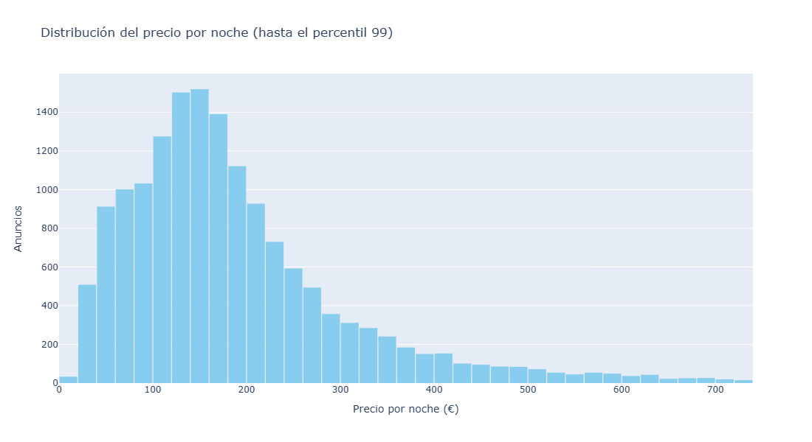
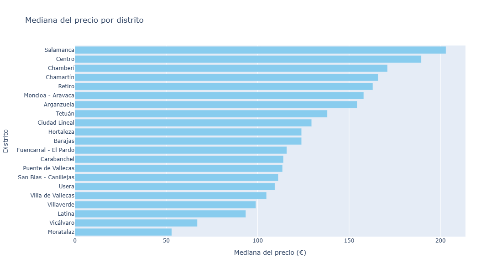
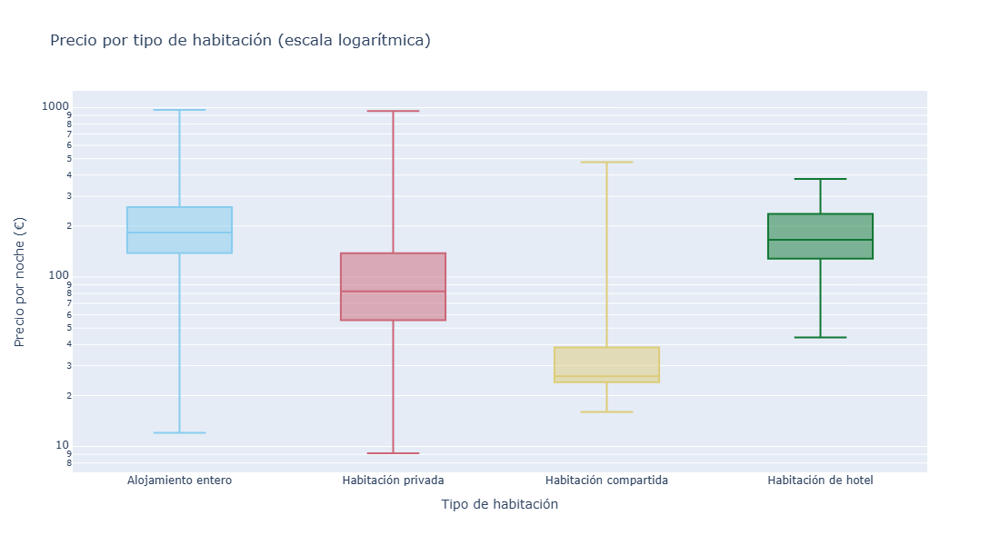
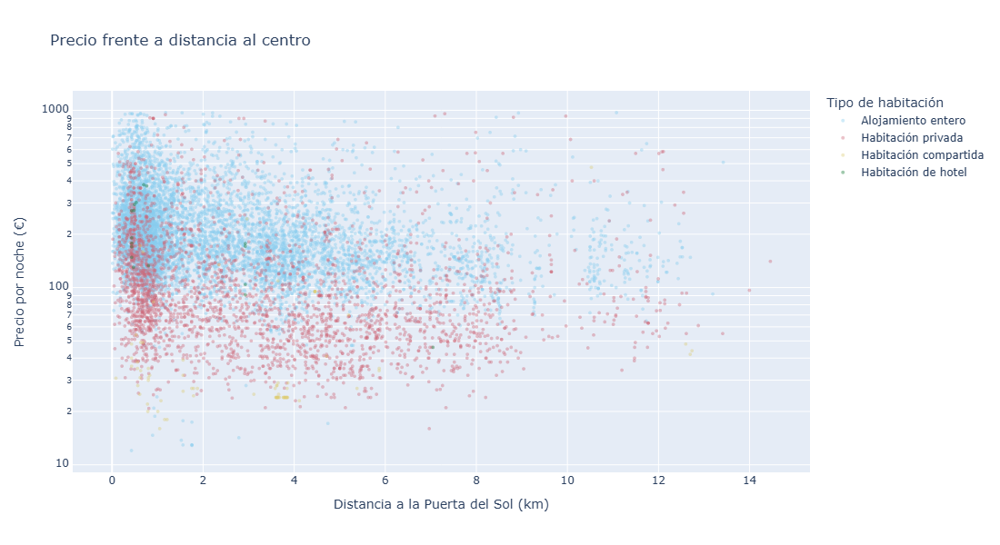
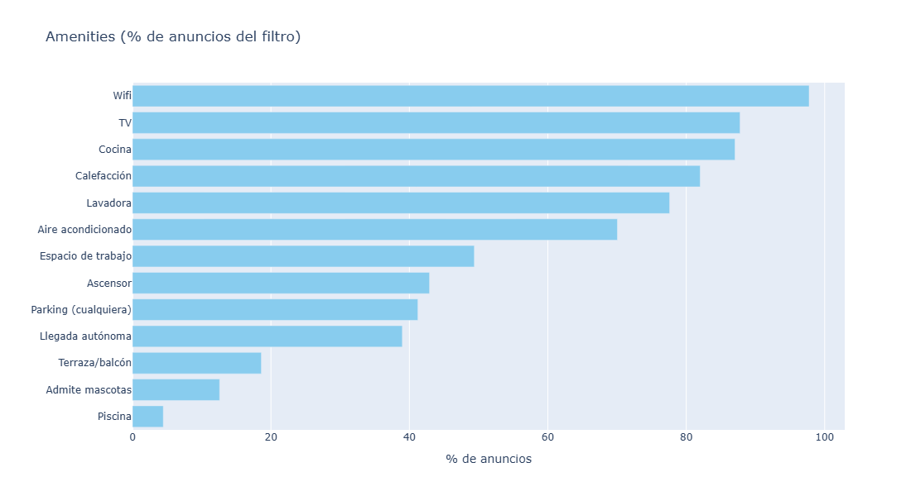

# Airbnb en Madrid: EDA, análisis estadístico y dashboard

Proyecto final del Máster en Data Analytics. Análisis exploratorio, limpieza, análisis estadístico inferencial y un dashboard operativo en Streamlit sobre los anuncios públicos de **Inside Airbnb** para Madrid (snapshot <!--f:meta.fecha_snapshot_url:fecha-->2026-09-17<!--/f-->).

- **Autor:** Diego Hernández Pellegrini
- **GitHub:** [diegopellegrini1](https://github.com/diegopellegrini1)
- **Informe completo:** [reports/informe.md](reports/informe.md)

## Objetivo

Describir con qué se asocia el precio por noche de los anuncios de Airbnb en Madrid (tipo de alojamiento, ubicación, capacidad, anfitrión, amenities, fecha de la cotización) y cómo está estructurada la oferta, y ofrecer un dashboard con filtros y un comparador de anuncios similares. Todo el flujo es reproducible con un solo comando. El análisis es observacional: describe asociaciones, no efectos causales.

## Dataset y requisitos mínimos

| Requisito (criterio propio) | Valor en el dataset | ¿Cumple? |
|---|---|---|
| Filas (al menos <!--f:meta.parametros.umbral_filas:n0-->1.000<!--/f-->) | <!--f:dataset.filas_raw:n0-->23.109<!--/f--> anuncios | Sí |
| Columnas (al menos <!--f:meta.parametros.umbral_columnas:n0-->20<!--/f-->) | <!--f:dataset.columnas_raw:n0-->90<!--/f--> columnas | Sí |
| Tipos de variable | <!--f:dataset.tipos_raw.numerico:n0-->54<!--/f--> numéricas, <!--f:dataset.tipos_raw.categorico:n0-->4<!--/f--> categóricas, <!--f:dataset.tipos_raw.booleano:n0-->4<!--/f--> booleanas, <!--f:dataset.tipos_raw.fecha:n0-->6<!--/f--> de fecha, <!--f:dataset.tipos_raw.texto:n0-->10<!--/f--> de texto libre, <!--f:dataset.tipos_raw.geoespacial:n0-->2<!--/f--> geoespaciales y <!--f:dataset.tipos_raw.identificador:n0-->10<!--/f--> identificadores (en total, las <!--f:dataset.columnas_raw:n0-->90<!--/f--> columnas) | Sí |

Fuente: `listings.csv.gz`, `neighbourhoods.csv` y `neighbourhoods.geojson` de [Inside Airbnb](https://insideairbnb.com/get-the-data/). La fecha del snapshot (<!--f:meta.fecha_snapshot_url:fecha-->2026-09-17<!--/f-->) es la que figura en la URL de descarga; los anuncios se scrapearon entre el <!--f:meta.last_scraped_min:fecha-->2026-09-19<!--/f--> y el <!--f:meta.last_scraped_max:fecha-->2026-09-22<!--/f-->. La clasificación por tipos y el cumplimiento se calculan por código (`src/calidad.py`). URLs, fechas, tamaños y hashes SHA-256 de los ficheros descargados: [data/raw/MANIFEST.json](data/raw/MANIFEST.json).

**Qué es el precio:** el precio por noche de una cotización concreta de Airbnb, **ya con los descuentos aplicables** (el <!--f:precio_naturaleza.pct_con_descuento:pct1-->20,3 %<!--/f--> de las cotizaciones con precio tiene alguno) y sin tasas. La estancia cotizada suele ser la estancia mínima del anuncio, y en estancias de <!--f:meta.parametros.min_nights_larga_estancia:n0-->30<!--/f--> noches o más suele ser una tarifa mensual repartida entre las noches.

## Resumen de hallazgos

- **Precio muy asimétrico:** mediana <!--f:descriptivo.precio.mediana:eur2-->151,00 €<!--/f--> y media <!--f:descriptivo.precio.media:eur2-->208,63 €<!--/f--> por noche en <!--f:descriptivo.precio.n:n0-->18.785<!--/f--> anuncios con precio (asimetría <!--f:descriptivo.precio.asimetria:n2-->31,54<!--/f-->). El <!--f:limpieza.precio.pct_nulo:pct1-->18,7 %<!--/f--> de los anuncios no publica precio, sobre todo los que no tienen fechas disponibles.
- **Tipo de habitación, la mayor diferencia entre grupos:** Alojamiento entero <!--f:estadistica.bootstrap.tipo.0.mediana:eur2-->173,63 €<!--/f--> (IC 95 % por anfitrión <!--f:estadistica.bootstrap.tipo.0.ic_inf_cluster:eur2-->167,00 €<!--/f--> – <!--f:estadistica.bootstrap.tipo.0.ic_sup_cluster:eur2-->180,00 €<!--/f-->) frente a habitación privada <!--f:estadistica.bootstrap.tipo.1.mediana:eur2-->74,00 €<!--/f--> (<!--f:estadistica.bootstrap.tipo.1.ic_inf_cluster:eur2-->66,00 €<!--/f--> – <!--f:estadistica.bootstrap.tipo.1.ic_sup_cluster:eur2-->81,67 €<!--/f-->); Kruskal-Wallis con ε² = <!--f:estadistica.kruskal_tipo.tamano_efecto.valor:n3-->0,234<!--/f--> (efecto grande), mayor que el del distrito (ε² = <!--f:estadistica.kruskal_distrito.tamano_efecto.valor:n3-->0,122<!--/f-->).
- **Ubicación:** Salamanca (<!--f:descriptivo.por_distrito.0.mediana:eur2-->188,34 €<!--/f-->) y Centro (<!--f:descriptivo.por_distrito.1.mediana:eur2-->180,00 €<!--/f-->) son los distritos con mayor mediana (empatados estadísticamente) y Moratalaz (<!--f:descriptivo.distrito_mas_barato.mediana:eur2-->58,00 €<!--/f-->) el de menor. En la regresión, dentro de un mismo distrito, cada km desde la Puerta del Sol se asocia con un precio <!--f:estadistica.ols.coef_distancia.pct:signo_pct-->-5,0 %<!--/f-->.
- **Superhost:** la diferencia bruta (mediana <!--f:estadistica.mann_whitney_superhost.extra.mediana_a:eur2-->163,50 €<!--/f--> frente a <!--f:estadistica.mann_whitney_superhost.extra.mediana_b:eur2-->147,00 €<!--/f-->) es estadísticamente significativa pero con efecto despreciable (r = <!--f:estadistica.mann_whitney_superhost.tamano_efecto.valor:n4-->0,0997<!--/f-->). Al controlar en la regresión no hay evidencia robusta de una prima (coeficiente <!--f:estadistica.ols.coef_superhost.pct:signo_pct-->+3,4 %<!--/f-->, IC 95 % <!--f:estadistica.ols.coef_superhost.ic_inf_pct:signo_pct-->+0,5 %<!--/f--> a <!--f:estadistica.ols.coef_superhost.ic_sup_pct:signo_pct-->+6,5 %<!--/f-->); si existe, es pequeña.
- **Regresión OLS sobre ln(precio)** con controles de distrito y de mes de la cotización: R² ajustado = <!--f:estadistica.ols.r2_ajustado:n3-->0,601<!--/f--> con n = <!--f:estadistica.ols.n_efectivo:n0-->18.159<!--/f-->; capacidad <!--f:estadistica.ols.coef_accommodates.pct:signo_pct-->+11,0 %<!--/f--> por persona, habitación privada <!--f:estadistica.ols.coef_privada.pct:signo_pct-->-24,2 %<!--/f-->, estancia mínima larga <!--f:estadistica.ols.coef_por_termino.alquiler_larga_estancia.pct:signo_pct-->-37,7 %<!--/f-->, aire acondicionado <!--f:estadistica.ols.coef_por_termino.tiene_aire_acondicionado.pct:signo_pct-->+12,8 %<!--/f--> (errores agrupados por anfitrión; asociaciones, no efectos causales).
- **Modelo predictivo:** HistGradientBoosting validado con <!--f:estadistica.ml.n_folds:n0-->5<!--/f--> particiones agrupadas por anfitrión (`GroupKFold`): R² = <!--f:estadistica.ml.cv.r2_media:n3-->0,669<!--/f--> ± <!--f:estadistica.ml.cv.r2_std:n3-->0,071<!--/f--> y mediana del error absoluto ≈ <!--f:estadistica.ml.cv.medae_eur_media:eur0-->30 €<!--/f--> por noche (línea base: <!--f:estadistica.ml.cv_base.medae_eur_media:eur0-->62 €<!--/f-->). Con una partición aleatoria el R² sería <!--f:estadistica.ml.aleatorio.r2:n3-->0,755<!--/f-->, una cifra optimista porque comparte anfitriones entre entrenamiento y prueba.
- **Oferta concentrada:** el <!--f:descriptivo.hosts.pct_anuncios_multianuncio:pct1-->73,5 %<!--/f--> de los anuncios es de cuentas con varios anuncios y el <!--f:descriptivo.hosts.pct_anuncios_hosts_6_o_mas:pct1-->50,0 %<!--/f--> de cuentas con seis o más anuncios, aunque el <!--f:descriptivo.hosts.pct_hosts_un_anuncio:pct1-->70,3 %<!--/f--> de los anfitriones tiene uno solo. Tener varios anuncios no implica por sí solo gestión profesional.

Todas las cifras de este README y del informe se generan desde [reports/findings.json](reports/findings.json). [scripts/verificar_consistencia.py](scripts/verificar_consistencia.py) comprueba que estos documentos **reproducen** findings.json (cada cifra marcada coincide, el texto se regenera idéntico, sin enlaces rotos ni números escritos a mano en las plantillas). Es una comprobación de transcripción: **no** comprueba que las interpretaciones sean ciertas; eso lo sostienen el análisis, sus supuestos y las sensibilidades del informe.

## Estructura del repositorio

```
├─ run_pipeline.py                 pipeline completo (un solo comando)
├─ requirements.txt                dependencias con versiones fijas
├─ data/
│  ├─ raw/                         datos originales de Inside Airbnb + MANIFEST.json (URL, fecha, tamaño, SHA-256)
│  └─ processed/                   listings_limpio.parquet + listings_muestra.csv (muestra legible)
├─ src/                            módulos reutilizables (type hints y docstrings)
│  ├─ carga.py  limpieza.py  calidad.py  features.py  diccionario.py
│  ├─ estadistica.py  analisis.py  visualizacion.py  informe.py
│  ├─ config.py  formato.py  geo.py  errores.py
│  └─ plantillas/                  plantillas Jinja2 de README e informe
├─ notebooks/                      01_eda.ipynb y 02_analisis_estadistico.ipynb (ejecutados, con salidas)
│  └─ fuentes_py/                  fuentes .py de los notebooks
├─ dashboard/                      app Streamlit (app.py, datos.py, filtros.py, graficos.py)
├─ reports/
│  ├─ informe.md                   informe explicativo
│  ├─ findings.json                todas las cifras calculadas
│  ├─ calidad_datos.json           calidad de datos antes/después
│  ├─ diccionario_datos.md         diccionario de columnas
│  └─ figures/                     figuras PNG generadas por script
├─ scripts/                        ejecución de notebooks, verificadores y exportación de gráficos
└─ tests/                          tests de pytest
```

## Instalación

Requiere Python 3.13 y Git.

```bash
git clone https://github.com/diegopellegrini1/Proyecto-Final-Airbnb-Madrid.git
cd Proyecto-Final-Airbnb-Madrid
```

Windows (PowerShell):

```powershell
py -3.13 -m venv .venv
.\.venv\Scripts\Activate.ps1
pip install -r requirements.txt
```

macOS / Linux:

```bash
python3.13 -m venv .venv
source .venv/bin/activate
pip install -r requirements.txt
```

`requirements.txt` fija con `==` todas las dependencias directas; pip resuelve las transitivas.

## Ejecución

```bash
python run_pipeline.py                 # descarga (o verifica) datos, limpia, analiza, genera figuras, documentos y notebooks
python -B -m pytest -q                 # tests (-B: sin __pycache__)
streamlit run dashboard/app.py --server.address 127.0.0.1   # dashboard en http://127.0.0.1:8501 (solo en este equipo)
```

`--server.address 127.0.0.1` hace que el dashboard solo sea accesible desde tu propio equipo; sin ese parámetro, Streamlit escucha en todas las interfaces de red y otros equipos de la misma red (por ejemplo, una wifi pública) podrían abrirlo.

Opciones útiles de `run_pipeline.py`: `--sin-descarga` (modo offline: exige `data/raw` íntegro y también rechaza `--incluir-reviews`/`--incluir-calendar` si esos ficheros no están ya en caché), `--forzar-descarga`, `--semilla`, `--n-boot`, `--sin-ml`, `--sin-notebooks`, `--sin-verificacion`. Si `data/raw` ya contiene los ficheros y su hash coincide con el manifiesto, el pipeline no usa la red. Los tiempos de ejecución de cada etapa quedan en `reports/findings.json` (no en este README, para que se regenere idéntico en cualquier máquina).

Notebooks: [notebooks/01_eda.ipynb](notebooks/01_eda.ipynb) y [notebooks/02_analisis_estadistico.ipynb](notebooks/02_analisis_estadistico.ipynb). Se regeneran y ejecutan con `python scripts/ejecutar_notebooks.py` (el pipeline lo hace al final), usan los mismos módulos de `src/` y narran cada resultado con cifras leídas de `findings.json` o calculadas en la propia celda.

**Antes de subir a GitHub arrastrando archivos** (la subida web no aplica `.gitignore`): `python scripts/verificar_subida.py --limpiar` borra cachés y comprueba que ningún archivo supera 25 MB. No subas `.venv/` ni `data/extra/`.

**README e informe se generan desde plantillas** (`src/plantillas/`): para cambiar el texto se edita la plantilla y se vuelve a ejecutar el pipeline. Si se edita `README.md` o `reports/informe.md` a mano, el verificador lo detecta y la siguiente ejecución lo sobrescribe.

## Dashboard

`streamlit run dashboard/app.py --server.address 127.0.0.1` abre una app con barra lateral de filtros (distrito, barrio en cascada, tipo de habitación, capacidad, superhost, precio mínimo y máximo, búsqueda por nombre y **excluir estancias mínimas de <!--f:meta.parametros.min_nights_larga_estancia:n0-->30<!--/f--> noches o más**, activado por defecto) y seis pestañas:

1. **Resumen:** KPIs (anuncios, precio mediano y medio, % de días no disponibles, % superhost, % multi-anuncio, valoración media), histograma de precio y mediana por distrito. Bajo los KPIs, una nota explica por qué no coinciden con el informe: por defecto se excluyen los precios por encima del P99 y las estancias mensuales, y solo se cuentan anuncios con precio.
2. **Comparador:** eliges tipo, capacidad y distrito o barrio y devuelve cuántos anuncios comparables hay, su mediana y su rango P25–P75, con aviso si hay menos de <!--f:meta.parametros.min_n_comparador:n0-->30<!--/f-->.
3. **Mapa:** puntos coloreados por precio (muestreo aleatorio con semilla si hay más de <!--f:meta.parametros.max_puntos_mapa:n0-->10.000<!--/f--> puntos) o coropleta de la mediana por barrio. Mapas base de CARTO sin API key (necesita internet en el navegador). Si falta el GeoJSON de barrios, solo se desactiva la vista de barrios.
4. **Precios:** precio por tipo de habitación, frente a la distancia al centro y por barrio.
5. **Anfitriones y calidad:** segmentos de anfitrión, puntuaciones y amenities.
6. **Datos:** tabla filtrable con nombres de columna en español y descarga del CSV filtrado (separador `;` y BOM, para abrirlo directamente en Excel en español).

El dashboard lee `data/processed/` (no limpia datos al arrancar), usa `st.cache_data` y comprueba al arrancar el Parquet, sus columnas y el GeoJSON, con mensajes que indican qué hacer. Si los filtros dejan cero anuncios muestra un aviso.

**Gráficos exportados del dashboard.** Las imágenes siguientes **no son capturas de pantalla**: son gráficos generados con las mismas funciones de `dashboard/graficos.py` sobre los datos reales y los filtros por defecto, exportados a PNG con `python scripts/exportar_graficos_dashboard.py`.












## Mapeo de los criterios de evaluación

| # | Criterio | Dónde se cumple |
|---|---|---|
| 1 | Requisitos mínimos del conjunto de datos | [Dataset y requisitos mínimos](#dataset-y-requisitos-mínimos), [src/calidad.py](src/calidad.py), [reports/findings.json](reports/findings.json) |
| 2 | Uso eficiente de Python y Pandas | [src/](src/) (operaciones vectorizadas, sin bucles por fila, type hints), [notebooks/01_eda.ipynb](notebooks/01_eda.ipynb) (operaciones pandas visibles), [run_pipeline.py](run_pipeline.py), [tests/](tests/) |
| 3 | Uso eficiente de herramienta de visualización | [src/visualizacion.py](src/visualizacion.py), [reports/figures/](reports/figures/), [dashboard/graficos.py](dashboard/graficos.py) (Plotly) |
| 4 | Transformación y limpieza de datos | [src/limpieza.py](src/limpieza.py), [src/features.py](src/features.py), [reports/calidad_datos.json](reports/calidad_datos.json), [reports/diccionario_datos.md](reports/diccionario_datos.md) |
| 5 | Análisis descriptivo | [notebooks/01_eda.ipynb](notebooks/01_eda.ipynb), [src/analisis.py](src/analisis.py), [informe, sección de hallazgos descriptivos](reports/informe.md) |
| 6 | Análisis estadístico | [notebooks/02_analisis_estadistico.ipynb](notebooks/02_analisis_estadistico.ipynb), [src/estadistica.py](src/estadistica.py) |
| 7 | Dashboard operativo | [dashboard/app.py](dashboard/app.py), [tests/test_dashboard.py](tests/test_dashboard.py), [scripts/verificar_dashboard.py](scripts/verificar_dashboard.py) |
| 8 | Informe explicativo | [reports/informe.md](reports/informe.md) |
| 9 | README del proyecto | este archivo, generado desde [src/plantillas/README.md.j2](src/plantillas/README.md.j2) |
| 10 | Correcta organización del repositorio GitHub | [estructura](#estructura-del-repositorio), [requirements.txt](requirements.txt), [.gitignore](.gitignore), [LICENSE](LICENSE), [scripts/verificar_subida.py](scripts/verificar_subida.py) |

## Por qué hay tanta infraestructura

Plantillas, marcadores de cifra, manifiesto con hashes y verificadores tienen un único fin: que **ninguna cifra del texto se escriba a mano** y que, si los datos cambian, los documentos se regeneren y cualquier discrepancia se detecte. El manifiesto garantiza que se analiza exactamente el fichero descargado. Nada de esto valida las interpretaciones: esas se justifican en el informe.

## Limitaciones

- **Datos scrapeados** de la web pública de Airbnb: pueden tener errores y campos vacíos (<!--f:calidad.n_columnas_100_nulas:n0-->13<!--/f--> columnas vienen vacías en este snapshot).
- **Precio de anuncio ≠ precio pagado:** es una **cotización para unas fechas concretas** (entradas entre el <!--f:precio_naturaleza.checkin_min:fecha-->2026-09-19<!--/f--> y el <!--f:precio_naturaleza.checkin_max:fecha-->2027-09-18<!--/f-->), ya con descuentos y sin tasas, no una media anual. El símbolo `$` del fichero es un artefacto: las cotizaciones están en EUR.
- **Días no disponibles e ingreso hipotético:** `365 − availability_365` no es ocupación real (incluye bloqueos y mira al próximo año, no al pasado); el ingreso derivado es un proxy, no un ingreso observado.
- **Sesgo de selección:** los análisis de precio solo incluyen anuncios que publican precio, y los que no lo hacen son sobre todo anuncios sin disponibilidad.
- **Snapshot único** (fecha de la URL frente a fechas de scrape, explicadas arriba): no hay tendencia.
- **Correlación ≠ causalidad**, anuncios de un mismo anfitrión no independientes (errores agrupados, bootstrap por anfitrión y un anuncio por anfitrión) y coordenadas anonimizadas por Airbnb.

Detalle completo en el [informe](reports/informe.md).

## Datos adicionales (reviews y calendar)

El pipeline puede descargar, para el mismo snapshot, las reseñas y el calendario:

```bash
python run_pipeline.py --incluir-reviews --incluir-calendar
```

Se guardan en `data/extra/` (ignorada por git) y no se usan en el análisis. Son ficheros grandes (las reseñas superan los 25 MB de subida web de GitHub), por eso no forman parte del repositorio.

## Uso de herramientas de IA

En este proyecto se utilizó un asistente de IA como apoyo para escribir y depurar código, revisar la consistencia de los datos y redactar la documentación. El autor revisó y validó el código, los datos y las conclusiones del análisis. Ninguna cifra se ha escrito a mano: todas proceden de ejecutar el código sobre los datos públicos (`reports/findings.json`), y un script comprueba que los documentos las reproducen fielmente.

## Datos personales y privacidad

- `data/raw/listings.csv.gz` es el fichero de Inside Airbnb **sin modificar** (se conserva para poder reproducir el análisis sin conexión y verificar su hash). Contiene datos **públicos** de los anfitriones tal como aparecen en Airbnb (`host_name`, `host_url`, `host_picture_url`, `host_about`, `host_location`), redistribuidos por Inside Airbnb.
- Los datos procesados (`data/processed/`) **eliminan** el nombre, la ubicación declarada, las URLs y la descripción del anfitrión. Se conserva `host_id` (identificador numérico público de Airbnb) porque es imprescindible para el análisis: agrupar los errores de la regresión por anfitrión, validar el modelo sin repetir anfitriones entre entrenamiento y prueba, el bootstrap por anfitrión y la composición de la oferta. El dashboard no lo carga.
- No se cruzan los datos con otras fuentes ni se intenta reidentificar a nadie.

## Fuente de datos, atribución y licencias

- **Datos:** [Inside Airbnb](https://insideairbnb.com/), «Get the Data», Madrid, snapshot <!--f:meta.fecha_snapshot_url:fecha-->2026-09-17<!--/f-->. Licencia: **Creative Commons Attribution 4.0 International (CC BY 4.0)** ([https://creativecommons.org/licenses/by/4.0/](https://creativecommons.org/licenses/by/4.0/)), verificada en la página de descargas el <!--f:dataset.licencia.fecha_verificacion:fecha-->2026-10-25<!--/f-->. La página de Inside Airbnb es ambigua: indica esa licencia y, en su pie, también una renuncia de derechos del autor; por prudencia se cita y se respeta la licencia con atribución. Los datos se han limpiado y transformado para este proyecto. No se usan datos privados ni de ninguna otra fuente.
- **Código:** licencia MIT, ver [LICENSE](LICENSE).
