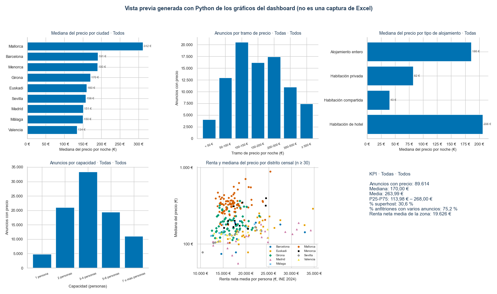

# Dashboard operativo en Excel

[Dashboard_Airbnb_Espana.xlsx](Dashboard_Airbnb_Espana.xlsx) es el dashboard del proyecto. Lo genera `src/dashboard_excel.py` (etapa del pipeline
`python run_pipeline.py`) a partir de `data/processed/airbnb_espana_ine.parquet` y `reports/findings.json`.
Ninguna cifra está escrita a mano. No tiene macros y funciona sin Python.



*Vista previa generada con Python de los gráficos del dashboard (no es una captura de Excel).*

## Hojas

| Hoja | Qué contiene |
|---|---|
| Inicio | Pregunta de negocio, cómo usar el libro, índice con hipervínculos, fuentes (Inside Airbnb e INE con su cita y fecha de actualización), fechas de los snapshots y limitaciones. |
| Dashboard | Desplegables de Ciudad (incluye «Todas») y Tipo de alojamiento (incluye «Todos»), tarjetas KPI y 5 gráficos nativos de Excel. |
| Comparador | Ciudad + tipo + capacidad → anuncios, mediana, P25, P75 y media, con aviso si hay menos de 30 anuncios. |
| Renta y precio | ρ de Spearman renta-precio por ciudad con IC 95 %, p y Holm, y la elasticidad del OLS. Se leen de `findings.json` (no se calculan en Excel). |
| Resumen ciudades | Una fila por ciudad: anuncios, con precio, % emparejado con el INE, mediana, media, % superhost, % multi-anuncio y renta. |
| Datos | Tabla de Excel `TablaDatos` con los anuncios **con precio** y 19 columnas, con filtros. |
| Cálculos | Listas de los desplegables, criterios de filtro y tablas auxiliares (fórmulas) que alimentan los gráficos. |

## Cómo usar los selectores

- **Dashboard:** las celdas amarillas `C4` (Ciudad) y `C5` (Tipo de alojamiento) son listas desplegables. Al cambiarlas se
  recalculan las tarjetas (anuncios con precio, mediana, media, P25, P75, % superhost, % de anuncios de anfitriones con
  varios anuncios y renta neta media por persona de la zona) y cuatro gráficos: mediana por ciudad (responde al tipo),
  anuncios por tramo de precio y por capacidad (responden a los dos) y mediana por tipo (responde a la ciudad). La
  dispersión renta-precio por distrito censal muestra siempre todos los distritos con al menos 30
  anuncios con precio.
- **Comparador:** elige ciudad, tipo y capacidad (1 persona, 2 personas, 3-4 personas, 5-6 personas, 7 o más personas).
- Tramos de precio del gráfico de columnas (intervalos cerrados por la izquierda): < 50 €, 50-100 €, 100-150 €, 150-200 €, 200-300 €, 300-500 €, ≥ 500 €.

## Fórmulas y compatibilidad

- Excel 2016 o posterior y Microsoft 365 (Windows y Mac). Solo se usan COUNTIFS, AVERAGEIFS, IF, IFERROR,
  CONCATENATE y fórmulas matriciales clásicas `{=MEDIAN(IF(...))}` y `{=PERCENTILE(IF(...))}`. No se usan LET,
  LAMBDA, FILTER, UNIQUE, SORT ni matrices dinámicas. En Excel en español se muestran traducidas
  (CONTAR.SI.CONJUNTO, PROMEDIO.SI.CONJUNTO, MEDIANA, PERCENTIL, SI.ERROR...).
- Las fórmulas usan rangos con nombre legibles (`dPrecio`, `dCiudad`, `dTipo`, `selCiudad`, `selTipo`...;
  ver *Fórmulas > Administrador de nombres*). Los rangos cubren las filas actuales de la tabla: si se añaden anuncios
  a mano, hay que ampliar los nombres o regenerar el libro.
- El libro guarda los valores calculados para la selección por defecto y pide un recálculo completo al abrirse.
  Si Excel está en cálculo manual, pulsa F9. Con 89.614 filas, el recálculo de las
  fórmulas matriciales puede tardar unos segundos.
- Los formatos numéricos usan el separador del sistema: en una configuración regional española se ve 1.234,56 €.
- **LibreOffice Calc:** abre el libro, los desplegables y los gráficos; las fórmulas son estándar y deberían
  recalcularse, pero no se ha comprobado en este proyecto (LibreOffice no estaba instalado).
- **Google Sheets:** al importar el .xlsx convierte las fórmulas matriciales en `ARRAYFORMULA` y mantiene las listas
  desplegables; algunos formatos de gráfico (escala logarítmica, marcadores) pueden cambiar. No comprobado.

## Cómo regenerarlo

```bash
python run_pipeline.py --sin-descarga    # todo el pipeline (incluye el dashboard)
python -m src.dashboard_excel            # solo el dashboard, la vista previa y este README
python -B -m pytest -q tests/test_dashboard_excel.py
```

## Limitaciones

- Precio = cotización por noche con los descuentos aplicados y sin tasas; no es el precio pagado.
- Asociaciones, no efectos causales. La renta del INE es anterior a los anuncios (desfase temporal).
- La renta de la zona explica poco del precio: pesan mucho más el tipo, la capacidad y la ciudad.
- Solo anuncios con precio. Sin datos personales: no incluye nombres, URLs, fotos, coordenadas ni `host_id`.
- La apertura en Excel de escritorio no se ha comprobado de forma automática: los tests leen el archivo con
  openpyxl y recalculan las fórmulas con un evaluador propio en Python.
