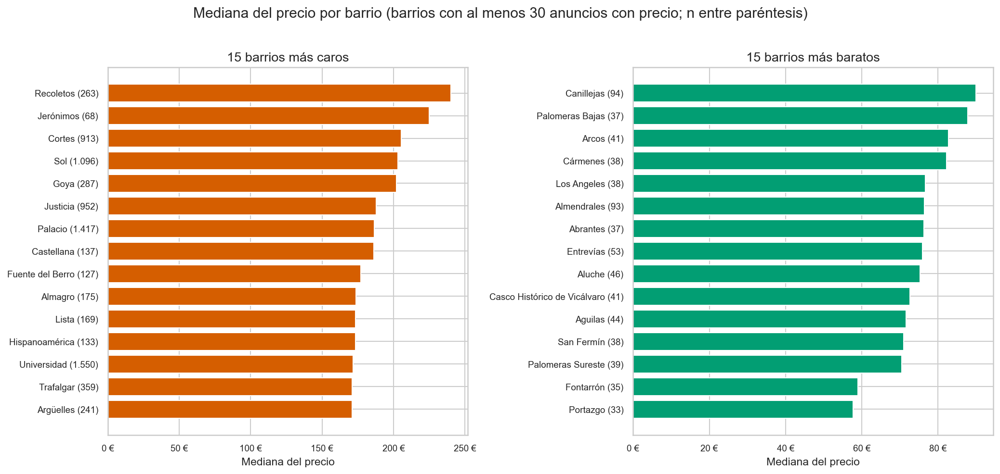
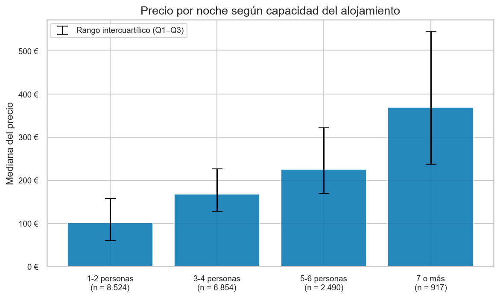
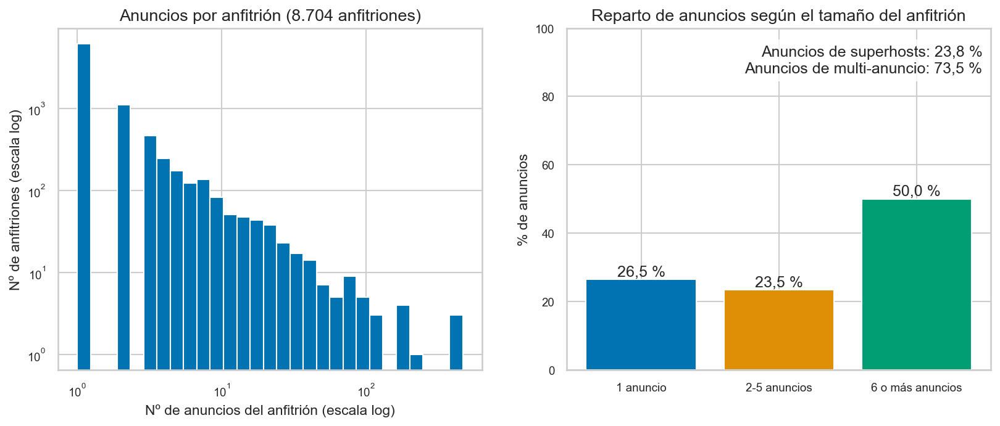
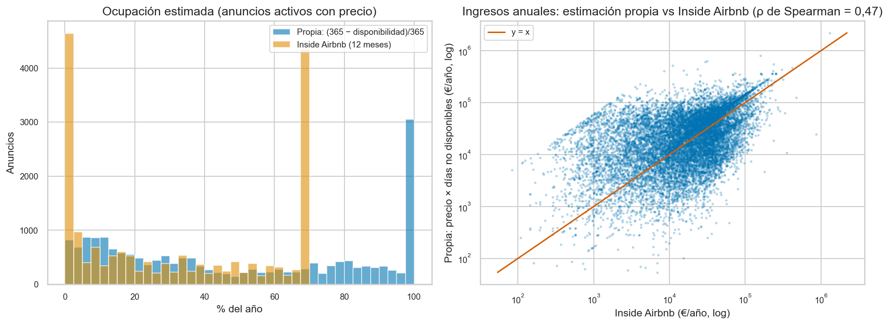
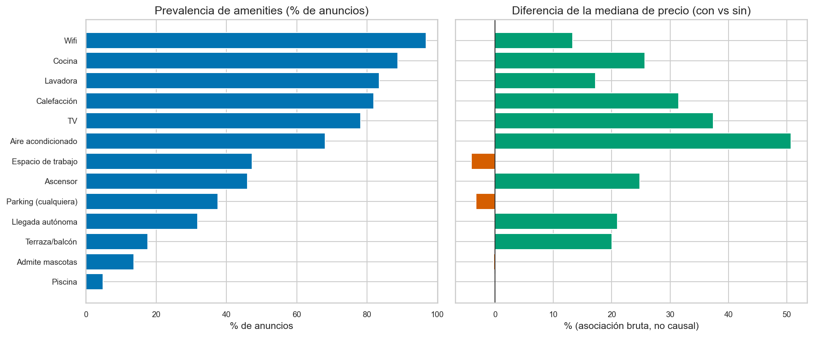
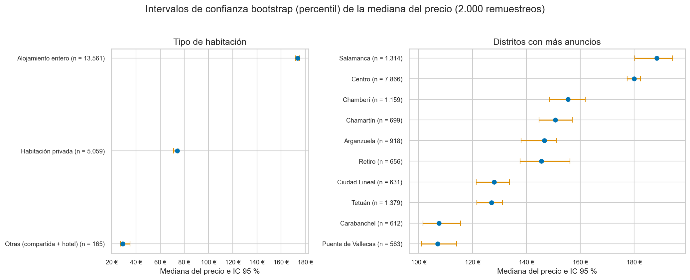
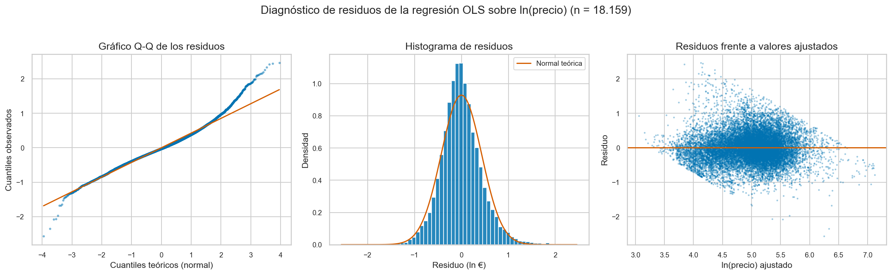

# Informe: mercado de alquiler turístico de Airbnb en Madrid

**Autor:** Diego Hernández Pellegrini (GitHub [diegopellegrini1](https://github.com/diegopellegrini1)) · **Datos:** Inside Airbnb, snapshot <!--f:meta.fecha_snapshot_url:fecha-->2026-09-17<!--/f--> · **Documento generado** desde `reports/findings.json` por `run_pipeline.py`.

> Todas las cifras de este informe se insertan automáticamente desde [findings.json](findings.json) y se verifican con `scripts/verificar_consistencia.py`. Si se vuelve a ejecutar el pipeline con otro snapshot, el texto se regenera y las frases que dependen del sentido de un resultado se comprueban por código.

## 1. Introducción y objetivo

El objetivo es entender **qué explica el precio por noche** de los anuncios de Airbnb en Madrid y **cómo está estructurada la oferta** (tipos de alojamiento, zonas, anfitriones profesionales frente a particulares), y convertirlo en una herramienta operativa: un dashboard con filtros que permite explorar el mercado por distrito, barrio, tipo de habitación y rango de precio.

Preguntas de trabajo:

- ¿Cómo se distribuye el precio y qué tan asimétrico es?
- ¿Cuánto cambia el precio según el tipo de habitación, el distrito y la capacidad?
- ¿Cobran más los superhosts? ¿Se mantiene la diferencia al controlar por otras variables?
- ¿Qué peso tienen los anfitriones con muchos anuncios?
- ¿Qué variables se asocian con el precio en un modelo multivariante?

## 2. Datos y fuente

- **Fuente:** [Inside Airbnb](https://insideairbnb.com/get-the-data/), ficheros `listings.csv.gz`, `neighbourhoods.csv` y `neighbourhoods.geojson` de Madrid.
- **Fecha:** el snapshot publicado lleva la fecha <!--f:meta.fecha_snapshot_url:fecha-->2026-09-17<!--/f--> (es la fecha de la URL); los anuncios se scrapearon entre el <!--f:meta.last_scraped_min:fecha-->2026-09-19<!--/f--> y el <!--f:meta.last_scraped_max:fecha-->2026-09-22<!--/f--> (`last_scraped`). En este proyecto, «fecha de scrape» se refiere a ese rango, y la fecha de referencia para calcular antigüedades es <!--f:meta.fecha_referencia:fecha-->2026-09-22<!--/f-->.
- **Licencia:** Creative Commons Attribution 4.0 International (CC BY 4.0), verificada en la página de descargas el <!--f:dataset.licencia.fecha_verificacion:fecha-->2026-10-25<!--/f-->. Los datos se han transformado (limpieza y variables derivadas).
- **Volumen:** <!--f:dataset.filas_raw:n0-->23.109<!--/f--> anuncios × <!--f:dataset.columnas_raw:n0-->90<!--/f--> columnas, <!--f:dataset.n_distritos:n0-->21<!--/f--> distritos, <!--f:dataset.n_barrios:n0-->128<!--/f--> barrios y <!--f:dataset.n_hosts:n0-->8.704<!--/f--> anfitriones.
- **Tipos de variable** (clasificación por código del fichero original): <!--f:dataset.tipos_raw.numerico:n0-->54<!--/f--> numéricas, <!--f:dataset.tipos_raw.categorico:n0-->4<!--/f--> categóricas, <!--f:dataset.tipos_raw.booleano:n0-->4<!--/f--> booleanas, <!--f:dataset.tipos_raw.fecha:n0-->6<!--/f--> de fecha, <!--f:dataset.tipos_raw.texto:n0-->10<!--/f--> de texto libre, <!--f:dataset.tipos_raw.geoespacial:n0-->2<!--/f--> geoespaciales y <!--f:dataset.tipos_raw.identificador:n0-->10<!--/f--> identificadores. Cumple los umbrales propios del proyecto (al menos <!--f:meta.parametros.umbral_filas:n0-->1.000<!--/f--> filas, <!--f:meta.parametros.umbral_columnas:n0-->20<!--/f--> columnas y los cinco tipos de variable).
- **Moneda y naturaleza del precio.** `price` viene como texto con símbolo `$`, pero el <!--f:moneda.pct_moneda:pct1-->100,0 %<!--/f--> de las <!--f:moneda.n_cotizaciones_con_moneda:n0-->18.539<!--/f--> cotizaciones con moneda indica EUR, así que el símbolo es un artefacto y se trabaja en euros. Además, `price` coincide con el precio por noche de la cotización (`price_quote_price_per_night`) en el <!--f:precio_naturaleza.pct_precio_igual_cotizacion:pct1-->100,0 %<!--/f--> de los casos comparables, con fechas de entrada entre el <!--f:precio_naturaleza.checkin_min:fecha-->2026-09-19<!--/f--> y el <!--f:precio_naturaleza.checkin_max:fecha-->2027-09-18<!--/f-->. **El precio es una cotización para unas fechas concretas, no una tarifa media anual.**

## 3. Metodología

### Limpieza y transformación

El orden es: perfilar → convertir tipos → derivar → eliminar columnas → reglas de calidad. El detalle completo está en [calidad_datos.json](calidad_datos.json) y el diccionario de columnas en [diccionario_datos.md](diccionario_datos.md).

- **Conversiones:** precio de texto a número, booleanos `t/f` a `bool`, fechas ISO a `datetime64`, porcentajes de texto a número (las tasas de respuesta vienen vacías en este snapshot), `bathrooms_text` a número de baños más un indicador de baño compartido, y `amenities` (lista JSON) a número de amenities y <!--f:features.n_flags_amenities:n0-->13<!--/f--> indicadores; <!--f:limpieza.amenities_malformadas:n0-->0<!--/f--> listas tenían JSON malformado (el parser tiene plan B por expresión regular).
- **Columnas eliminadas:** <!--f:limpieza.n_columnas_eliminadas:n0-->26<!--/f-->, cada una con su motivo: <!--f:calidad.n_columnas_100_nulas:n0-->13<!--/f--> venían completamente vacías en este snapshot (entre ellas `host_since`, `host_response_rate` e `instant_bookable`), además de URLs, identificadores técnicos, el nombre del anfitrión (privacidad) y textos largos sustituidos por métricas de longitud. Se crearon <!--f:limpieza.n_columnas_derivadas:n0-->45<!--/f--> columnas nuevas. El resultado tiene <!--f:dataset.filas_procesadas:n0-->23.109<!--/f--> filas × <!--f:dataset.columnas_procesadas:n0-->109<!--/f--> columnas y se guarda en Parquet.
- **Duplicados:** <!--f:limpieza.duplicados.por_id:n0-->0<!--/f--> por `id` y <!--f:limpieza.duplicados.filas_completas:n0-->0<!--/f--> filas completas repetidas; no se eliminó ninguna fila sin contabilizarla.
- **Nulos:** cada columna con nulos tiene una regla documentada (política declarativa en `src/limpieza.py`). Las puntuaciones de reseñas se dejan vacías (no tener reseñas no es puntuar cero). Solo se imputan `bedrooms` (<!--f:limpieza.imputados.bedrooms:n0-->12<!--/f--> filas) y `beds` (<!--f:limpieza.imputados.beds:n0-->574<!--/f--> filas) con la mediana por tipo de habitación y capacidad, con indicador de imputación.
- **Precio:** <!--f:limpieza.precio.nulo:n0-->4.324<!--/f--> anuncios (<!--f:limpieza.precio.pct_nulo:pct1-->18,7 %<!--/f-->) no tienen precio y <!--f:limpieza.precio.cero:n0-->0<!--/f--> tienen precio cero. No se imputa el precio porque es la variable objetivo. El <!--f:limpieza.precio.pct_nulos_sin_disponibilidad:pct1-->75,6 %<!--/f--> de los precios nulos corresponde a anuncios sin ningún día disponible en el año, así que los nulos no son aleatorios.
- **Outliers:** vallas de Tukey (k = <!--f:limpieza.outliers.k:n1-->1,5<!--/f-->) sobre el logaritmo del precio, porque la escala original es muy asimétrica. Valla inferior <!--f:limpieza.outliers.valla_inf:eur2-->26,46 €<!--/f--> y superior <!--f:limpieza.outliers.valla_sup:eur2-->809,80 €<!--/f-->: <!--f:limpieza.outliers.n_bajo:n0-->320<!--/f--> anuncios por debajo y <!--f:limpieza.outliers.n_alto:n0-->289<!--/f--> por encima, <!--f:limpieza.outliers.n_total:n0-->609<!--/f--> en total (<!--f:limpieza.outliers.pct_total:pct1-->3,2 %<!--/f--> de los anuncios con precio). **No se borran:** se marcan con `es_outlier_precio`. Los contrastes no paramétricos y el bootstrap usan todos los precios; la regresión los excluye y repite el ajuste con ellos como análisis de sensibilidad.
- **Estancias mínimas:** <!--f:limpieza.minimum_nights.extremo_mayor_365:n0-->8<!--/f--> anuncios exigen más de <!--f:meta.parametros.min_nights_extremo:n0-->365<!--/f--> noches (máximo <!--f:limpieza.minimum_nights.max:n0-->1.125<!--/f-->) y <!--f:limpieza.minimum_nights.larga_estancia_30_o_mas:n0-->3.151<!--/f--> exigen al menos <!--f:meta.parametros.min_nights_larga_estancia:n0-->30<!--/f-->; se marcan, no se modifican.
- **Coordenadas:** <!--f:limpieza.coordenadas.fuera_bbox_o_nulas:n0-->0<!--/f--> anuncios quedan fuera del rectángulo de validación de Madrid.

### Variables derivadas

Precio por persona, logaritmo del precio, antigüedad del anfitrión (fuente: hosts_time_as_host_years + hosts_time_as_host_months / 12 (host_since 100 % nulo)), ocupación estimada `(365 − availability_365) / 365`, indicador de anuncio activo probable (descarta los que no tienen disponibilidad ni reseñas en el último año), ingresos anuales estimados `price × (365 − availability_365)`, distancia haversine a la Puerta del Sol, categoría de precio por cuartiles (cortes en <!--f:features.cortes_categoria_precio.1:eur2-->95,45 €<!--/f-->, <!--f:features.cortes_categoria_precio.2:eur2-->151,00 €<!--/f--> y <!--f:features.cortes_categoria_precio.3:eur2-->224,50 €<!--/f-->), tramos de capacidad, segmento del anfitrión según su número de anuncios, tipo de licencia, indicadores de amenities y tipo de habitación agrupado: las categorías con menos de <!--f:meta.parametros.min_n_categoria_rara:n0-->200<!--/f--> anuncios con precio (habitación compartida y de hotel) se agrupan en «Otras (compartida + hotel)» para los contrastes, el bootstrap y la regresión.

### Análisis estadístico

Nivel de significación α = <!--f:meta.alfa:n2-->0,05<!--/f--> en todos los contrastes. Para cada uno se declaran H0 y H1 antes de ejecutarlo, se comprueban los supuestos y se informa el tamaño del efecto, porque con miles de observaciones casi cualquier diferencia es «significativa». Los grupos con menos de <!--f:meta.parametros.min_n_grupo:n0-->30<!--/f--> anuncios con precio se excluyen de la inferencia. Semilla fija <!--f:meta.semilla:n0-->42<!--/f--> para muestreos, bootstrap y modelo.

## 4. Hallazgos descriptivos

**Precio.** Sobre <!--f:descriptivo.precio.n:n0-->18.785<!--/f--> anuncios con precio, la mediana es <!--f:descriptivo.precio.mediana:eur2-->151,00 €<!--/f--> y la media <!--f:descriptivo.precio.media:eur2-->208,63 €<!--/f--> (desviación típica <!--f:descriptivo.precio.std:eur2-->543,63 €<!--/f-->). El rango intercuartílico va de <!--f:descriptivo.precio.q1:eur2-->95,45 €<!--/f--> a <!--f:descriptivo.precio.q3:eur2-->224,50 €<!--/f--> (IQR = <!--f:descriptivo.precio.iqr:eur2-->129,05 €<!--/f-->). La distribución es muy asimétrica a la derecha (asimetría <!--f:descriptivo.precio.asimetria:n2-->31,54<!--/f-->, curtosis de exceso <!--f:descriptivo.precio.curtosis_exceso:n1-->1.469,9<!--/f-->), con un máximo de <!--f:descriptivo.precio.max:eur0-->36.883 €<!--/f-->. Sin outliers, la media baja a <!--f:descriptivo.precio_sin_outliers.media:eur2-->178,61 €<!--/f--> y la mediana queda en <!--f:descriptivo.precio_sin_outliers.mediana:eur2-->151,00 €<!--/f-->. En escala logarítmica la asimetría es <!--f:descriptivo.log_precio.asimetria:n2-->0,21<!--/f-->, por eso la regresión modela `ln(precio)`.

**Tipo de habitación.**

| Tipo | Anuncios con precio | Mediana | Media | Q1 | Q3 |
|---|---|---|---|---|---|
| Alojamiento entero | <!--f:descriptivo.por_tipo.0.n:n0-->13.561<!--/f--> | <!--f:descriptivo.por_tipo.0.mediana:eur2-->173,63 €<!--/f--> | <!--f:descriptivo.por_tipo.0.media:eur2-->234,55 €<!--/f--> | <!--f:descriptivo.por_tipo.0.q1:eur2-->127,50 €<!--/f--> | <!--f:descriptivo.por_tipo.0.q3:eur2-->247,95 €<!--/f--> |
| Habitación de hotel | <!--f:descriptivo.por_tipo.1.n:n0-->29<!--/f--> | <!--f:descriptivo.por_tipo.1.mediana:eur2-->162,00 €<!--/f--> | <!--f:descriptivo.por_tipo.1.media:eur2-->174,34 €<!--/f--> | <!--f:descriptivo.por_tipo.1.q1:eur2-->127,00 €<!--/f--> | <!--f:descriptivo.por_tipo.1.q3:eur2-->201,00 €<!--/f--> |
| Habitación privada | <!--f:descriptivo.por_tipo.2.n:n0-->5.059<!--/f--> | <!--f:descriptivo.por_tipo.2.mediana:eur2-->74,00 €<!--/f--> | <!--f:descriptivo.por_tipo.2.media:eur2-->142,95 €<!--/f--> | <!--f:descriptivo.por_tipo.2.q1:eur2-->47,00 €<!--/f--> | <!--f:descriptivo.por_tipo.2.q3:eur2-->128,00 €<!--/f--> |
| Habitación compartida | <!--f:descriptivo.por_tipo.3.n:n0-->136<!--/f--> | <!--f:descriptivo.por_tipo.3.mediana:eur2-->27,00 €<!--/f--> | <!--f:descriptivo.por_tipo.3.media:eur2-->74,81 €<!--/f--> | <!--f:descriptivo.por_tipo.3.q1:eur2-->24,00 €<!--/f--> | <!--f:descriptivo.por_tipo.3.q3:eur2-->40,00 €<!--/f--> |

**Distritos y barrios.** El distrito con la mediana más alta es Salamanca (<!--f:descriptivo.por_distrito.0.mediana:eur2-->188,34 €<!--/f-->, n = <!--f:descriptivo.por_distrito.0.n:n0-->1.314<!--/f-->), seguido de Centro (<!--f:descriptivo.por_distrito.1.mediana:eur2-->180,00 €<!--/f-->); el de mediana más baja es Moratalaz (<!--f:descriptivo.distrito_mas_barato.mediana:eur2-->58,00 €<!--/f-->, n = <!--f:descriptivo.distrito_mas_barato.n:n0-->103<!--/f-->). Entre los <!--f:descriptivo.n_barrios_con_n_min:n0-->96<!--/f--> barrios con al menos <!--f:descriptivo.barrios_n_min:n0-->30<!--/f--> anuncios con precio, el más caro es Recoletos (<!--f:descriptivo.barrios_top.0.mediana:eur2-->240,00 €<!--/f-->) y el más barato Portazgo (<!--f:descriptivo.barrios_bottom.0.mediana:eur2-->57,71 €<!--/f-->). El mapa muestra que los precios más altos se concentran en los barrios centrales, y la regresión confirma que el precio baja con la distancia al centro.

**Capacidad.** La mediana crece con la capacidad: 1-2 personas, <!--f:descriptivo.por_capacidad.0.mediana:eur2-->101,20 €<!--/f--> (n = <!--f:descriptivo.por_capacidad.0.n:n0-->8.524<!--/f-->); 3-4 personas, <!--f:descriptivo.por_capacidad.1.mediana:eur2-->168,21 €<!--/f--> (n = <!--f:descriptivo.por_capacidad.1.n:n0-->6.854<!--/f-->); 5-6 personas, <!--f:descriptivo.por_capacidad.2.mediana:eur2-->225,50 €<!--/f--> (n = <!--f:descriptivo.por_capacidad.2.n:n0-->2.490<!--/f-->); 7 o más, <!--f:descriptivo.por_capacidad.3.mediana:eur2-->368,85 €<!--/f--> (n = <!--f:descriptivo.por_capacidad.3.n:n0-->917<!--/f-->).

**Anfitriones.** Hay <!--f:descriptivo.hosts.n_hosts:n0-->8.704<!--/f--> anfitriones. El <!--f:descriptivo.hosts.pct_hosts_un_anuncio:pct1-->70,3 %<!--/f--> de ellos tiene un solo anuncio, pero el <!--f:descriptivo.hosts.pct_anuncios_multianuncio:pct1-->73,5 %<!--/f--> de los anuncios pertenece a anfitriones con varios. El <!--f:descriptivo.hosts.pct_anuncios_hosts_6_o_mas:pct1-->50,0 %<!--/f--> de los anuncios está en manos de anfitriones con seis o más, y los diez mayores concentran el <!--f:descriptivo.hosts.pct_anuncios_top10_hosts:pct1-->11,1 %<!--/f--> (el mayor tiene <!--f:descriptivo.hosts.anuncios_por_host_max:n0-->469<!--/f-->). Son superhosts el <!--f:descriptivo.hosts.pct_hosts_superhost:pct1-->27,1 %<!--/f--> de los anfitriones y el <!--f:descriptivo.hosts.pct_anuncios_superhost:pct1-->23,8 %<!--/f--> de los anuncios. Es un mercado con fuerte peso de la gestión profesional.

**Ocupación e ingresos (estimaciones).** Entre los <!--f:descriptivo.ocupacion_ingresos.n_activos_con_precio:n0-->18.757<!--/f--> anuncios activos con precio, la ocupación estimada como complemento de la disponibilidad tiene una media del <!--f:descriptivo.ocupacion_ingresos.ocupacion_estimada_media:pct1-->48,6 %<!--/f-->, frente al <!--f:descriptivo.ocupacion_ingresos.ocupacion_inside_airbnb_media:pct1-->31,6 %<!--/f--> que estima Inside Airbnb a partir de reseñas. Los ingresos anuales estimados propios tienen una mediana de <!--f:descriptivo.ocupacion_ingresos.ingresos_propios_mediana:eur0-->19.503 €<!--/f-->, <!--f:descriptivo.ocupacion_ingresos.cociente_medianas:n2-->1,57<!--/f--> veces la mediana de Inside Airbnb (<!--f:descriptivo.ocupacion_ingresos.ingresos_inside_airbnb_mediana:eur0-->12.432 €<!--/f-->); la correlación de Spearman entre ambas estimaciones es <!--f:descriptivo.ocupacion_ingresos.spearman_propio_vs_inside:n2-->0,47<!--/f-->. La estimación propia es una **cota superior**: los días no disponibles incluyen bloqueos del anfitrión, no solo reservas.

**Amenities.** Las más frecuentes son wifi (<!--f:descriptivo.amenities.0.prevalencia_pct:pct1-->96,8 %<!--/f-->), cocina (<!--f:descriptivo.amenities.1.prevalencia_pct:pct1-->88,7 %<!--/f-->), lavadora (<!--f:descriptivo.amenities.2.prevalencia_pct:pct1-->83,4 %<!--/f-->). Las diferencias de mediana entre anuncios con y sin cada amenity son asociaciones brutas y pueden reflejar diferencias de tipo de alojamiento o de zona.

**Correlaciones.** La variable más correlacionada con el precio es `accommodates` (ρ de Spearman = <!--f:descriptivo.correlaciones.con_precio.0.spearman:n2-->0,60<!--/f-->; Pearson con `ln(precio)` = <!--f:descriptivo.correlaciones.con_precio.0.pearson_log:n2-->0,56<!--/f-->), seguida de `beds` (<!--f:descriptivo.correlaciones.con_precio.1.spearman:n2-->0,49<!--/f-->) y `bedrooms` (<!--f:descriptivo.correlaciones.con_precio.2.spearman:n2-->0,40<!--/f-->). La distancia al centro tiene ρ = <!--f:descriptivo.correlaciones.con_precio_por_variable.distancia_centro_km.spearman:n2-->-0,31<!--/f-->. Pearson sobre el precio en escala original es mucho menor que Spearman porque los valores extremos dominan la covarianza: un motivo más para usar rangos o logaritmos.

## 5. Hallazgos estadísticos

### Normalidad del precio

- **H0:** La variable procede de una distribución normal.
- **H1:** La variable no procede de una distribución normal.
- **Resultado:** estadístico = <!--f:estadistica.normalidad_precio.estadistico:n2-->49.774,06<!--/f-->, <!--f:estadistica.normalidad_precio.p_valor:p-->p < 0,001<!--/f-->; asimetría y curtosis = <!--f:estadistica.normalidad_precio.tamano_efecto.valor:n3-->31,540<!--/f--> (efecto grande).
- **Conclusión:** Se rechaza H0 (p < α) con un efecto grande. El precio no es normal (asimetría 31,54, curtosis de exceso 1.469,92). Con n tan grande el test rechaza incluso desviaciones leves; la decisión de usar contrastes no paramétricos se apoya también en la asimetría y en los gráficos Q-Q.
- **Supuestos y detalle:** Shapiro-Wilk sobre una muestra aleatoria de <!--f:estadistica.normalidad_precio.supuestos.n_muestra_shapiro:n0-->5.000<!--/f--> precios (W = <!--f:estadistica.normalidad_precio.extra.shapiro_w:n3-->0,100<!--/f-->, <!--f:estadistica.normalidad_precio.extra.shapiro_p:p-->p < 0,001<!--/f-->) y D'Agostino-K² sobre todos. Para `ln(precio)` también se rechaza (K² = <!--f:estadistica.normalidad_log_precio.estadistico:n1-->1.014,4<!--/f-->, <!--f:estadistica.normalidad_log_precio.p_valor:p-->p < 0,001<!--/f-->), aunque su asimetría es solo <!--f:estadistica.normalidad_log_precio.tamano_efecto.valor:n2-->0,21<!--/f-->. **Decisión:** contrastes no paramétricos (Mann-Whitney, Kruskal-Wallis) para comparar grupos, y regresión sobre `ln(precio)` con errores robustos.

### Superhosts frente a no superhosts (Mann-Whitney U)

- **H0:** El precio de los anuncios de superhosts y de no superhosts tiene la misma distribución (P(X_superhost > X_no) = 0,5).
- **H1:** Las distribuciones difieren (contraste bilateral).
- **Resultado:** estadístico = <!--f:estadistica.mann_whitney_superhost.estadistico:n2-->38.271.719,00<!--/f-->, <!--f:estadistica.mann_whitney_superhost.p_valor:p-->p < 0,001<!--/f-->; correlación rank-biserial = <!--f:estadistica.mann_whitney_superhost.tamano_efecto.valor:n3-->0,100<!--/f--> (efecto despreciable).
- **Conclusión:** Se rechaza H0 (p < α): resultado estadísticamente significativo pero con efecto despreciable, sin relevancia práctica. Los anuncios de superhosts tienden a tener precios más altos (mediana de superhosts: 163,50 €; de no superhosts: 147,00 €). Es una asociación bruta, sin controlar por ubicación ni tipo.
- **Detalle:** n = <!--f:estadistica.mann_whitney_superhost.n.superhosts:n0-->5.078<!--/f--> y <!--f:estadistica.mann_whitney_superhost.n.no superhosts:n0-->13.707<!--/f-->; probabilidad de superioridad (CLES) = <!--f:estadistica.mann_whitney_superhost.tamano_efecto.cles:n3-->0,550<!--/f-->. Supuesto de independencia solo parcial (un anfitrión tiene varios anuncios); con **un anuncio por anfitrión** (n = <!--f:estadistica.sensibilidad_un_anuncio_por_host.n:n0-->6.546<!--/f-->) la correlación rank-biserial es <!--f:estadistica.sensibilidad_un_anuncio_por_host.mann_whitney_superhost.tamano_efecto.valor:n3-->0,078<!--/f--> (<!--f:estadistica.sensibilidad_un_anuncio_por_host.mann_whitney_superhost.p_valor:p-->p < 0,001<!--/f-->). La decisión no cambia. **Al controlar por tipo, ubicación y características en la regresión, la diferencia asociada a ser superhost (<!--f:estadistica.ols.coef_superhost.pct:signo_pct-->+2,5 %<!--/f-->) deja de ser significativa (<!--f:estadistica.ols.coef_superhost.p_cluster:p-->p = 0,107<!--/f-->).** La diferencia bruta se explica sobre todo por qué y dónde anuncian los superhosts.

### Precio por tipo de habitación (Kruskal-Wallis)

- **H0:** La distribución del precio es la misma en todos los tipos de habitación.
- **H1:** Al menos un tipo de habitación tiene una distribución de precio distinta.
- **Resultado:** estadístico = <!--f:estadistica.kruskal_tipo.estadistico:n2-->4.403,95<!--/f-->, <!--f:estadistica.kruskal_tipo.p_valor:p-->p < 0,001<!--/f-->; épsilon cuadrado = <!--f:estadistica.kruskal_tipo.tamano_efecto.valor:n3-->0,234<!--/f--> (efecto grande).
- **Conclusión:** Se rechaza H0 (p < α) con un efecto grande. El precio difiere entre tipos de habitación: la mediana más alta es la de Alojamiento entero y la más baja la de Otras (compartida + hotel).
- **Detalle:** grupos: Alojamiento entero (n = <!--f:estadistica.kruskal_tipo.n.Alojamiento entero:n0-->13.561<!--/f-->), Habitación privada (n = <!--f:estadistica.kruskal_tipo.n.Habitación privada:n0-->5.059<!--/f-->), Otras (compartida + hotel) (n = <!--f:estadistica.kruskal_tipo.n.Otras (compartida + hotel):n0-->165<!--/f-->). Post-hoc (Dunn con corrección de Bonferroni (scikit-posthocs)): <!--f:estadistica.posthoc_tipo.n_pares_significativos:n0-->3<!--/f--> de <!--f:estadistica.posthoc_tipo.n_pares:n0-->3<!--/f--> pares significativos. La habitación compartida y la de hotel se describen aparte porque son pocas: Habitación de hotel con <!--f:estadistica.tipos_solo_descriptivos.0.n:n0-->29<!--/f--> anuncios con precio y mediana <!--f:estadistica.tipos_solo_descriptivos.0.mediana:eur2-->162,00 €<!--/f-->; Habitación compartida con <!--f:estadistica.tipos_solo_descriptivos.1.n:n0-->136<!--/f--> anuncios con precio y mediana <!--f:estadistica.tipos_solo_descriptivos.1.mediana:eur2-->27,00 €<!--/f-->. Agruparlas mezcla dos productos muy distintos, así que la categoría «Otras» solo se interpreta como control.

### Precio por distrito (Kruskal-Wallis)

- **H0:** La distribución del precio es la misma en todos los distritos (n ≥ 30).
- **H1:** Al menos un distrito tiene una distribución de precio distinta.
- **Resultado:** estadístico = <!--f:estadistica.kruskal_distrito.estadistico:n2-->2.296,34<!--/f-->, <!--f:estadistica.kruskal_distrito.p_valor:p-->p < 0,001<!--/f-->; épsilon cuadrado = <!--f:estadistica.kruskal_distrito.tamano_efecto.valor:n3-->0,122<!--/f--> (efecto mediano).
- **Conclusión:** Se rechaza H0 (p < α) con un efecto mediano. El precio difiere entre distritos: la mediana más alta es la de Salamanca y la más baja la de Moratalaz.
- **Detalle:** <!--f:estadistica.kruskal_distrito.supuestos.n_grupos:n0-->21<!--/f--> distritos con al menos <!--f:meta.parametros.min_n_grupo:n0-->30<!--/f--> anuncios con precio. Post-hoc sobre los <!--f:meta.parametros.top_n_distritos:n0-->10<!--/f--> distritos con más anuncios (Dunn con corrección de Bonferroni (scikit-posthocs)): <!--f:estadistica.posthoc_distrito.n_pares_significativos:n0-->36<!--/f--> de <!--f:estadistica.posthoc_distrito.n_pares:n0-->45<!--/f--> pares difieren.

### Tipo de habitación × superhost (chi-cuadrado)

- **H0:** El tipo de habitación y ser superhost son independientes.
- **H1:** Existe asociación entre tipo de habitación y ser superhost.
- **Resultado:** estadístico = <!--f:estadistica.chi2_tipo_superhost.estadistico:n2-->181,14<!--/f-->, <!--f:estadistica.chi2_tipo_superhost.p_valor:p-->p < 0,001<!--/f-->; V de Cramér = <!--f:estadistica.chi2_tipo_superhost.tamano_efecto.valor:n3-->0,089<!--/f--> (efecto despreciable).
- **Conclusión:** Se rechaza H0 (p < α): resultado estadísticamente significativo pero con efecto despreciable, sin relevancia práctica. Hay asociación entre tipo de habitación y ser superhost (V de Cramér = 0,089).
- **Supuestos:** frecuencia esperada mínima <!--f:estadistica.chi2_tipo_superhost.supuestos.min_esperada:n1-->45,7<!--/f-->; <!--f:estadistica.chi2_tipo_superhost.supuestos.pct_celdas_esperada_menor_5:pct1-->0,0 %<!--/f--> de celdas con esperada menor que cinco.

### Distrito × tipo de habitación (chi-cuadrado)

- **H0:** El distrito y el tipo de habitación son independientes.
- **H1:** Existe asociación entre distrito y tipo de habitación.
- **Resultado:** estadístico = <!--f:estadistica.chi2_distrito_tipo.estadistico:n2-->1.320,26<!--/f-->, <!--f:estadistica.chi2_distrito_tipo.p_valor:p-->p < 0,001<!--/f-->; V de Cramér = <!--f:estadistica.chi2_distrito_tipo.tamano_efecto.valor:n3-->0,169<!--/f--> (efecto pequeño).
- **Conclusión:** Se rechaza H0 (p < α) con un efecto pequeño. Hay asociación entre distrito y tipo de habitación (V de Cramér = 0,169).
- **Supuestos:** con todos los distritos, demasiadas celdas tenían frecuencia esperada baja, así que se agruparon en «Otros distritos» los de menos de <!--f:meta.parametros.min_n_categoria_rara:n0-->200<!--/f--> anuncios (Barajas, Moratalaz, Vicálvaro, Villa de Vallecas); tras ello, <!--f:estadistica.chi2_distrito_tipo.supuestos.pct_celdas_esperada_menor_5:pct1-->13,0 %<!--/f--> de celdas con esperada menor que cinco. La mezcla de tipos de alojamiento cambia de un distrito a otro.

### Anfitrión multi-anuncio × tipo de habitación (chi-cuadrado)

- **H0:** Ser anfitrión multi-anuncio y el tipo de habitación son independientes.
- **H1:** Existe asociación entre ser multi-anuncio y el tipo de habitación.
- **Resultado:** estadístico = <!--f:estadistica.chi2_multi_tipo.estadistico:n2-->178,12<!--/f-->, <!--f:estadistica.chi2_multi_tipo.p_valor:p-->p < 0,001<!--/f-->; V de Cramér = <!--f:estadistica.chi2_multi_tipo.tamano_efecto.valor:n3-->0,088<!--/f--> (efecto despreciable).
- **Conclusión:** Se rechaza H0 (p < α): resultado estadísticamente significativo pero con efecto despreciable, sin relevancia práctica. Hay asociación entre ser multi-anuncio y tipo de habitación (V de Cramér = 0,088).
- **Supuestos:** <!--f:estadistica.chi2_multi_tipo.supuestos.pct_celdas_esperada_menor_5:pct1-->0,0 %<!--/f--> de celdas con esperada menor que cinco.

### Intervalos de confianza bootstrap de la mediana

<!--f:estadistica.bootstrap.n_boot:n0-->2.000<!--/f--> remuestreos con reemplazo por grupo, IC 95 % por percentiles, semilla fija. Los intervalos de alojamiento entero y habitación privada no se solapan.

| Grupo | n | Mediana | IC 95 % |
|---|---|---|---|
| Alojamiento entero | <!--f:estadistica.bootstrap.tipo.0.n:n0-->13.561<!--/f--> | <!--f:estadistica.bootstrap.tipo.0.mediana:eur2-->173,63 €<!--/f--> | <!--f:estadistica.bootstrap.tipo.0.ic_inf:eur2-->172,00 €<!--/f--> – <!--f:estadistica.bootstrap.tipo.0.ic_sup:eur2-->175,36 €<!--/f--> |
| Habitación privada | <!--f:estadistica.bootstrap.tipo.1.n:n0-->5.059<!--/f--> | <!--f:estadistica.bootstrap.tipo.1.mediana:eur2-->74,00 €<!--/f--> | <!--f:estadistica.bootstrap.tipo.1.ic_inf:eur2-->71,10 €<!--/f--> – <!--f:estadistica.bootstrap.tipo.1.ic_sup:eur2-->75,60 €<!--/f--> |
| Otras (compartida + hotel) | <!--f:estadistica.bootstrap.tipo.2.n:n0-->165<!--/f--> | <!--f:estadistica.bootstrap.tipo.2.mediana:eur2-->29,00 €<!--/f--> | <!--f:estadistica.bootstrap.tipo.2.ic_inf:eur2-->27,00 €<!--/f--> – <!--f:estadistica.bootstrap.tipo.2.ic_sup:eur2-->35,00 €<!--/f--> |
| Distrito: Salamanca | <!--f:estadistica.bootstrap.distritos.0.n:n0-->1.314<!--/f--> | <!--f:estadistica.bootstrap.distritos.0.mediana:eur2-->188,34 €<!--/f--> | <!--f:estadistica.bootstrap.distritos.0.ic_inf:eur2-->180,16 €<!--/f--> – <!--f:estadistica.bootstrap.distritos.0.ic_sup:eur2-->194,25 €<!--/f--> |
| Distrito: Centro | <!--f:estadistica.bootstrap.distritos.1.n:n0-->7.866<!--/f--> | <!--f:estadistica.bootstrap.distritos.1.mediana:eur2-->180,00 €<!--/f--> | <!--f:estadistica.bootstrap.distritos.1.ic_inf:eur2-->177,30 €<!--/f--> – <!--f:estadistica.bootstrap.distritos.1.ic_sup:eur2-->182,35 €<!--/f--> |
| Distrito: Chamberí | <!--f:estadistica.bootstrap.distritos.2.n:n0-->1.159<!--/f--> | <!--f:estadistica.bootstrap.distritos.2.mediana:eur2-->155,40 €<!--/f--> | <!--f:estadistica.bootstrap.distritos.2.ic_inf:eur2-->148,60 €<!--/f--> – <!--f:estadistica.bootstrap.distritos.2.ic_sup:eur2-->161,85 €<!--/f--> |
| Distrito: Chamartín | <!--f:estadistica.bootstrap.distritos.3.n:n0-->699<!--/f--> | <!--f:estadistica.bootstrap.distritos.3.mediana:eur2-->150,70 €<!--/f--> | <!--f:estadistica.bootstrap.distritos.3.ic_inf:eur2-->144,68 €<!--/f--> – <!--f:estadistica.bootstrap.distritos.3.ic_sup:eur2-->157,00 €<!--/f--> |
| Distrito: Arganzuela | <!--f:estadistica.bootstrap.distritos.4.n:n0-->918<!--/f--> | <!--f:estadistica.bootstrap.distritos.4.mediana:eur2-->146,57 €<!--/f--> | <!--f:estadistica.bootstrap.distritos.4.ic_inf:eur2-->138,00 €<!--/f--> – <!--f:estadistica.bootstrap.distritos.4.ic_sup:eur2-->151,01 €<!--/f--> |
| Distrito: Retiro | <!--f:estadistica.bootstrap.distritos.5.n:n0-->656<!--/f--> | <!--f:estadistica.bootstrap.distritos.5.mediana:eur2-->145,47 €<!--/f--> | <!--f:estadistica.bootstrap.distritos.5.ic_inf:eur2-->137,60 €<!--/f--> – <!--f:estadistica.bootstrap.distritos.5.ic_sup:eur2-->156,07 €<!--/f--> |
| Distrito: Ciudad Lineal | <!--f:estadistica.bootstrap.distritos.6.n:n0-->631<!--/f--> | <!--f:estadistica.bootstrap.distritos.6.mediana:eur2-->128,00 €<!--/f--> | <!--f:estadistica.bootstrap.distritos.6.ic_inf:eur2-->121,30 €<!--/f--> – <!--f:estadistica.bootstrap.distritos.6.ic_sup:eur2-->133,60 €<!--/f--> |
| Distrito: Tetuán | <!--f:estadistica.bootstrap.distritos.7.n:n0-->1.379<!--/f--> | <!--f:estadistica.bootstrap.distritos.7.mediana:eur2-->127,00 €<!--/f--> | <!--f:estadistica.bootstrap.distritos.7.ic_inf:eur2-->121,51 €<!--/f--> – <!--f:estadistica.bootstrap.distritos.7.ic_sup:eur2-->131,00 €<!--/f--> |
| Distrito: Carabanchel | <!--f:estadistica.bootstrap.distritos.8.n:n0-->612<!--/f--> | <!--f:estadistica.bootstrap.distritos.8.mediana:eur2-->107,50 €<!--/f--> | <!--f:estadistica.bootstrap.distritos.8.ic_inf:eur2-->101,50 €<!--/f--> – <!--f:estadistica.bootstrap.distritos.8.ic_sup:eur2-->115,50 €<!--/f--> |
| Distrito: Puente de Vallecas | <!--f:estadistica.bootstrap.distritos.9.n:n0-->563<!--/f--> | <!--f:estadistica.bootstrap.distritos.9.mediana:eur2-->107,00 €<!--/f--> | <!--f:estadistica.bootstrap.distritos.9.ic_inf:eur2-->101,00 €<!--/f--> – <!--f:estadistica.bootstrap.distritos.9.ic_sup:eur2-->114,00 €<!--/f--> |

### Regresión OLS sobre ln(precio)

- **H0 por coeficiente:** Cada coeficiente β es 0 (la variable no se asocia con ln(precio) controlando por el resto). **H1:** β ≠ 0.
- **Muestra:** anuncios con precio, sin outliers y con coordenadas válidas; n efectivo = <!--f:estadistica.ols.n_efectivo:n0-->18.159<!--/f--> (<!--f:estadistica.ols.perdidas_por_nulos:n0-->17<!--/f--> perdidos por nulos en covariables). Distritos como efectos fijos (referencia: Centro); tipo de referencia: Alojamiento entero.
- **Ajuste:** R² = <!--f:estadistica.ols.r2:n3-->0,572<!--/f-->, R² ajustado = <!--f:estadistica.ols.r2_ajustado:n3-->0,571<!--/f-->, F = <!--f:estadistica.ols.f:n1-->604,2<!--/f--> (<!--f:estadistica.ols.f_p:p-->p < 0,001<!--/f-->).
- **Supuestos:** Breusch-Pagan detecta heterocedasticidad (LM = <!--f:estadistica.ols.diagnostico.breusch_pagan_lm:n1-->1.601,9<!--/f-->, <!--f:estadistica.ols.diagnostico.breusch_pagan_p:p-->p < 0,001<!--/f-->), por lo que los errores estándar se calculan **agrupados por anfitrión** (también robustos a heterocedasticidad), con HC3 como comparación. Jarque-Bera rechaza la normalidad de los residuos (asimetría <!--f:estadistica.ols.diagnostico.asimetria_residuos:n2-->0,49<!--/f-->, curtosis <!--f:estadistica.ols.diagnostico.curtosis_residuos:n2-->4,80<!--/f-->); con este tamaño muestral la inferencia sobre coeficientes es robusta a ello. <!--f:estadistica.ols.diagnostico.n_cook_mayor_4_n:n0-->963<!--/f--> observaciones tienen distancia de Cook alta. El VIF máximo (sin dummies de distrito) es <!--f:estadistica.ols.vif_max.vif:n2-->2,20<!--/f--> (Capacidad (+1 persona)): no hay multicolinealidad preocupante.
- **Sensibilidad:** incluyendo outliers, R² ajustado = <!--f:estadistica.ols.sensibilidad_con_outliers.r2_ajustado:n3-->0,533<!--/f--> y los <!--f:estadistica.ols.sensibilidad_con_outliers.n_significativos:n0-->19<!--/f--> coeficientes significativos conservan su signo.

Coeficientes (cambio porcentual del precio asociado a cada variable, manteniendo constantes las demás; IC 95 % con errores agrupados por anfitrión):

| Variable | Cambio % | IC 95 % | p (cluster) | p (HC3) |
|---|---|---|---|---|
| Tipo: Habitación privada | <!--f:estadistica.ols.coeficientes.0.pct:signo_pct-->-22,8 %<!--/f--> | <!--f:estadistica.ols.coeficientes.0.ic_inf_pct:signo_pct-->-28,3 %<!--/f--> a <!--f:estadistica.ols.coeficientes.0.ic_sup_pct:signo_pct-->-16,9 %<!--/f--> | <!--f:estadistica.ols.coeficientes.0.p_cluster:pvalor-->< 0,001<!--/f--> | <!--f:estadistica.ols.coeficientes.0.p_hc3:pvalor-->< 0,001<!--/f--> |
| Tipo: Otras (compartida + hotel) | <!--f:estadistica.ols.coeficientes.1.pct:signo_pct-->-43,7 %<!--/f--> | <!--f:estadistica.ols.coeficientes.1.ic_inf_pct:signo_pct-->-57,1 %<!--/f--> a <!--f:estadistica.ols.coeficientes.1.ic_sup_pct:signo_pct-->-25,9 %<!--/f--> | <!--f:estadistica.ols.coeficientes.1.p_cluster:pvalor-->< 0,001<!--/f--> | <!--f:estadistica.ols.coeficientes.1.p_hc3:pvalor-->< 0,001<!--/f--> |
| Licencia: Con nº de registro | <!--f:estadistica.ols.coeficientes.2.pct:signo_pct-->+1,6 %<!--/f--> | <!--f:estadistica.ols.coeficientes.2.ic_inf_pct:signo_pct-->-2,6 %<!--/f--> a <!--f:estadistica.ols.coeficientes.2.ic_sup_pct:signo_pct-->+6,0 %<!--/f--> | <!--f:estadistica.ols.coeficientes.2.p_cluster:pvalor-->0,457<!--/f--> | <!--f:estadistica.ols.coeficientes.2.p_hc3:pvalor-->0,076<!--/f--> |
| Licencia: Exenta | <!--f:estadistica.ols.coeficientes.3.pct:signo_pct-->-0,3 %<!--/f--> | <!--f:estadistica.ols.coeficientes.3.ic_inf_pct:signo_pct-->-4,7 %<!--/f--> a <!--f:estadistica.ols.coeficientes.3.ic_sup_pct:signo_pct-->+4,4 %<!--/f--> | <!--f:estadistica.ols.coeficientes.3.p_cluster:pvalor-->0,905<!--/f--> | <!--f:estadistica.ols.coeficientes.3.p_hc3:pvalor-->0,713<!--/f--> |
| Licencia: Otro / en proceso | <!--f:estadistica.ols.coeficientes.4.pct:signo_pct-->+12,7 %<!--/f--> | <!--f:estadistica.ols.coeficientes.4.ic_inf_pct:signo_pct-->-0,6 %<!--/f--> a <!--f:estadistica.ols.coeficientes.4.ic_sup_pct:signo_pct-->+27,7 %<!--/f--> | <!--f:estadistica.ols.coeficientes.4.p_cluster:pvalor-->0,062<!--/f--> | <!--f:estadistica.ols.coeficientes.4.p_hc3:pvalor-->0,002<!--/f--> |
| Capacidad (+1 persona) | <!--f:estadistica.ols.coeficientes.25.pct:signo_pct-->+12,0 %<!--/f--> | <!--f:estadistica.ols.coeficientes.25.ic_inf_pct:signo_pct-->+10,4 %<!--/f--> a <!--f:estadistica.ols.coeficientes.25.ic_sup_pct:signo_pct-->+13,6 %<!--/f--> | <!--f:estadistica.ols.coeficientes.25.p_cluster:pvalor-->< 0,001<!--/f--> | <!--f:estadistica.ols.coeficientes.25.p_hc3:pvalor-->< 0,001<!--/f--> |
| Dormitorios (+1) | <!--f:estadistica.ols.coeficientes.26.pct:signo_pct-->+4,6 %<!--/f--> | <!--f:estadistica.ols.coeficientes.26.ic_inf_pct:signo_pct-->+1,6 %<!--/f--> a <!--f:estadistica.ols.coeficientes.26.ic_sup_pct:signo_pct-->+7,6 %<!--/f--> | <!--f:estadistica.ols.coeficientes.26.p_cluster:pvalor-->0,002<!--/f--> | <!--f:estadistica.ols.coeficientes.26.p_hc3:pvalor-->0,006<!--/f--> |
| Baños (+1) | <!--f:estadistica.ols.coeficientes.27.pct:signo_pct-->-0,3 %<!--/f--> | <!--f:estadistica.ols.coeficientes.27.ic_inf_pct:signo_pct-->-4,4 %<!--/f--> a <!--f:estadistica.ols.coeficientes.27.ic_sup_pct:signo_pct-->+4,1 %<!--/f--> | <!--f:estadistica.ols.coeficientes.27.p_cluster:pvalor-->0,895<!--/f--> | <!--f:estadistica.ols.coeficientes.27.p_hc3:pvalor-->0,708<!--/f--> |
| Baño compartido | <!--f:estadistica.ols.coeficientes.28.pct:signo_pct-->-26,4 %<!--/f--> | <!--f:estadistica.ols.coeficientes.28.ic_inf_pct:signo_pct-->-32,8 %<!--/f--> a <!--f:estadistica.ols.coeficientes.28.ic_sup_pct:signo_pct-->-19,5 %<!--/f--> | <!--f:estadistica.ols.coeficientes.28.p_cluster:pvalor-->< 0,001<!--/f--> | <!--f:estadistica.ols.coeficientes.28.p_hc3:pvalor-->< 0,001<!--/f--> |
| Amenities (+1) | <!--f:estadistica.ols.coeficientes.29.pct:signo_pct-->+0,3 %<!--/f--> | <!--f:estadistica.ols.coeficientes.29.ic_inf_pct:signo_pct-->+0,2 %<!--/f--> a <!--f:estadistica.ols.coeficientes.29.ic_sup_pct:signo_pct-->+0,5 %<!--/f--> | <!--f:estadistica.ols.coeficientes.29.p_cluster:pvalor-->< 0,001<!--/f--> | <!--f:estadistica.ols.coeficientes.29.p_hc3:pvalor-->< 0,001<!--/f--> |
| Distancia al centro (+1 km) | <!--f:estadistica.ols.coeficientes.30.pct:signo_pct-->-4,7 %<!--/f--> | <!--f:estadistica.ols.coeficientes.30.ic_inf_pct:signo_pct-->-5,9 %<!--/f--> a <!--f:estadistica.ols.coeficientes.30.ic_sup_pct:signo_pct-->-3,6 %<!--/f--> | <!--f:estadistica.ols.coeficientes.30.p_cluster:pvalor-->< 0,001<!--/f--> | <!--f:estadistica.ols.coeficientes.30.p_hc3:pvalor-->< 0,001<!--/f--> |
| Superhost | <!--f:estadistica.ols.coeficientes.31.pct:signo_pct-->+2,5 %<!--/f--> | <!--f:estadistica.ols.coeficientes.31.ic_inf_pct:signo_pct-->-0,5 %<!--/f--> a <!--f:estadistica.ols.coeficientes.31.ic_sup_pct:signo_pct-->+5,7 %<!--/f--> | <!--f:estadistica.ols.coeficientes.31.p_cluster:pvalor-->0,107<!--/f--> | <!--f:estadistica.ols.coeficientes.31.p_hc3:pvalor-->< 0,001<!--/f--> |
| Anfitrión multi-anuncio | <!--f:estadistica.ols.coeficientes.32.pct:signo_pct-->+0,0 %<!--/f--> | <!--f:estadistica.ols.coeficientes.32.ic_inf_pct:signo_pct-->-2,8 %<!--/f--> a <!--f:estadistica.ols.coeficientes.32.ic_sup_pct:signo_pct-->+2,8 %<!--/f--> | <!--f:estadistica.ols.coeficientes.32.p_cluster:pvalor-->0,987<!--/f--> | <!--f:estadistica.ols.coeficientes.32.p_hc3:pvalor-->0,979<!--/f--> |
| Estancia mínima ≥ 30 noches | <!--f:estadistica.ols.coeficientes.33.pct:signo_pct-->-45,0 %<!--/f--> | <!--f:estadistica.ols.coeficientes.33.ic_inf_pct:signo_pct-->-49,5 %<!--/f--> a <!--f:estadistica.ols.coeficientes.33.ic_sup_pct:signo_pct-->-40,2 %<!--/f--> | <!--f:estadistica.ols.coeficientes.33.p_cluster:pvalor-->< 0,001<!--/f--> | <!--f:estadistica.ols.coeficientes.33.p_hc3:pvalor-->< 0,001<!--/f--> |
| Aire acondicionado | <!--f:estadistica.ols.coeficientes.34.pct:signo_pct-->+15,0 %<!--/f--> | <!--f:estadistica.ols.coeficientes.34.ic_inf_pct:signo_pct-->+9,8 %<!--/f--> a <!--f:estadistica.ols.coeficientes.34.ic_sup_pct:signo_pct-->+20,5 %<!--/f--> | <!--f:estadistica.ols.coeficientes.34.p_cluster:pvalor-->< 0,001<!--/f--> | <!--f:estadistica.ols.coeficientes.34.p_hc3:pvalor-->< 0,001<!--/f--> |
| Ascensor | <!--f:estadistica.ols.coeficientes.35.pct:signo_pct-->+9,2 %<!--/f--> | <!--f:estadistica.ols.coeficientes.35.ic_inf_pct:signo_pct-->+5,9 %<!--/f--> a <!--f:estadistica.ols.coeficientes.35.ic_sup_pct:signo_pct-->+12,7 %<!--/f--> | <!--f:estadistica.ols.coeficientes.35.p_cluster:pvalor-->< 0,001<!--/f--> | <!--f:estadistica.ols.coeficientes.35.p_hc3:pvalor-->< 0,001<!--/f--> |
| Terraza/balcón | <!--f:estadistica.ols.coeficientes.36.pct:signo_pct-->+2,2 %<!--/f--> | <!--f:estadistica.ols.coeficientes.36.ic_inf_pct:signo_pct-->-0,3 %<!--/f--> a <!--f:estadistica.ols.coeficientes.36.ic_sup_pct:signo_pct-->+4,7 %<!--/f--> | <!--f:estadistica.ols.coeficientes.36.p_cluster:pvalor-->0,083<!--/f--> | <!--f:estadistica.ols.coeficientes.36.p_hc3:pvalor-->0,011<!--/f--> |
| Parking | <!--f:estadistica.ols.coeficientes.37.pct:signo_pct-->-1,1 %<!--/f--> | <!--f:estadistica.ols.coeficientes.37.ic_inf_pct:signo_pct-->-4,1 %<!--/f--> a <!--f:estadistica.ols.coeficientes.37.ic_sup_pct:signo_pct-->+2,1 %<!--/f--> | <!--f:estadistica.ols.coeficientes.37.p_cluster:pvalor-->0,512<!--/f--> | <!--f:estadistica.ols.coeficientes.37.p_hc3:pvalor-->0,173<!--/f--> |
| Wifi | <!--f:estadistica.ols.coeficientes.38.pct:signo_pct-->-3,8 %<!--/f--> | <!--f:estadistica.ols.coeficientes.38.ic_inf_pct:signo_pct-->-11,1 %<!--/f--> a <!--f:estadistica.ols.coeficientes.38.ic_sup_pct:signo_pct-->+4,1 %<!--/f--> | <!--f:estadistica.ols.coeficientes.38.p_cluster:pvalor-->0,336<!--/f--> | <!--f:estadistica.ols.coeficientes.38.p_hc3:pvalor-->0,099<!--/f--> |
| ln(1 + nº reseñas) | <!--f:estadistica.ols.coeficientes.39.pct:signo_pct-->-3,4 %<!--/f--> | <!--f:estadistica.ols.coeficientes.39.ic_inf_pct:signo_pct-->-4,6 %<!--/f--> a <!--f:estadistica.ols.coeficientes.39.ic_sup_pct:signo_pct-->-2,2 %<!--/f--> | <!--f:estadistica.ols.coeficientes.39.p_cluster:pvalor-->< 0,001<!--/f--> | <!--f:estadistica.ols.coeficientes.39.p_hc3:pvalor-->< 0,001<!--/f--> |

Lectura: cada persona más de capacidad se asocia con un precio <!--f:estadistica.ols.coef_accommodates.pct:signo_pct-->+12,0 %<!--/f-->; cada kilómetro más lejos de la Puerta del Sol, <!--f:estadistica.ols.coef_distancia.pct:signo_pct-->-4,7 %<!--/f-->; una habitación privada frente a un alojamiento entero comparable, <!--f:estadistica.ols.coef_privada.pct:signo_pct-->-22,8 %<!--/f-->; exigir una estancia mínima de al menos <!--f:meta.parametros.min_nights_larga_estancia:n0-->30<!--/f--> noches, <!--f:estadistica.ols.coef_por_termino.alquiler_larga_estancia.pct:signo_pct-->-45,0 %<!--/f--> (precios por noche de alquiler mensual); el baño compartido, <!--f:estadistica.ols.coef_por_termino.bano_compartido.pct:signo_pct-->-26,4 %<!--/f-->; y el aire acondicionado, <!--f:estadistica.ols.coef_por_termino.tiene_aire_acondicionado.pct:signo_pct-->+15,0 %<!--/f-->. Los distritos con mayor efecto significativo frente a Centro son Barajas (<!--f:estadistica.ols.top_distritos.0.pct:signo_pct-->+47,5 %<!--/f-->), Moratalaz (<!--f:estadistica.ols.top_distritos.1.pct:signo_pct-->-31,3 %<!--/f-->), Usera (<!--f:estadistica.ols.top_distritos.2.pct:signo_pct-->-29,1 %<!--/f-->). Son **asociaciones, no efectos causales**.

### Modelo predictivo (complementario)

Modelo HistGradientBoostingRegressor (max_iter=300, early_stopping) sobre `ln(precio)` con <!--f:estadistica.ml.n_features:n0-->32<!--/f--> variables de una lista blanca (sin ninguna derivada del precio), partición entrenamiento/test (<!--f:estadistica.ml.n_train:n0-->15.028<!--/f--> / <!--f:estadistica.ml.n_test:n0-->3.757<!--/f-->) con semilla fija. En test: R² = <!--f:estadistica.ml.r2_test:n3-->0,740<!--/f-->, MAE en log = <!--f:estadistica.ml.mae_log_test:n3-->0,274<!--/f--> y MAE ≈ <!--f:estadistica.ml.mae_eur_test:eur0-->60 €<!--/f--> por noche, frente a una línea base (mediana) con R² = <!--f:estadistica.ml.r2_base:n3-->-0,005<!--/f--> y MAE ≈ <!--f:estadistica.ml.mae_eur_base:eur0-->103 €<!--/f-->. Las variables más importantes por permutación son `minimum_nights`, `accommodates` y `availability_365`. Es importancia **predictiva**, no causal; el modelo captura no linealidades que el OLS no recoge.

## 6. Limitaciones

- **Datos scrapeados:** Inside Airbnb recoge la información pública de los anuncios; puede haber errores de captura y campos vacíos en algunos snapshots (en este, <!--f:calidad.n_columnas_100_nulas:n0-->13<!--/f--> columnas vienen completamente vacías, entre ellas la fecha de alta y las tasas de respuesta del anfitrión).
- **Precio de anuncio ≠ precio pagado:** es el precio publicado, sin descuentos, tasas de limpieza ni negociación.
- **El precio es una cotización fechada:** corresponde a una ventana de fechas concreta entre el <!--f:precio_naturaleza.checkin_min:fecha-->2026-09-19<!--/f--> y el <!--f:precio_naturaleza.checkin_max:fecha-->2027-09-18<!--/f-->, no a una tarifa media; mezcla temporadas distintas entre anuncios.
- **Ocupación estimada:** `365 − availability_365` no es ocupación real; los días no disponibles incluyen bloqueos del anfitrión. Se complementa con la estimación de Inside Airbnb, que también es un modelo.
- **Ingresos estimados con alta incertidumbre:** heredan los dos problemas anteriores; son órdenes de magnitud, no cifras contables.
- **Sesgo de selección:** el <!--f:limpieza.precio.pct_nulo:pct1-->18,7 %<!--/f--> de los anuncios no tiene precio y esos nulos se concentran en anuncios sin disponibilidad. Los análisis de precio describen a los anuncios con fechas reservables, no a toda la oferta.
- **Snapshot único:** una foto de <!--f:meta.fecha_snapshot_url:fecha-->2026-09-17<!--/f-->; no permite estudiar estacionalidad ni tendencias.
- **Correlación ≠ causalidad:** ni la regresión ni el modelo predictivo identifican efectos causales; hay variables omitidas (calidad de las fotos, reformas, vistas…).
- **Anuncios inactivos o duplicados:** <!--f:descriptivo.n_no_activos:n0-->2.469<!--/f--> anuncios no tienen disponibilidad ni reseñas en el último año; se excluyen de ocupación e ingresos. Un mismo inmueble podría aparecer con varios anuncios y no hay forma fiable de detectarlo.
- **Dependencia entre anuncios:** los anuncios de un mismo anfitrión no son independientes; se mitiga con errores agrupados y con el análisis de un anuncio por anfitrión.
- **Coordenadas anonimizadas:** Airbnb desplaza la ubicación hasta unos cientos de metros, lo que añade ruido a la distancia al centro y a los mapas.

## 7. Recomendaciones accionables

1. **Para quien fija precios, comparar con el segmento correcto.** El tipo de habitación es el factor con mayor efecto (ε² = <!--f:estadistica.kruskal_tipo.tamano_efecto.valor:n3-->0,234<!--/f-->) y la capacidad la variable más correlacionada (ρ = <!--f:descriptivo.correlaciones.con_precio.0.spearman:n2-->0,60<!--/f-->). Las comparaciones de precio deben hacerse dentro del mismo tipo, capacidad y distrito; el dashboard permite filtrar exactamente así.
2. **No pagar una prima por la etiqueta de superhost sin más.** La diferencia bruta de mediana existe pero su efecto es despreciable (r = <!--f:estadistica.mann_whitney_superhost.tamano_efecto.valor:n3-->0,100<!--/f-->) y desaparece al controlar (<!--f:estadistica.ols.coef_superhost.pct:signo_pct-->+2,5 %<!--/f-->, <!--f:estadistica.ols.coef_superhost.p_cluster:p-->p = 0,107<!--/f-->). Las mejoras con asociación clara y significativa son de producto: capacidad, aire acondicionado (<!--f:estadistica.ols.coef_por_termino.tiene_aire_acondicionado.pct:signo_pct-->+15,0 %<!--/f-->) y baño privado (el compartido se asocia con <!--f:estadistica.ols.coef_por_termino.bano_compartido.pct:signo_pct-->-26,4 %<!--/f-->).
3. **Para el regulador o un analista de vivienda, vigilar la concentración y las licencias.** El <!--f:descriptivo.hosts.pct_anuncios_hosts_6_o_mas:pct1-->50,0 %<!--/f--> de los anuncios pertenece a anfitriones con seis o más y el <!--f:descriptivo.pct_sin_licencia:pct1-->47,2 %<!--/f--> de los anuncios no informa licencia. Priorizar inspecciones en los anfitriones grandes y en los distritos con más oferta (Centro reúne <!--f:descriptivo.por_distrito_n.0.n:n0-->7.866<!--/f--> anuncios con precio) es lo más eficiente.
4. **Separar el mercado de media estancia.** Los anuncios con estancia mínima de al menos <!--f:meta.parametros.min_nights_larga_estancia:n0-->30<!--/f--> noches (<!--f:limpieza.minimum_nights.larga_estancia_30_o_mas:n0-->3.151<!--/f-->) tienen un precio por noche <!--f:estadistica.ols.coef_por_termino.alquiler_larga_estancia.pct:signo_pct-->-45,0 %<!--/f--> menor a igualdad de características: son otro producto y conviene analizarlos aparte (filtro disponible en los datos procesados).
5. **No usar `365 − availability_365` como ocupación real.** Da una media del <!--f:descriptivo.ocupacion_ingresos.ocupacion_estimada_media:pct1-->48,6 %<!--/f--> frente al <!--f:descriptivo.ocupacion_ingresos.ocupacion_inside_airbnb_media:pct1-->31,6 %<!--/f--> de Inside Airbnb. Para estimar rentabilidad hace falta el calendario o las reseñas (el pipeline puede descargarlos con `--incluir-calendar` y `--incluir-reviews`).

## 8. Conclusiones

El precio de Airbnb en Madrid es muy asimétrico (mediana <!--f:descriptivo.precio.mediana:eur2-->151,00 €<!--/f-->, media <!--f:descriptivo.precio.media:eur2-->208,63 €<!--/f-->) y se explica sobre todo por **qué se alquila** (alojamiento entero frente a habitación, capacidad, baño privado) y **dónde** (Salamanca y Centro encabezan las medianas; cada kilómetro desde el centro se asocia con <!--f:estadistica.ols.coef_distancia.pct:signo_pct-->-4,7 %<!--/f-->). Un modelo lineal sencillo explica el <!--f:estadistica.ols.r2_ajustado_pct:pct1-->57,1 %<!--/f--> de la varianza de `ln(precio)` y un modelo no lineal llega a un R² en test de <!--f:estadistica.ml.r2_test:n3-->0,740<!--/f-->. Ser superhost no se asocia con un precio mayor una vez controladas esas variables. La oferta está muy profesionalizada: la mayoría de anuncios pertenece a anfitriones con varios. Las estimaciones de ocupación e ingresos deben leerse como cotas aproximadas.
