# Qué explica el precio de un alojamiento turístico en España y cómo se relaciona con la renta de la zona

Informe del Proyecto Final del Máster en Data Analytics. Autor: Diego Hernández Pellegrini.

Todas las cifras de este informe proceden de `reports/findings.json`, generado por `python run_pipeline.py`. Ninguna se ha escrito a mano: la plantilla `src/plantillas/informe.md.j2` las inserta y `scripts/verificar_consistencia.py` comprueba que coinciden con el JSON.

## Resumen ejecutivo

- **Datos.** Se unen dos fuentes públicas e independientes: los anuncios de **Inside Airbnb** de <!--f:descriptivo.n_ciudades:n0-->9<!--/f--> ciudades y regiones de España (snapshots del <!--f:meta.snapshot_min:fecha-->2026-09-17<!--/f--> al <!--f:meta.snapshot_max:fecha-->2026-09-28<!--/f-->) y el **Atlas de Distribución de Renta de los Hogares (ADRH) del INE** (año de referencia <!--f:meta.anio_ine:texto-->2024<!--/f-->). El conjunto final tiene <!--f:dataset.filas_procesadas:n0-->109.437<!--/f--> filas y <!--f:dataset.columnas_procesadas:n0-->73<!--/f--> columnas, y el <!--f:dataset.union.total.pct_distrito:pct2-->99,61 %<!--/f--> de los anuncios recibe los indicadores del INE de su distrito censal.
- **Precio.** La mediana es <!--f:descriptivo.precio.mediana:eur2-->170,00 €<!--/f--> por noche y la media <!--f:descriptivo.precio.media:eur2-->263,99 €<!--/f--> (<!--f:descriptivo.precio.n:n0-->89.614<!--/f--> anuncios con precio). Mallorca es la zona más cara (<!--f:descriptivo.ciudad_mas_cara.mediana:eur0-->312 €<!--/f-->) y Valencia la más barata (<!--f:descriptivo.ciudad_mas_barata.mediana:eur0-->134 €<!--/f-->).
- **Lo que más se asocia con el precio** son las características del alojamiento: el tipo de habitación (ε² = <!--f:estadistica.kruskal_tipo.tamano_efecto.valor:n3-->0,161<!--/f-->), la capacidad (ρ de Spearman = <!--f:descriptivo.correlaciones.con_precio_por_variable.accommodates.spearman:n2-->0,61<!--/f-->), la estancia mínima y la ciudad (ε² = <!--f:estadistica.kruskal_ciudad.tamano_efecto.valor:n3-->0,114<!--/f-->).
- **Renta de la zona.** Comparando anuncio a anuncio en las <!--f:descriptivo.n_ciudades:n0-->9<!--/f--> ciudades juntas, la relación entre la renta del distrito y el precio es **débil** (ρ = <!--f:estadistica.renta_precio.global_distrito.rho:n3-->0,073<!--/f-->; IC 95 % remuestreando distritos <!--f:estadistica.renta_precio.global_distrito.cluster_zona.ic_inf:n3-->0,001<!--/f--> a <!--f:estadistica.renta_precio.global_distrito.cluster_zona.ic_sup:n3-->0,138<!--/f-->). Dentro de cada ciudad la relación es positiva pero modesta (ρ entre <!--f:estadistica.renta_precio.rho_ciudad_min.distrito.rho:n2-->0,03<!--/f--> en Mallorca y <!--f:estadistica.renta_precio.rho_ciudad_max.distrito.rho:n2-->0,29<!--/f--> en Euskadi). En la regresión con efectos fijos de ciudad y los demás controles, una renta del distrito un 10 % mayor se asocia con un precio <!--f:estadistica.ols.coef_renta.pct_por_10pct_renta:signo_pct-->+4,3 %<!--/f--> mayor, pero las variables del INE solo añaden <!--f:estadistica.ols.delta_r2_ajustado_ine_pp:n1-->2,1<!--/f--> puntos de R² ajustado. **La renta de la zona explica poco del precio**; es una asociación, no un efecto causal.
- **Modelo.** La regresión OLS sobre ln(precio) alcanza un R² ajustado de <!--f:estadistica.ols.r2_ajustado:n3-->0,609<!--/f--> (n = <!--f:estadistica.ols.n_efectivo:n0-->89.182<!--/f-->). Un modelo HistGradientBoosting validado sin repetir anfitriones entre entrenamiento y prueba llega a R² = <!--f:estadistica.ml.cv.r2_media:n3-->0,713<!--/f--> ± <!--f:estadistica.ml.cv.r2_std:n3-->0,014<!--/f-->.
## 1. Pregunta de negocio y alcance

La pregunta es **qué características se asocian con el precio por noche de un alojamiento turístico anunciado en Airbnb en España y qué papel tiene la renta de la zona donde está**. Interesa a quien quiera fijar o evaluar un precio, a quien estudia el mercado de vivienda turística y a las administraciones que regulan la oferta.

El análisis es **observacional**: describe asociaciones en un momento concreto. No permite afirmar que una variable cause un precio mayor o menor, porque no hay asignación aleatoria y pueden existir factores no medidos (calidad de las fotos, vistas, reformas, estrategia de precios del anfitrión).

## 2. Datos

### 2.1 Fuente 1: Inside Airbnb

Inside Airbnb publica, para cada ciudad, un `listings.csv.gz` con todos los anuncios visibles en Airbnb el día del scrape, y los límites de sus barrios o municipios. Se usan las <!--f:descriptivo.n_ciudades:n0-->9<!--/f--> ciudades y regiones españolas publicadas: Barcelona (<!--f:meta.ciudades.barcelona.fecha_snapshot:fecha-->2026-09-17<!--/f-->), Euskadi (<!--f:meta.ciudades.euskadi.fecha_snapshot:fecha-->2026-09-25<!--/f-->), Girona (<!--f:meta.ciudades.girona.fecha_snapshot:fecha-->2026-09-25<!--/f-->), Madrid (<!--f:meta.ciudades.madrid.fecha_snapshot:fecha-->2026-09-17<!--/f-->), Málaga (<!--f:meta.ciudades.malaga.fecha_snapshot:fecha-->2026-09-28<!--/f-->), Mallorca (<!--f:meta.ciudades.mallorca.fecha_snapshot:fecha-->2026-09-19<!--/f-->), Menorca (<!--f:meta.ciudades.menorca.fecha_snapshot:fecha-->2026-09-28<!--/f-->), Sevilla (<!--f:meta.ciudades.sevilla.fecha_snapshot:fecha-->2026-09-25<!--/f-->), Valencia (<!--f:meta.ciudades.valencia.fecha_snapshot:fecha-->2026-09-20<!--/f-->). Son <!--f:dataset.fuente_airbnb.n_ficheros:n0-->27<!--/f--> ficheros (<!--f:dataset.fuente_airbnb.bytes:n0-->63.162.113<!--/f--> bytes; el mayor, <!--f:dataset.fuente_airbnb.bytes_max:n0-->11.812.658<!--/f-->) guardados en `data/raw/inside_airbnb/` con su URL, fecha y hash SHA-256 en `MANIFEST.json`.

Las <!--f:descriptivo.n_urbanas:n0-->5<!--/f--> **ciudades** (Madrid, Barcelona, Valencia, Sevilla y Málaga) cubren un solo municipio. Las otras cuatro son **regiones** (Girona, Mallorca, Menorca y Euskadi) con decenas o cientos de municipios de costa e interior. Esta diferencia condiciona algunas decisiones, como la distancia al centro (ver la sección de limpieza).

### 2.2 Fuente 2: INE, Atlas de Distribución de Renta de los Hogares

El ADRH publica, por municipio, distrito censal y sección censal, la renta media y mediana, el índice de Gini y la distribución P80/P20, indicadores demográficos (edad media, tamaño del hogar, hogares unipersonales, población) y el porcentaje de población por debajo del umbral de riesgo de pobreza. Se descargan <!--f:dataset.fuente_ine.n_tablas:n0-->40<!--/f--> tablas de <!--f:dataset.fuente_ine.n_provincias:n0-->10<!--/f--> provincias (<!--f:dataset.fuente_ine.bytes:n0-->34.273.215<!--/f--> bytes comprimidos sin pérdida en `data/raw/ine/`). El código elige el año más reciente con cobertura completa: <!--f:meta.anio_ine:texto-->2024<!--/f-->.

### 2.3 Unión de las dos fuentes

Cada anuncio se sitúa en su **sección censal** con un cruce punto en polígono entre sus coordenadas y el seccionado oficial del INE (`src/fuentes.py`). De la sección salen, sin emparejar nombres, el distrito censal y el municipio, que son las claves del ADRH. Los anuncios sin sección (casi todos en la costa, donde la anonimización de coordenadas los saca al mar) o sin dato publicado por el INE se conservan con valores vacíos.

| Ciudad | Anuncios | Con dato del INE (distrito) | % |
|---|---:|---:|---:|
| Barcelona | <!--f:dataset.union.tasas.0.anuncios:n0-->15.236<!--/f--> | <!--f:dataset.union.tasas.0.con_distrito:n0-->15.236<!--/f--> | <!--f:dataset.union.tasas.0.pct_distrito:pct2-->100,00 %<!--/f--> |
| Euskadi | <!--f:dataset.union.tasas.1.anuncios:n0-->6.248<!--/f--> | <!--f:dataset.union.tasas.1.con_distrito:n0-->6.225<!--/f--> | <!--f:dataset.union.tasas.1.pct_distrito:pct2-->99,63 %<!--/f--> |
| Girona | <!--f:dataset.union.tasas.2.anuncios:n0-->20.470<!--/f--> | <!--f:dataset.union.tasas.2.con_distrito:n0-->20.266<!--/f--> | <!--f:dataset.union.tasas.2.pct_distrito:pct2-->99,00 %<!--/f--> |
| Madrid | <!--f:dataset.union.tasas.3.anuncios:n0-->23.109<!--/f--> | <!--f:dataset.union.tasas.3.con_distrito:n0-->23.109<!--/f--> | <!--f:dataset.union.tasas.3.pct_distrito:pct2-->100,00 %<!--/f--> |
| Málaga | <!--f:dataset.union.tasas.4.anuncios:n0-->9.505<!--/f--> | <!--f:dataset.union.tasas.4.con_distrito:n0-->9.498<!--/f--> | <!--f:dataset.union.tasas.4.pct_distrito:pct2-->99,93 %<!--/f--> |
| Mallorca | <!--f:dataset.union.tasas.5.anuncios:n0-->14.901<!--/f--> | <!--f:dataset.union.tasas.5.con_distrito:n0-->14.785<!--/f--> | <!--f:dataset.union.tasas.5.pct_distrito:pct2-->99,22 %<!--/f--> |
| Menorca | <!--f:dataset.union.tasas.6.anuncios:n0-->3.625<!--/f--> | <!--f:dataset.union.tasas.6.con_distrito:n0-->3.549<!--/f--> | <!--f:dataset.union.tasas.6.pct_distrito:pct2-->97,90 %<!--/f--> |
| Sevilla | <!--f:dataset.union.tasas.7.anuncios:n0-->8.375<!--/f--> | <!--f:dataset.union.tasas.7.con_distrito:n0-->8.375<!--/f--> | <!--f:dataset.union.tasas.7.pct_distrito:pct2-->100,00 %<!--/f--> |
| Valencia | <!--f:dataset.union.tasas.8.anuncios:n0-->7.968<!--/f--> | <!--f:dataset.union.tasas.8.con_distrito:n0-->7.967<!--/f--> | <!--f:dataset.union.tasas.8.pct_distrito:pct2-->99,99 %<!--/f--> |
| **Total** | <!--f:dataset.union.tasas.9.anuncios:n0-->109.437<!--/f--> | <!--f:dataset.union.tasas.9.con_distrito:n0-->109.010<!--/f--> | <!--f:dataset.union.tasas.9.pct_distrito:pct2-->99,61 %<!--/f--> |

Como validación, la unidad asignada por el INE coincide con la que declara Inside Airbnb (distrito oficial en las ciudades con distritos, municipio en el resto) en el <!--f:dataset.union.concordancia_total.pct_coinciden:pct2-->99,58 %<!--/f--> de <!--f:dataset.union.concordancia_total.validados:n0-->109.062<!--/f--> anuncios validados. Las discrepancias son entre unidades vecinas, coherentes con la anonimización de coordenadas.

El conjunto unido tiene <!--f:dataset.filas_union:n0-->109.437<!--/f--> filas y <!--f:dataset.columnas_union:n0-->129<!--/f--> columnas. El **conjunto final** (`data/processed/airbnb_espana_ine.parquet`) conserva <!--f:dataset.columnas_procesadas:n0-->73<!--/f--> columnas seleccionadas, <!--f:dataset.n_columnas_ine_final:n0-->14<!--/f--> de ellas del INE, y <!--f:dataset.filas_procesadas:n0-->109.437<!--/f--> filas. El código comprueba que cumple los mínimos del enunciado (<!--f:meta.parametros.min_filas:n0-->50.000<!--/f--> filas y <!--f:meta.parametros.min_columnas:n0-->20<!--/f--> columnas) y se detiene si no.

## 3. Limpieza y transformación

La limpieza (`src/limpieza.py`, `src/features.py`) sigue un orden documentado y registra cuántas filas afecta cada regla en `reports/calidad_datos.json`, también **por ciudad**:

- **Tipos.** Precios, porcentajes, booleanos y fechas se convierten a su tipo. Los baños se reconstruyen desde `bathrooms_text`, que también indica si el baño es compartido.
- **Textos.** Los nombres de barrio y distrito de Euskadi vienen con doble codificación (por ejemplo, `Guipúzcoa`) y se reparan: <!--f:limpieza.mojibake_reparado.neighbourhood_cleansed:n0-->1.706<!--/f--> anuncios en el barrio o municipio y <!--f:limpieza.mojibake_reparado.neighbourhood_group_cleansed:n0-->2.978<!--/f--> en el distrito o provincia.
- **Precio.** El <!--f:limpieza.precio.pct_nulo:pct1-->18,1 %<!--/f--> de los anuncios (<!--f:limpieza.precio.nulo:n0-->19.823<!--/f-->) no publica precio y <!--f:limpieza.precio.cero:n0-->0<!--/f--> lo tienen a cero; no se imputan, porque es la variable objetivo. El <!--f:limpieza.precio.pct_nulos_sin_disponibilidad:pct1-->54,2 %<!--/f--> de los precios vacíos son anuncios sin ningún día disponible: los nulos **no son aleatorios** y el análisis de precio describe solo la oferta con fechas reservables (sesgo de selección).
- **Atípicos.** Las vallas de Tukey se calculan sobre ln(precio) con todo el conjunto: <!--f:limpieza.outliers.valla_inf:eur2-->31,61 €<!--/f--> y <!--f:limpieza.outliers.valla_sup:eur2-->966,29 €<!--/f-->. Quedan fuera <!--f:limpieza.outliers.n_total:n0-->3.782<!--/f--> anuncios (<!--f:limpieza.outliers.pct_total:pct1-->4,2 %<!--/f-->). Se marcan pero no se borran, y hay una sensibilidad sin ellos.
- **Estancias.** <!--f:limpieza.minimum_nights.extremo_mayor_365:n0-->16<!--/f--> anuncios exigen más de <!--f:meta.parametros.min_nights_extremo:n0-->365<!--/f--> noches y <!--f:limpieza.minimum_nights.larga_estancia_30_o_mas:n0-->10.633<!--/f--> al menos <!--f:meta.parametros.min_nights_larga_estancia:n0-->30<!--/f-->: estos últimos son alquileres de temporada y se marcan.
- **Coordenadas.** Se comprueban contra la envolvente de **su propia ciudad** (definida en `src/config.py`): <!--f:limpieza.coordenadas.fuera_bbox_o_nulas:n0-->0<!--/f--> quedan fuera.
- **Imputación.** Dormitorios y camas vacíos (<!--f:limpieza.imputados.bedrooms:n0-->43<!--/f--> y <!--f:limpieza.imputados.beds:n0-->2.297<!--/f-->) se imputan con la mediana por tipo y capacidad, con un indicador para auditarlo. El modelo de machine learning repite esa imputación dentro de cada partición.
- **Duplicados.** <!--f:limpieza.duplicados.por_id:n0-->0<!--/f--> identificadores repetidos.
- **Variables derivadas.** ln(precio), tipo de habitación en español, tramo de capacidad, <!--f:features.n_flags_amenities:n0-->13<!--/f--> indicadores de amenities, anfitrión con varios anuncios, tipo de licencia, mes de la cotización y el proxy de ocupación. La **distancia al centro** solo se calcula en las ciudades urbanas, con su centro documentado en `src/config.py`; en las regiones no hay un centro único que tenga sentido y queda vacía en lugar de inventarlo.

Calidad por ciudad (antes de limpiar, sobre el conjunto unido):

| Ciudad | Anuncios | % sin precio | Precio a cero | Atípicos | Estancia mínima larga | Fuera de la envolvente |
|---|---:|---:|---:|---:|---:|---:|
| Barcelona | <!--f:calidad.por_ciudad.barcelona.reglas.filas:n0-->15.236<!--/f--> | <!--f:calidad.por_ciudad.barcelona.reglas.pct_precio_nulo:pct1-->17,2 %<!--/f--> | <!--f:calidad.por_ciudad.barcelona.reglas.precio_cero:n0-->0<!--/f--> | <!--f:calidad.por_ciudad.barcelona.reglas.outliers_total:n0-->586<!--/f--> (<!--f:calidad.por_ciudad.barcelona.reglas.pct_outliers:pct1-->4,6 %<!--/f-->) | <!--f:calidad.por_ciudad.barcelona.reglas.larga_estancia:n0-->5.408<!--/f--> | <!--f:calidad.por_ciudad.barcelona.reglas.fuera_bbox_o_nulas:n0-->0<!--/f--> |
| Euskadi | <!--f:calidad.por_ciudad.euskadi.reglas.filas:n0-->6.248<!--/f--> | <!--f:calidad.por_ciudad.euskadi.reglas.pct_precio_nulo:pct1-->11,3 %<!--/f--> | <!--f:calidad.por_ciudad.euskadi.reglas.precio_cero:n0-->0<!--/f--> | <!--f:calidad.por_ciudad.euskadi.reglas.outliers_total:n0-->103<!--/f--> (<!--f:calidad.por_ciudad.euskadi.reglas.pct_outliers:pct1-->1,9 %<!--/f-->) | <!--f:calidad.por_ciudad.euskadi.reglas.larga_estancia:n0-->264<!--/f--> | <!--f:calidad.por_ciudad.euskadi.reglas.fuera_bbox_o_nulas:n0-->0<!--/f--> |
| Girona | <!--f:calidad.por_ciudad.girona.reglas.filas:n0-->20.470<!--/f--> | <!--f:calidad.por_ciudad.girona.reglas.pct_precio_nulo:pct1-->26,1 %<!--/f--> | <!--f:calidad.por_ciudad.girona.reglas.precio_cero:n0-->0<!--/f--> | <!--f:calidad.por_ciudad.girona.reglas.outliers_total:n0-->407<!--/f--> (<!--f:calidad.por_ciudad.girona.reglas.pct_outliers:pct1-->2,7 %<!--/f-->) | <!--f:calidad.por_ciudad.girona.reglas.larga_estancia:n0-->409<!--/f--> | <!--f:calidad.por_ciudad.girona.reglas.fuera_bbox_o_nulas:n0-->0<!--/f--> |
| Madrid | <!--f:calidad.por_ciudad.madrid.reglas.filas:n0-->23.109<!--/f--> | <!--f:calidad.por_ciudad.madrid.reglas.pct_precio_nulo:pct1-->18,7 %<!--/f--> | <!--f:calidad.por_ciudad.madrid.reglas.precio_cero:n0-->0<!--/f--> | <!--f:calidad.por_ciudad.madrid.reglas.outliers_total:n0-->761<!--/f--> (<!--f:calidad.por_ciudad.madrid.reglas.pct_outliers:pct1-->4,1 %<!--/f-->) | <!--f:calidad.por_ciudad.madrid.reglas.larga_estancia:n0-->3.151<!--/f--> | <!--f:calidad.por_ciudad.madrid.reglas.fuera_bbox_o_nulas:n0-->0<!--/f--> |
| Málaga | <!--f:calidad.por_ciudad.malaga.reglas.filas:n0-->9.505<!--/f--> | <!--f:calidad.por_ciudad.malaga.reglas.pct_precio_nulo:pct1-->10,3 %<!--/f--> | <!--f:calidad.por_ciudad.malaga.reglas.precio_cero:n0-->0<!--/f--> | <!--f:calidad.por_ciudad.malaga.reglas.outliers_total:n0-->202<!--/f--> (<!--f:calidad.por_ciudad.malaga.reglas.pct_outliers:pct1-->2,4 %<!--/f-->) | <!--f:calidad.por_ciudad.malaga.reglas.larga_estancia:n0-->195<!--/f--> | <!--f:calidad.por_ciudad.malaga.reglas.fuera_bbox_o_nulas:n0-->0<!--/f--> |
| Mallorca | <!--f:calidad.por_ciudad.mallorca.reglas.filas:n0-->14.901<!--/f--> | <!--f:calidad.por_ciudad.mallorca.reglas.pct_precio_nulo:pct1-->25,6 %<!--/f--> | <!--f:calidad.por_ciudad.mallorca.reglas.precio_cero:n0-->0<!--/f--> | <!--f:calidad.por_ciudad.mallorca.reglas.outliers_total:n0-->1.304<!--/f--> (<!--f:calidad.por_ciudad.mallorca.reglas.pct_outliers:pct1-->11,8 %<!--/f-->) | <!--f:calidad.por_ciudad.mallorca.reglas.larga_estancia:n0-->691<!--/f--> | <!--f:calidad.por_ciudad.mallorca.reglas.fuera_bbox_o_nulas:n0-->0<!--/f--> |
| Menorca | <!--f:calidad.por_ciudad.menorca.reglas.filas:n0-->3.625<!--/f--> | <!--f:calidad.por_ciudad.menorca.reglas.pct_precio_nulo:pct1-->16,9 %<!--/f--> | <!--f:calidad.por_ciudad.menorca.reglas.precio_cero:n0-->0<!--/f--> | <!--f:calidad.por_ciudad.menorca.reglas.outliers_total:n0-->105<!--/f--> (<!--f:calidad.por_ciudad.menorca.reglas.pct_outliers:pct1-->3,5 %<!--/f-->) | <!--f:calidad.por_ciudad.menorca.reglas.larga_estancia:n0-->44<!--/f--> | <!--f:calidad.por_ciudad.menorca.reglas.fuera_bbox_o_nulas:n0-->0<!--/f--> |
| Sevilla | <!--f:calidad.por_ciudad.sevilla.reglas.filas:n0-->8.375<!--/f--> | <!--f:calidad.por_ciudad.sevilla.reglas.pct_precio_nulo:pct1-->7,8 %<!--/f--> | <!--f:calidad.por_ciudad.sevilla.reglas.precio_cero:n0-->0<!--/f--> | <!--f:calidad.por_ciudad.sevilla.reglas.outliers_total:n0-->136<!--/f--> (<!--f:calidad.por_ciudad.sevilla.reglas.pct_outliers:pct1-->1,8 %<!--/f-->) | <!--f:calidad.por_ciudad.sevilla.reglas.larga_estancia:n0-->181<!--/f--> | <!--f:calidad.por_ciudad.sevilla.reglas.fuera_bbox_o_nulas:n0-->0<!--/f--> |
| Valencia | <!--f:calidad.por_ciudad.valencia.reglas.filas:n0-->7.968<!--/f--> | <!--f:calidad.por_ciudad.valencia.reglas.pct_precio_nulo:pct1-->9,7 %<!--/f--> | <!--f:calidad.por_ciudad.valencia.reglas.precio_cero:n0-->0<!--/f--> | <!--f:calidad.por_ciudad.valencia.reglas.outliers_total:n0-->178<!--/f--> (<!--f:calidad.por_ciudad.valencia.reglas.pct_outliers:pct1-->2,5 %<!--/f-->) | <!--f:calidad.por_ciudad.valencia.reglas.larga_estancia:n0-->290<!--/f--> | <!--f:calidad.por_ciudad.valencia.reglas.fuera_bbox_o_nulas:n0-->0<!--/f--> |

**Qué es el precio.** `price` es el precio por noche de una **cotización concreta** que Inside Airbnb pide a Airbnb para unas fechas (entradas entre el <!--f:precio_naturaleza.checkin_min:fecha-->2026-09-17<!--/f--> y el <!--f:precio_naturaleza.checkin_max:fecha-->2027-09-28<!--/f-->). Coincide con el precio por noche de la cotización en el <!--f:precio_naturaleza.pct_precio_igual_cotizacion:pct1-->100,0 %<!--/f--> de los casos, **ya incluye los descuentos** aplicables (el <!--f:precio_naturaleza.pct_con_descuento:pct1-->19,9 %<!--/f--> de las cotizaciones tiene alguno, con una mediana del <!--f:precio_naturaleza.mediana_pct_descuento:pct1-->9,3 %<!--/f-->) y no incluye tasas. La estancia cotizada coincide con la estancia mínima en el <!--f:precio_naturaleza.pct_noches_igual_minimo:pct1-->74,4 %<!--/f--> de los casos. Por eso el modelo controla el mes de la cotización y la estancia mínima larga. La moneda es EUR.

## 4. Análisis descriptivo

### 4.1 Precio y ciudades

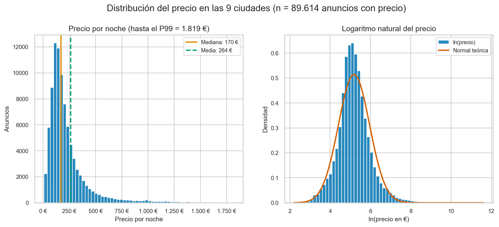

El precio es muy asimétrico (asimetría <!--f:descriptivo.precio.asimetria:n2-->84,48<!--/f-->, curtosis de exceso <!--f:descriptivo.precio.curtosis_exceso:n1-->12.241,7<!--/f-->): la media (<!--f:descriptivo.precio.media:eur2-->263,99 €<!--/f-->) supera a la mediana (<!--f:descriptivo.precio.mediana:eur2-->170,00 €<!--/f-->), la desviación típica es <!--f:descriptivo.precio.std:eur2-->678,40 €<!--/f--> y el rango intercuartílico <!--f:descriptivo.precio.iqr:eur2-->154,02 €<!--/f-->. El logaritmo es casi simétrico (asimetría <!--f:descriptivo.log_precio.asimetria:n2-->0,57<!--/f-->), por eso los modelos usan ln(precio) y los contrastes son no paramétricos.

| Ciudad | Tipo | Anuncios | Con precio | Mediana | Q1–Q3 | % entero | % multi-anuncio | % sin licencia | Renta mediana del distrito |
|---|---|---:|---:|---:|---|---:|---:|---:|---:|
| Mallorca | región | <!--f:descriptivo.por_ciudad.0.n_anuncios:n0-->14.901<!--/f--> | <!--f:descriptivo.por_ciudad.0.n:n0-->11.082<!--/f--> | <!--f:descriptivo.por_ciudad.0.mediana:eur0-->312 €<!--/f--> | <!--f:descriptivo.por_ciudad.0.q1:eur0-->203 €<!--/f--> – <!--f:descriptivo.por_ciudad.0.q3:eur0-->545 €<!--/f--> | <!--f:descriptivo.por_ciudad.0.pct_entero:pct1-->93,6 %<!--/f--> | <!--f:descriptivo.por_ciudad.0.pct_multianuncio:pct1-->81,1 %<!--/f--> | <!--f:descriptivo.por_ciudad.0.pct_sin_licencia:pct1-->7,0 %<!--/f--> | <!--f:descriptivo.por_ciudad.0.renta_dis_mediana:eur0-->17.066 €<!--/f--> |
| Barcelona | ciudad | <!--f:descriptivo.por_ciudad.1.n_anuncios:n0-->15.236<!--/f--> | <!--f:descriptivo.por_ciudad.1.n:n0-->12.610<!--/f--> | <!--f:descriptivo.por_ciudad.1.mediana:eur0-->191 €<!--/f--> | <!--f:descriptivo.por_ciudad.1.q1:eur0-->93 €<!--/f--> – <!--f:descriptivo.por_ciudad.1.q3:eur0-->284 €<!--/f--> | <!--f:descriptivo.por_ciudad.1.pct_entero:pct1-->69,6 %<!--/f--> | <!--f:descriptivo.por_ciudad.1.pct_multianuncio:pct1-->80,5 %<!--/f--> | <!--f:descriptivo.por_ciudad.1.pct_sin_licencia:pct1-->35,9 %<!--/f--> | <!--f:descriptivo.por_ciudad.1.renta_dis_mediana:eur0-->22.141 €<!--/f--> |
| Menorca | región | <!--f:descriptivo.por_ciudad.2.n_anuncios:n0-->3.625<!--/f--> | <!--f:descriptivo.por_ciudad.2.n:n0-->3.013<!--/f--> | <!--f:descriptivo.por_ciudad.2.mediana:eur0-->190 €<!--/f--> | <!--f:descriptivo.por_ciudad.2.q1:eur0-->130 €<!--/f--> – <!--f:descriptivo.por_ciudad.2.q3:eur0-->326 €<!--/f--> | <!--f:descriptivo.por_ciudad.2.pct_entero:pct1-->96,4 %<!--/f--> | <!--f:descriptivo.por_ciudad.2.pct_multianuncio:pct1-->71,8 %<!--/f--> | <!--f:descriptivo.por_ciudad.2.pct_sin_licencia:pct1-->5,0 %<!--/f--> | <!--f:descriptivo.por_ciudad.2.renta_dis_mediana:eur0-->18.610 €<!--/f--> |
| Girona | región | <!--f:descriptivo.por_ciudad.3.n_anuncios:n0-->20.470<!--/f--> | <!--f:descriptivo.por_ciudad.3.n:n0-->15.136<!--/f--> | <!--f:descriptivo.por_ciudad.3.mediana:eur0-->170 €<!--/f--> | <!--f:descriptivo.por_ciudad.3.q1:eur0-->120 €<!--/f--> – <!--f:descriptivo.por_ciudad.3.q3:eur0-->273 €<!--/f--> | <!--f:descriptivo.por_ciudad.3.pct_entero:pct1-->94,4 %<!--/f--> | <!--f:descriptivo.por_ciudad.3.pct_multianuncio:pct1-->70,9 %<!--/f--> | <!--f:descriptivo.por_ciudad.3.pct_sin_licencia:pct1-->13,1 %<!--/f--> | <!--f:descriptivo.por_ciudad.3.renta_dis_mediana:eur0-->15.916 €<!--/f--> |
| Euskadi | región | <!--f:descriptivo.por_ciudad.4.n_anuncios:n0-->6.248<!--/f--> | <!--f:descriptivo.por_ciudad.4.n:n0-->5.540<!--/f--> | <!--f:descriptivo.por_ciudad.4.mediana:eur0-->160 €<!--/f--> | <!--f:descriptivo.por_ciudad.4.q1:eur0-->113 €<!--/f--> – <!--f:descriptivo.por_ciudad.4.q3:eur0-->241 €<!--/f--> | <!--f:descriptivo.por_ciudad.4.pct_entero:pct1-->72,6 %<!--/f--> | <!--f:descriptivo.por_ciudad.4.pct_multianuncio:pct1-->63,3 %<!--/f--> | <!--f:descriptivo.por_ciudad.4.pct_sin_licencia:pct1-->17,9 %<!--/f--> | <!--f:descriptivo.por_ciudad.4.renta_dis_mediana:eur0-->20.677 €<!--/f--> |
| Sevilla | ciudad | <!--f:descriptivo.por_ciudad.5.n_anuncios:n0-->8.375<!--/f--> | <!--f:descriptivo.por_ciudad.5.n:n0-->7.723<!--/f--> | <!--f:descriptivo.por_ciudad.5.mediana:eur0-->158 €<!--/f--> | <!--f:descriptivo.por_ciudad.5.q1:eur0-->118 €<!--/f--> – <!--f:descriptivo.por_ciudad.5.q3:eur0-->220 €<!--/f--> | <!--f:descriptivo.por_ciudad.5.pct_entero:pct1-->86,3 %<!--/f--> | <!--f:descriptivo.por_ciudad.5.pct_multianuncio:pct1-->76,5 %<!--/f--> | <!--f:descriptivo.por_ciudad.5.pct_sin_licencia:pct1-->24,4 %<!--/f--> | <!--f:descriptivo.por_ciudad.5.renta_dis_mediana:eur0-->22.106 €<!--/f--> |
| Madrid | ciudad | <!--f:descriptivo.por_ciudad.6.n_anuncios:n0-->23.109<!--/f--> | <!--f:descriptivo.por_ciudad.6.n:n0-->18.785<!--/f--> | <!--f:descriptivo.por_ciudad.6.mediana:eur0-->151 €<!--/f--> | <!--f:descriptivo.por_ciudad.6.q1:eur0-->95 €<!--/f--> – <!--f:descriptivo.por_ciudad.6.q3:eur0-->224 €<!--/f--> | <!--f:descriptivo.por_ciudad.6.pct_entero:pct1-->70,0 %<!--/f--> | <!--f:descriptivo.por_ciudad.6.pct_multianuncio:pct1-->73,5 %<!--/f--> | <!--f:descriptivo.por_ciudad.6.pct_sin_licencia:pct1-->47,2 %<!--/f--> | <!--f:descriptivo.por_ciudad.6.renta_dis_mediana:eur0-->23.342 €<!--/f--> |
| Málaga | ciudad | <!--f:descriptivo.por_ciudad.7.n_anuncios:n0-->9.505<!--/f--> | <!--f:descriptivo.por_ciudad.7.n:n0-->8.528<!--/f--> | <!--f:descriptivo.por_ciudad.7.mediana:eur0-->150 €<!--/f--> | <!--f:descriptivo.por_ciudad.7.q1:eur0-->112 €<!--/f--> – <!--f:descriptivo.por_ciudad.7.q3:eur0-->209 €<!--/f--> | <!--f:descriptivo.por_ciudad.7.pct_entero:pct1-->88,7 %<!--/f--> | <!--f:descriptivo.por_ciudad.7.pct_multianuncio:pct1-->77,5 %<!--/f--> | <!--f:descriptivo.por_ciudad.7.pct_sin_licencia:pct1-->23,4 %<!--/f--> | <!--f:descriptivo.por_ciudad.7.renta_dis_mediana:eur0-->15.082 €<!--/f--> |
| Valencia | ciudad | <!--f:descriptivo.por_ciudad.8.n_anuncios:n0-->7.968<!--/f--> | <!--f:descriptivo.por_ciudad.8.n:n0-->7.197<!--/f--> | <!--f:descriptivo.por_ciudad.8.mediana:eur0-->134 €<!--/f--> | <!--f:descriptivo.por_ciudad.8.q1:eur0-->98 €<!--/f--> – <!--f:descriptivo.por_ciudad.8.q3:eur0-->183 €<!--/f--> | <!--f:descriptivo.por_ciudad.8.pct_entero:pct1-->78,5 %<!--/f--> | <!--f:descriptivo.por_ciudad.8.pct_multianuncio:pct1-->73,8 %<!--/f--> | <!--f:descriptivo.por_ciudad.8.pct_sin_licencia:pct1-->35,8 %<!--/f--> | <!--f:descriptivo.por_ciudad.8.renta_dis_mediana:eur0-->16.822 €<!--/f--> |

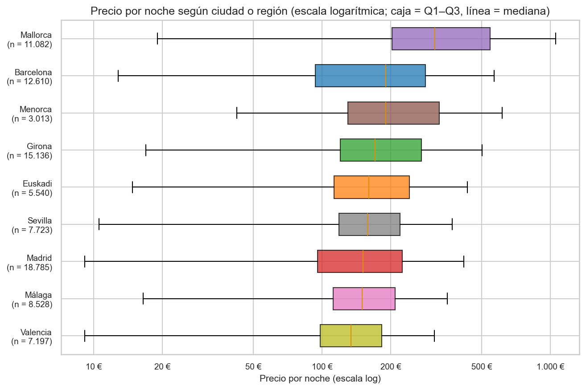

Las diferencias entre ciudades son claras, pero el orden no sigue la renta: la zona más cara, Mallorca, tiene una renta mediana del distrito de <!--f:descriptivo.ciudad_mas_cara.renta_dis_mediana:eur0-->17.066 €<!--/f-->, por debajo de la de ciudades más baratas. En esa zona el <!--f:descriptivo.ciudad_mas_cara.pct_entero:pct1-->93,6 %<!--/f--> de la oferta son alojamientos enteros, lo que encaja con que el tipo y el tamaño del alojamiento pesen más que la renta.

### 4.2 Tipo de habitación y capacidad

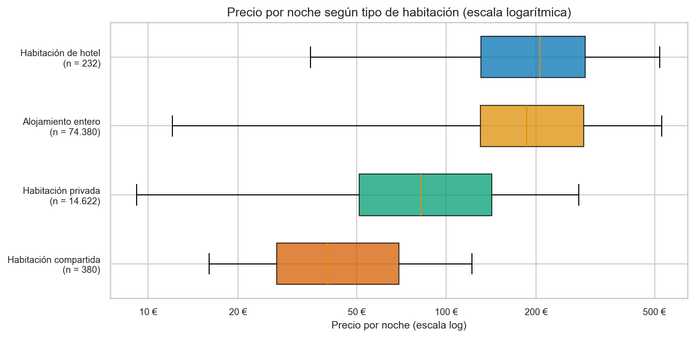

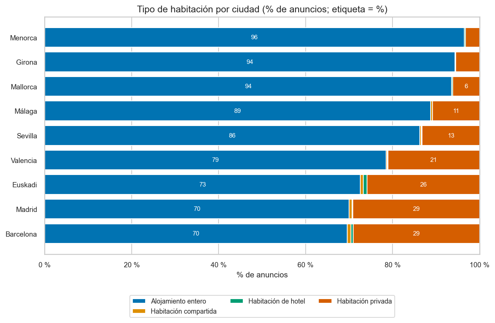

El <!--f:descriptivo.pct_entero:pct1-->82,2 %<!--/f--> de los anuncios son alojamientos enteros, con diferencias entre ciudades que muestra la figura (chi-cuadrado en la sección de análisis estadístico).

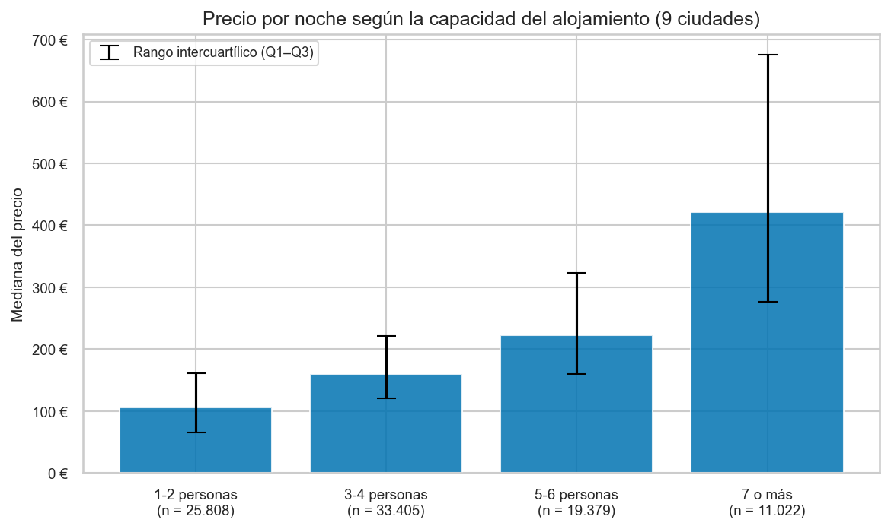

La mediana del precio crece con cada tramo de capacidad: de <!--f:descriptivo.por_capacidad.0.mediana:eur0-->107 €<!--/f--> (1-2 personas) a <!--f:descriptivo.por_capacidad.3.mediana:eur0-->422 €<!--/f--> (7 o más).

### 4.3 Anfitriones y licencias

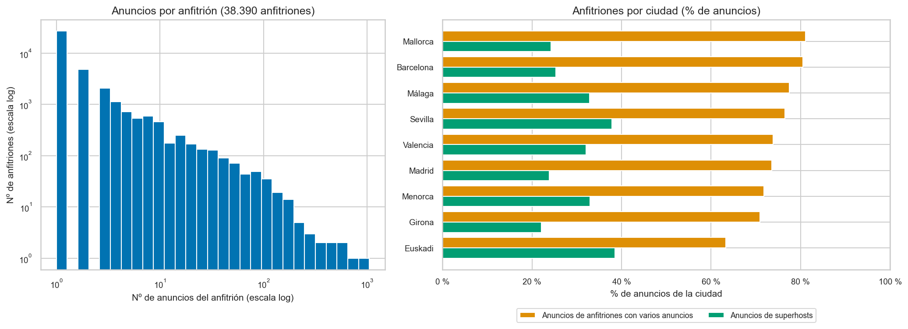

Hay <!--f:descriptivo.hosts.n_hosts:n0-->38.390<!--/f--> anfitriones. El <!--f:descriptivo.hosts.pct_hosts_un_anuncio:pct1-->70,2 %<!--/f--> tiene un solo anuncio, pero el <!--f:descriptivo.hosts.pct_anuncios_multianuncio:pct1-->75,0 %<!--/f--> de los anuncios es de anfitriones con varios y el <!--f:descriptivo.hosts.pct_anuncios_hosts_6_o_mas:pct1-->53,1 %<!--/f--> de cuentas con seis o más. La oferta está concentrada: los <!--f:descriptivo.hosts.n_hosts_top1pct:n0-->384<!--/f--> anfitriones con más anuncios (el uno por ciento del total) reúne el <!--f:descriptivo.hosts.pct_anuncios_top1pct_hosts:pct1-->28,6 %<!--/f--> de los anuncios. Tener varios anuncios no permite saber por sí solo quién gestiona el alojamiento ni con qué modelo. El <!--f:descriptivo.hosts.pct_anuncios_superhost:pct1-->27,4 %<!--/f--> de los anuncios es de superhosts.

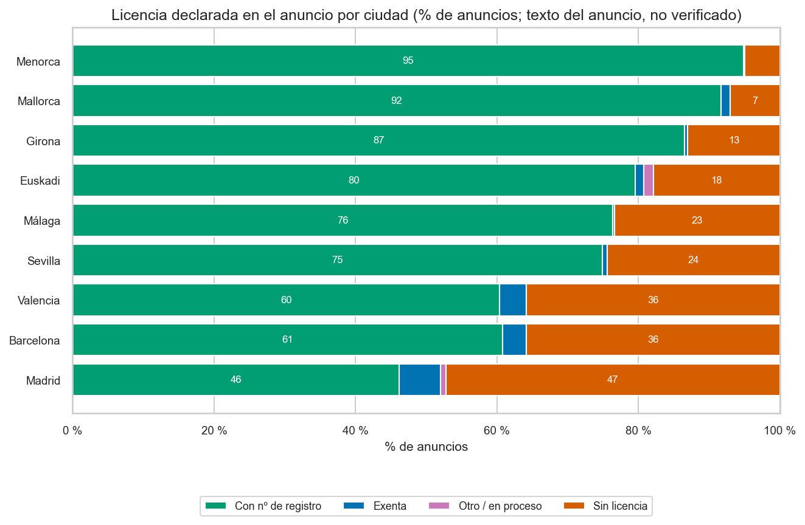

El <!--f:descriptivo.pct_sin_licencia:pct1-->26,1 %<!--/f--> de los anuncios no muestra ningún número de licencia y el <!--f:descriptivo.pct_registro_nacional:pct1-->61,6 %<!--/f--> declara un número del registro único nacional. Es lo que declara el anuncio: no se ha comprobado en ningún registro oficial, y las exenciones (por ejemplo, alquiler de temporada) varían según la comunidad autónoma.

### 4.4 Ocupación

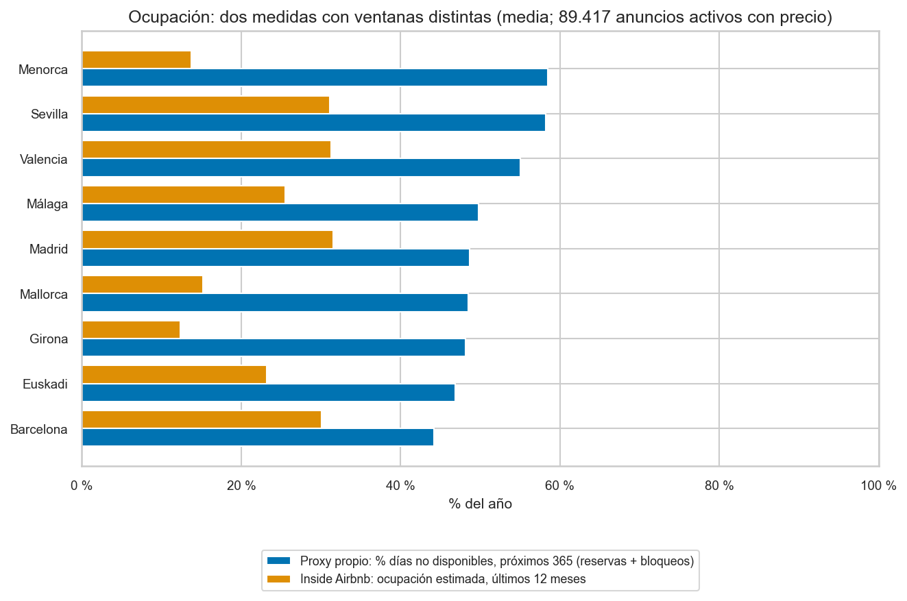

No hay datos de reservas reales. El **proxy de ocupación** es el porcentaje de días **no disponibles** en el año siguiente del calendario, que mezcla reservas y bloqueos del anfitrión; Inside Airbnb estima por su parte la ocupación de los últimos doce meses a partir de las reseñas. Son ventanas y métodos distintos: la media del proxy (<!--f:descriptivo.ocupacion.no_disponible_media:pct1-->49,6 %<!--/f-->) es mayor que la estimación de Inside Airbnb (<!--f:descriptivo.ocupacion.ocupacion_inside_airbnb_media:pct1-->24,3 %<!--/f-->), y ambas apenas se correlacionan (ρ = <!--f:descriptivo.ocupacion.spearman:n2-->0,23<!--/f-->). Ninguna de las dos es una ocupación observada.

### 4.5 Distribución territorial

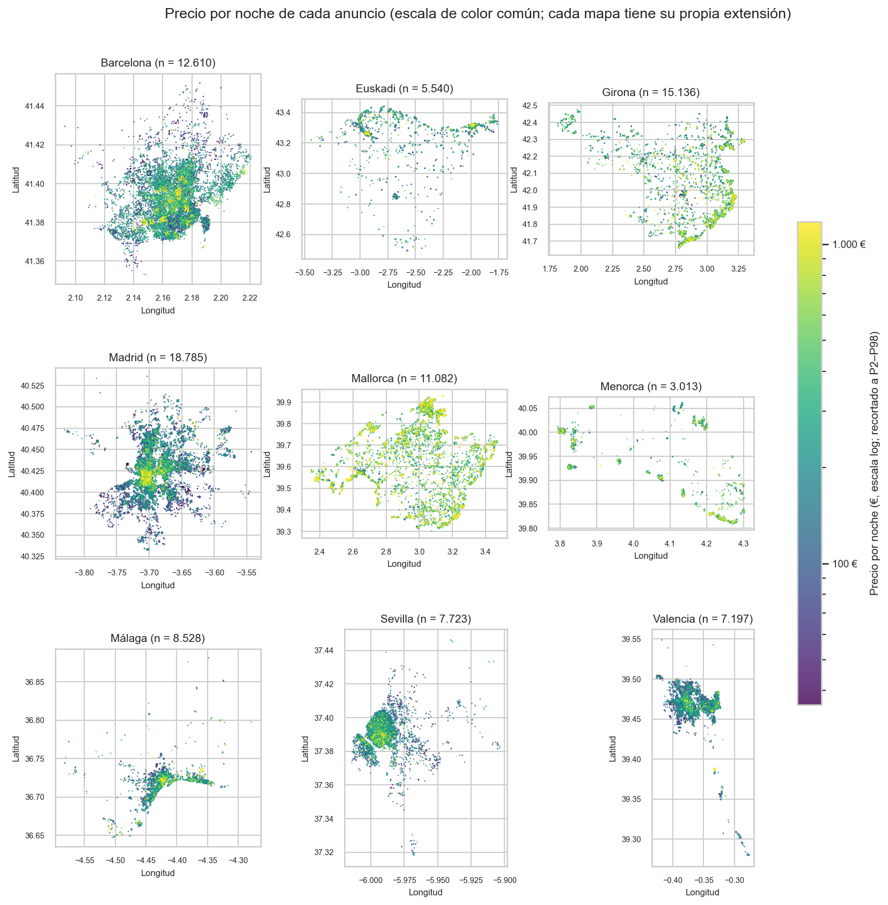

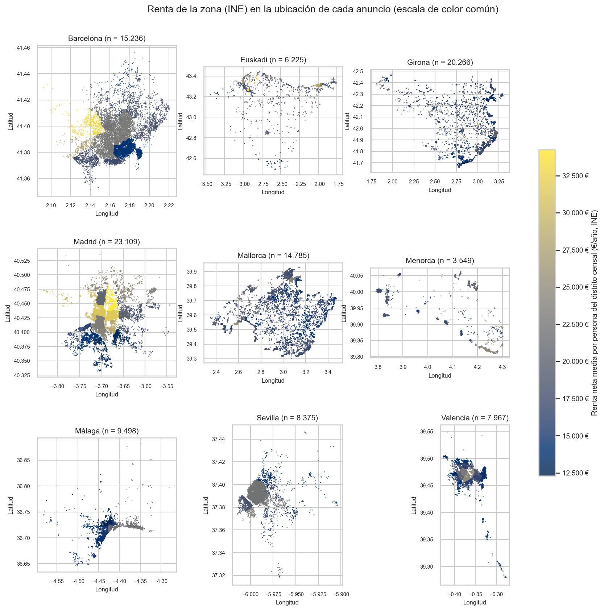

Los mapas muestran dónde se concentra la oferta en cada ciudad y región, con su precio y con la renta del distrito en que cae cada anuncio. Cada mapa tiene su propia extensión, pero la escala de color es común, así que los colores se pueden comparar entre ciudades. La relación entre ambas variables se cuantifica en el apartado de renta y precio del análisis estadístico.

### 4.6 Correlaciones

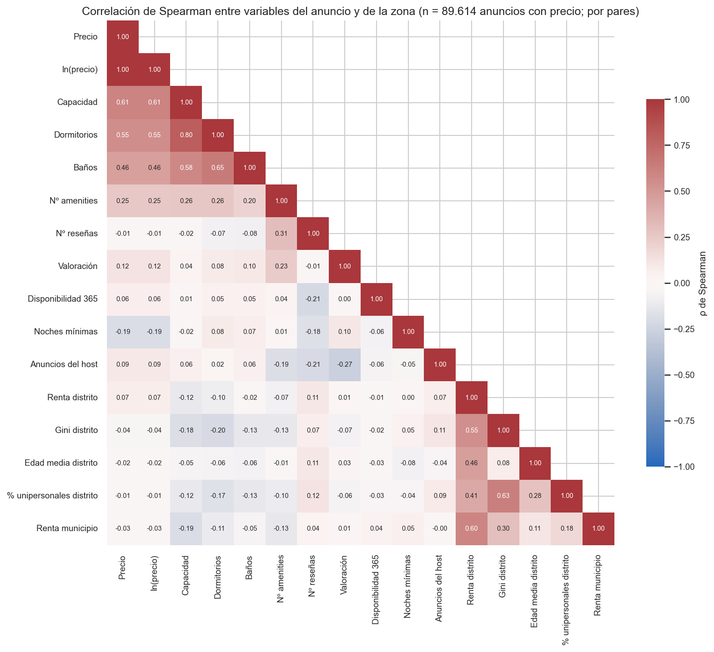

La variable más correlacionada con el precio es la capacidad (ρ = <!--f:descriptivo.correlaciones.con_precio.0.spearman:n2-->0,61<!--/f-->), seguida de dormitorios y baños. La renta del distrito apenas se correlaciona con el precio (ρ = <!--f:descriptivo.correlaciones.con_precio_por_variable.ine_dis_renta_neta_persona.spearman:n3-->0,073<!--/f-->), y la del municipio todavía menos (ρ = <!--f:descriptivo.correlaciones.con_precio_por_variable.ine_mun_renta_neta_persona.spearman:n3-->-0,030<!--/f-->).

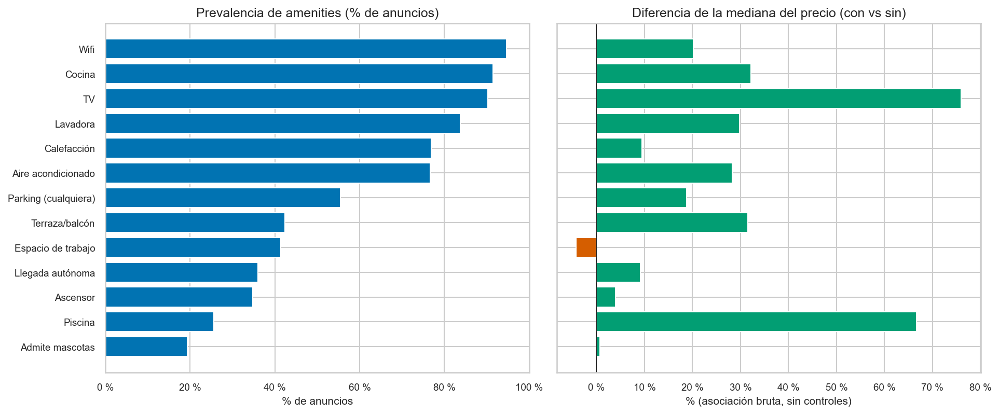

## 5. Análisis estadístico

Todos los contrastes declaran H0 y H1 antes de ejecutarse (`src/estadistica.py`), usan α = <!--f:meta.alfa:n2-->0,05<!--/f--> e informan del tamaño del efecto. Con decenas de miles de anuncios casi todo es «significativo», así que se interpreta sobre todo la magnitud. Los anuncios de un mismo anfitrión no son independientes: se usan errores agrupados por anfitrión, bootstrap por anfitrión y una sensibilidad con un anuncio por anfitrión.

### 5.1 Normalidad y elección de contrastes

D'Agostino-K² rechaza la normalidad del precio (p <!--f:estadistica.normalidad_precio.p_valor:pvalor-->< 0,001<!--/f-->) y también la de ln(precio). Por eso las comparaciones usan Kruskal-Wallis y Mann-Whitney (rangos), con ε² y la correlación rank-biserial como tamaños de efecto.

### 5.2 Diferencias de precio entre ciudades y tipos de habitación

- **Ciudades.** H0: La distribución del precio es la misma en todas las ciudades y regiones. Kruskal-Wallis: H = <!--f:estadistica.kruskal_ciudad.estadistico:n0-->10.229<!--/f-->, p <!--f:estadistica.kruskal_ciudad.p_valor:pvalor-->< 0,001<!--/f-->, ε² = <!--f:estadistica.kruskal_ciudad.tamano_efecto.valor:n3-->0,114<!--/f--> (efecto mediano). El post-hoc de Dunn con Bonferroni encuentra diferencias en <!--f:estadistica.posthoc_ciudad.n_pares_significativos:n0-->34<!--/f--> de <!--f:estadistica.posthoc_ciudad.n_pares:n0-->36<!--/f--> pares.
- **Tipo de habitación.** Kruskal-Wallis: ε² = <!--f:estadistica.kruskal_tipo.tamano_efecto.valor:n3-->0,161<!--/f--> (efecto grande), p <!--f:estadistica.kruskal_tipo.p_valor:pvalor-->< 0,001<!--/f-->. El tipo de habitación separa más los precios que la ciudad.
- **Superhost.** Mann-Whitney: mediana <!--f:estadistica.mann_whitney_superhost.extra.mediana_a:eur2-->173,00 €<!--/f--> frente a <!--f:estadistica.mann_whitney_superhost.extra.mediana_b:eur2-->168,50 €<!--/f-->, p <!--f:estadistica.mann_whitney_superhost.p_valor:pvalor-->< 0,001<!--/f--> y r = <!--f:estadistica.mann_whitney_superhost.tamano_efecto.valor:n4-->0,0202<!--/f-->: significativo pero con efecto despreciable.
- **Asociaciones categóricas.** Ciudad y tipo de habitación: V de Cramér = <!--f:estadistica.chi2_ciudad_tipo.tamano_efecto.valor:n3-->0,165<!--/f--> (pequeño). Tipo y superhost: V = <!--f:estadistica.chi2_tipo_superhost.tamano_efecto.valor:n3-->0,071<!--/f--> (despreciable). Multi-anuncio y tipo: V = <!--f:estadistica.chi2_multi_tipo.tamano_efecto.valor:n3-->0,040<!--/f--> (despreciable).

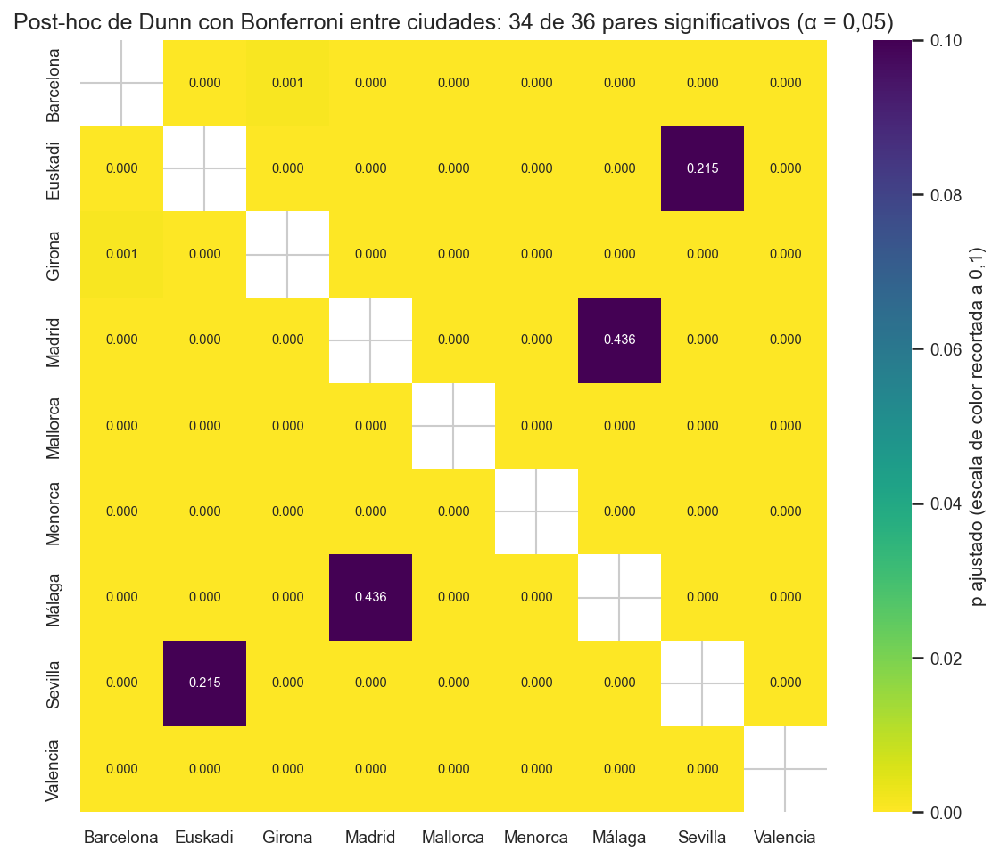

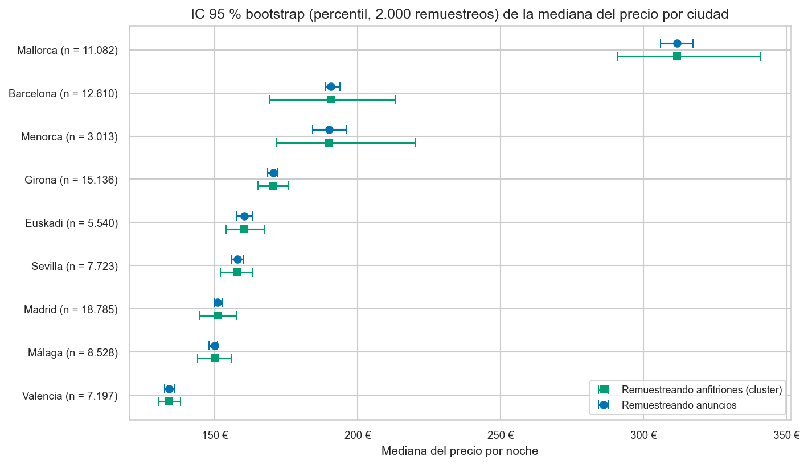

Los intervalos bootstrap de la mediana (remuestreando anfitriones, más anchos que remuestreando anuncios) confirman el orden: Mallorca <!--f:estadistica.bootstrap.ciudades.0.mediana:eur2-->311,75 €<!--/f--> (IC 95 % <!--f:estadistica.bootstrap.ciudades.0.ic_inf_cluster:eur2-->291,00 €<!--/f--> – <!--f:estadistica.bootstrap.ciudades.0.ic_sup_cluster:eur2-->341,02 €<!--/f-->), claramente por encima de la segunda. Habitación de hotel: <!--f:estadistica.bootstrap.tipo.0.mediana:eur2-->206,00 €<!--/f--> (IC <!--f:estadistica.bootstrap.tipo.0.ic_inf:eur2-->180,00 €<!--/f--> – <!--f:estadistica.bootstrap.tipo.0.ic_sup:eur2-->227,50 €<!--/f-->).

Con un anuncio por anfitrión elegido al azar (<!--f:estadistica.sensibilidad_un_anuncio_por_host.n:n0-->32.672<!--/f--> anuncios con precio) cambia la decisión en: superhost (superhost con un anuncio por anfitrión: r = <!--f:estadistica.sensibilidad_un_anuncio_por_host.mann_whitney_superhost.tamano_efecto.valor:n4-->0,0070<!--/f-->, p <!--f:estadistica.sensibilidad_un_anuncio_por_host.mann_whitney_superhost.p_valor:pvalor-->0,293<!--/f-->). Las demás decisiones se mantienen.
### 5.3 Relación entre la renta de la zona y el precio

H0: ρ de Spearman entre la renta neta por persona de la zona (INE) y el precio es 0. H1: ρ ≠ 0 (contraste bilateral; IC y p por bootstrap remuestreando distritos censales).

**Cómo se mide.** La renta del INE es la misma para todos los anuncios de un distrito, así que los anuncios no son observaciones independientes respecto a esa variable. El p-valor habitual de Spearman exageraría la evidencia. Por eso el intervalo de confianza y el p-valor se obtienen con un **bootstrap que remuestrea distritos censales enteros** (<!--f:estadistica.renta_precio.n_boot:n0-->1.000<!--/f--> réplicas) y, como contraste, anfitriones. Se usa la renta neta media por persona del distrito censal; la del municipio se usa para comparar entre municipios.

- **Global, anuncio a anuncio** (renta del distrito): ρ = <!--f:estadistica.renta_precio.global_distrito.rho:n3-->0,073<!--/f--> (n = <!--f:estadistica.renta_precio.global_distrito.n:n0-->89.257<!--/f-->; <!--f:estadistica.renta_precio.global_distrito.cluster_zona.n_clusters:n0-->738<!--/f--> distritos). IC 95 % remuestreando distritos: <!--f:estadistica.renta_precio.global_distrito.cluster_zona.ic_inf:n3-->0,001<!--/f--> a <!--f:estadistica.renta_precio.global_distrito.cluster_zona.ic_sup:n3-->0,138<!--/f-->, p bootstrap = <!--f:estadistica.renta_precio.global_distrito.cluster_zona.p_boot:n3-->0,050<!--/f-->. Es significativa, pero el efecto es débil.- **Global con la renta del municipio:** ρ = <!--f:estadistica.renta_precio.global_municipio.rho:n3-->-0,030<!--/f--> (IC remuestreando municipios <!--f:estadistica.renta_precio.global_municipio.cluster_zona.ic_inf:n3-->-0,145<!--/f--> a <!--f:estadistica.renta_precio.global_municipio.cluster_zona.ic_sup:n3-->0,140<!--/f-->).
- **Entre distritos** (un punto por distrito con al menos <!--f:meta.parametros.min_n_grupo:n0-->30<!--/f--> anuncios con precio): ρ = <!--f:estadistica.renta_precio.ecologico_global.rho:n3-->0,040<!--/f--> con <!--f:estadistica.renta_precio.ecologico_global.n_zonas:n0-->269<!--/f--> distritos (p = <!--f:estadistica.renta_precio.ecologico_global.p:n3-->0,515<!--/f-->).

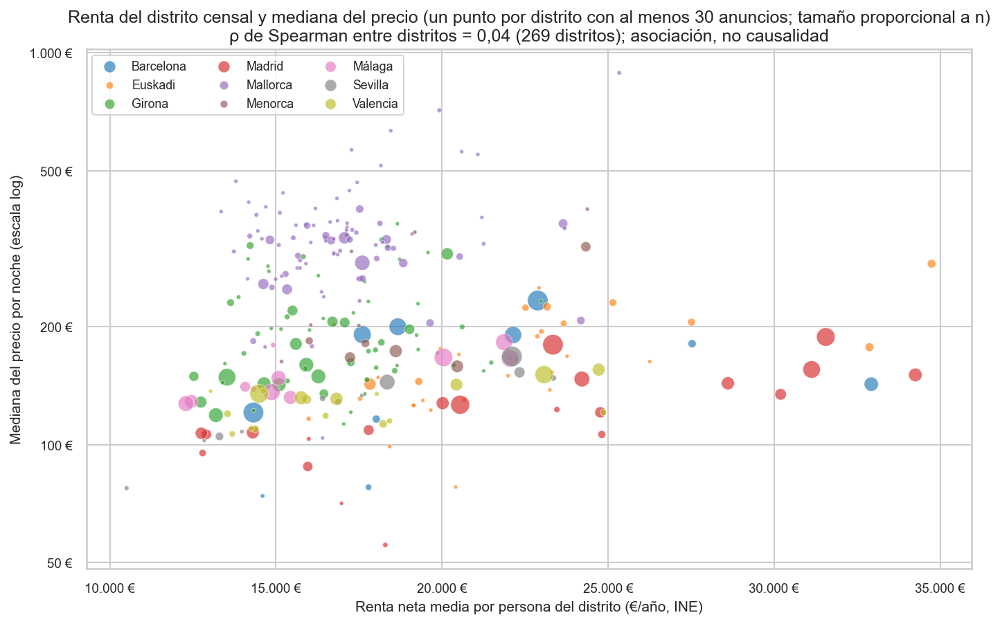

La figura explica por qué la relación global es débil: cada ciudad forma su propia nube. Las regiones con precios altos tienen rentas moderadas (tabla del apartado descriptivo), mientras que las ciudades con más renta no son las más caras. Mezclar ciudades oculta lo que pasa dentro de cada una.

**Por ciudad** (renta del distrito, IC remuestreando distritos; p corregido por Holm sobre las <!--f:estadistica.renta_precio.n_ciudades_evaluables:n0-->9<!--/f--> ciudades):

| Ciudad | n | Distritos | ρ | IC 95 % | p Holm | ρ entre distritos (n distritos) |
|---|---:|---:|---:|---|---:|---|
| Euskadi | <!--f:estadistica.renta_precio.por_ciudad.0.distrito.n:n0-->5.520<!--/f--> | <!--f:estadistica.renta_precio.por_ciudad.0.distrito.cluster_zona.n_clusters:n0-->284<!--/f--> | <!--f:estadistica.renta_precio.por_ciudad.0.distrito.rho:n3-->0,286<!--/f--> | <!--f:estadistica.renta_precio.por_ciudad.0.distrito.cluster_zona.ic_inf:n3-->0,187<!--/f--> a <!--f:estadistica.renta_precio.por_ciudad.0.distrito.cluster_zona.ic_sup:n3-->0,367<!--/f--> | <!--f:estadistica.renta_precio.por_ciudad.0.distrito.holm.p_holm:n3-->0,018<!--/f--> | <!--f:estadistica.renta_precio.por_ciudad.0.ecologico.rho:n2-->0,64<!--/f--> (<!--f:estadistica.renta_precio.por_ciudad.0.ecologico.n_zonas:n0-->33<!--/f-->) |
| Málaga | <!--f:estadistica.renta_precio.por_ciudad.1.distrito.n:n0-->8.523<!--/f--> | <!--f:estadistica.renta_precio.por_ciudad.1.distrito.cluster_zona.n_clusters:n0-->14<!--/f--> | <!--f:estadistica.renta_precio.por_ciudad.1.distrito.rho:n3-->0,235<!--/f--> | <!--f:estadistica.renta_precio.por_ciudad.1.distrito.cluster_zona.ic_inf:n3-->0,071<!--/f--> a <!--f:estadistica.renta_precio.por_ciudad.1.distrito.cluster_zona.ic_sup:n3-->0,302<!--/f--> | <!--f:estadistica.renta_precio.por_ciudad.1.distrito.holm.p_holm:n3-->0,048<!--/f--> | <!--f:estadistica.renta_precio.por_ciudad.1.ecologico.rho:n2-->0,72<!--/f--> (<!--f:estadistica.renta_precio.por_ciudad.1.ecologico.n_zonas:n0-->11<!--/f-->) |
| Girona | <!--f:estadistica.renta_precio.por_ciudad.2.distrito.n:n0-->14.968<!--/f--> | <!--f:estadistica.renta_precio.por_ciudad.2.distrito.cluster_zona.n_clusters:n0-->246<!--/f--> | <!--f:estadistica.renta_precio.por_ciudad.2.distrito.rho:n3-->0,209<!--/f--> | <!--f:estadistica.renta_precio.por_ciudad.2.distrito.cluster_zona.ic_inf:n3-->0,087<!--/f--> a <!--f:estadistica.renta_precio.por_ciudad.2.distrito.cluster_zona.ic_sup:n3-->0,306<!--/f--> | <!--f:estadistica.renta_precio.por_ciudad.2.distrito.holm.p_holm:n3-->0,032<!--/f--> | <!--f:estadistica.renta_precio.por_ciudad.2.ecologico.rho:n2-->0,21<!--/f--> (<!--f:estadistica.renta_precio.por_ciudad.2.ecologico.n_zonas:n0-->65<!--/f-->) |
| Sevilla | <!--f:estadistica.renta_precio.por_ciudad.3.distrito.n:n0-->7.723<!--/f--> | <!--f:estadistica.renta_precio.por_ciudad.3.distrito.cluster_zona.n_clusters:n0-->11<!--/f--> | <!--f:estadistica.renta_precio.por_ciudad.3.distrito.rho:n3-->0,175<!--/f--> | <!--f:estadistica.renta_precio.por_ciudad.3.distrito.cluster_zona.ic_inf:n3-->0,041<!--/f--> a <!--f:estadistica.renta_precio.por_ciudad.3.distrito.cluster_zona.ic_sup:n3-->0,315<!--/f--> | <!--f:estadistica.renta_precio.por_ciudad.3.distrito.holm.p_holm:n3-->0,042<!--/f--> | <!--f:estadistica.renta_precio.por_ciudad.3.ecologico.rho:n2-->0,95<!--/f--> (<!--f:estadistica.renta_precio.por_ciudad.3.ecologico.n_zonas:n0-->11<!--/f-->) |
| Madrid | <!--f:estadistica.renta_precio.por_ciudad.4.distrito.n:n0-->18.785<!--/f--> | <!--f:estadistica.renta_precio.por_ciudad.4.distrito.cluster_zona.n_clusters:n0-->21<!--/f--> | <!--f:estadistica.renta_precio.por_ciudad.4.distrito.rho:n3-->0,173<!--/f--> | <!--f:estadistica.renta_precio.por_ciudad.4.distrito.cluster_zona.ic_inf:n3-->0,018<!--/f--> a <!--f:estadistica.renta_precio.por_ciudad.4.distrito.cluster_zona.ic_sup:n3-->0,325<!--/f--> | <!--f:estadistica.renta_precio.por_ciudad.4.distrito.holm.p_holm:n3-->0,170<!--/f--> | <!--f:estadistica.renta_precio.por_ciudad.4.ecologico.rho:n2-->0,73<!--/f--> (<!--f:estadistica.renta_precio.por_ciudad.4.ecologico.n_zonas:n0-->21<!--/f-->) |
| Barcelona | <!--f:estadistica.renta_precio.por_ciudad.5.distrito.n:n0-->12.610<!--/f--> | <!--f:estadistica.renta_precio.por_ciudad.5.distrito.cluster_zona.n_clusters:n0-->11<!--/f--> | <!--f:estadistica.renta_precio.por_ciudad.5.distrito.rho:n3-->0,152<!--/f--> | <!--f:estadistica.renta_precio.por_ciudad.5.distrito.cluster_zona.ic_inf:n3-->-0,085<!--/f--> a <!--f:estadistica.renta_precio.por_ciudad.5.distrito.cluster_zona.ic_sup:n3-->0,248<!--/f--> | <!--f:estadistica.renta_precio.por_ciudad.5.distrito.holm.p_holm:n3-->0,827<!--/f--> | <!--f:estadistica.renta_precio.por_ciudad.5.ecologico.rho:n2-->0,45<!--/f--> (<!--f:estadistica.renta_precio.por_ciudad.5.ecologico.n_zonas:n0-->10<!--/f-->) |
| Menorca | <!--f:estadistica.renta_precio.por_ciudad.6.distrito.n:n0-->2.948<!--/f--> | <!--f:estadistica.renta_precio.por_ciudad.6.distrito.cluster_zona.n_clusters:n0-->17<!--/f--> | <!--f:estadistica.renta_precio.por_ciudad.6.distrito.rho:n3-->0,148<!--/f--> | <!--f:estadistica.renta_precio.por_ciudad.6.distrito.cluster_zona.ic_inf:n3-->-0,082<!--/f--> a <!--f:estadistica.renta_precio.por_ciudad.6.distrito.cluster_zona.ic_sup:n3-->0,341<!--/f--> | <!--f:estadistica.renta_precio.por_ciudad.6.distrito.holm.p_holm:n3-->0,827<!--/f--> | <!--f:estadistica.renta_precio.por_ciudad.6.ecologico.rho:n2-->0,42<!--/f--> (<!--f:estadistica.renta_precio.por_ciudad.6.ecologico.n_zonas:n0-->12<!--/f-->) |
| Valencia | <!--f:estadistica.renta_precio.por_ciudad.7.distrito.n:n0-->7.196<!--/f--> | <!--f:estadistica.renta_precio.por_ciudad.7.distrito.cluster_zona.n_clusters:n0-->19<!--/f--> | <!--f:estadistica.renta_precio.por_ciudad.7.distrito.rho:n3-->0,126<!--/f--> | <!--f:estadistica.renta_precio.por_ciudad.7.distrito.cluster_zona.ic_inf:n3-->-0,008<!--/f--> a <!--f:estadistica.renta_precio.por_ciudad.7.distrito.cluster_zona.ic_sup:n3-->0,203<!--/f--> | <!--f:estadistica.renta_precio.por_ciudad.7.distrito.holm.p_holm:n3-->0,240<!--/f--> | <!--f:estadistica.renta_precio.por_ciudad.7.ecologico.rho:n2-->0,36<!--/f--> (<!--f:estadistica.renta_precio.por_ciudad.7.ecologico.n_zonas:n0-->18<!--/f-->) |
| Mallorca | <!--f:estadistica.renta_precio.por_ciudad.8.distrito.n:n0-->10.984<!--/f--> | <!--f:estadistica.renta_precio.por_ciudad.8.distrito.cluster_zona.n_clusters:n0-->115<!--/f--> | <!--f:estadistica.renta_precio.por_ciudad.8.distrito.rho:n3-->0,030<!--/f--> | <!--f:estadistica.renta_precio.por_ciudad.8.distrito.cluster_zona.ic_inf:n3-->-0,052<!--/f--> a <!--f:estadistica.renta_precio.por_ciudad.8.distrito.cluster_zona.ic_sup:n3-->0,109<!--/f--> | <!--f:estadistica.renta_precio.por_ciudad.8.distrito.holm.p_holm:n3-->0,827<!--/f--> | <!--f:estadistica.renta_precio.por_ciudad.8.ecologico.rho:n2-->0,16<!--/f--> (<!--f:estadistica.renta_precio.por_ciudad.8.ecologico.n_zonas:n0-->88<!--/f-->) |

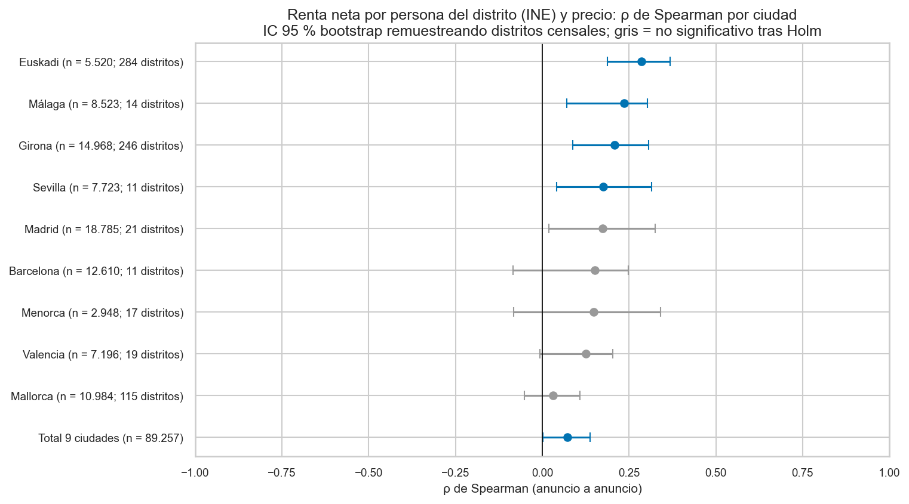

Dentro de cada ciudad la correlación es positiva, de pequeña a moderada. Tras corregir por Holm son significativas <!--f:estadistica.renta_precio.n_ciudades_positivas_holm:n0-->4<!--/f--> de <!--f:estadistica.renta_precio.n_ciudades_evaluables:n0-->9<!--/f--> ciudades. En las ciudades con pocos distritos (Madrid, Barcelona, Valencia, Sevilla, Málaga) la incertidumbre es grande porque la renta solo toma una decena o una veintena de valores distintos, uno por distrito; por eso la correlación entre distritos puede ser alta y aun así poco precisa.

**Sensibilidades** del ρ global (IC remuestreando distritos):

| Variante | n | ρ | IC 95 % |
|---|---:|---:|---|
| Sin estancias mínimas largas ni tarifas mensuales | <!--f:estadistica.renta_precio.sensibilidades.sin_estancias_30.n:n0-->80.241<!--/f--> | <!--f:estadistica.renta_precio.sensibilidades.sin_estancias_30.rho:n3-->0,118<!--/f--> | <!--f:estadistica.renta_precio.sensibilidades.sin_estancias_30.cluster_zona.ic_inf:n3-->0,031<!--/f--> a <!--f:estadistica.renta_precio.sensibilidades.sin_estancias_30.cluster_zona.ic_sup:n3-->0,208<!--/f--> |
| Sin atípicos | <!--f:estadistica.renta_precio.sensibilidades.sin_outliers.n:n0-->85.501<!--/f--> | <!--f:estadistica.renta_precio.sensibilidades.sin_outliers.rho:n3-->0,092<!--/f--> | <!--f:estadistica.renta_precio.sensibilidades.sin_outliers.cluster_zona.ic_inf:n3-->0,020<!--/f--> a <!--f:estadistica.renta_precio.sensibilidades.sin_outliers.cluster_zona.ic_sup:n3-->0,152<!--/f--> |
| Un anuncio por anfitrión | <!--f:estadistica.renta_precio.sensibilidades.un_anuncio_por_anfitrion.n:n0-->32.509<!--/f--> | <!--f:estadistica.renta_precio.sensibilidades.un_anuncio_por_anfitrion.rho:n3-->0,103<!--/f--> | <!--f:estadistica.renta_precio.sensibilidades.un_anuncio_por_anfitrion.cluster_zona.ic_inf:n3-->0,035<!--/f--> a <!--f:estadistica.renta_precio.sensibilidades.un_anuncio_por_anfitrion.cluster_zona.ic_sup:n3-->0,180<!--/f--> |
| Solo las ciudades urbanas | <!--f:estadistica.renta_precio.sensibilidades.solo_urbanas.n:n0-->54.837<!--/f--> | <!--f:estadistica.renta_precio.sensibilidades.solo_urbanas.rho:n3-->0,168<!--/f--> | <!--f:estadistica.renta_precio.sensibilidades.solo_urbanas.cluster_zona.ic_inf:n3-->0,098<!--/f--> a <!--f:estadistica.renta_precio.sensibilidades.solo_urbanas.cluster_zona.ic_sup:n3-->0,228<!--/f--> |

El signo se mantiene en todas las variantes.
### 5.4 Regresión OLS sobre ln(precio)

**Especificación.** ln(precio) ~ efectos fijos de ciudad (referencia Madrid) + tipo de habitación + capacidad, dormitorios, baños y baño compartido + nº de amenities y cuatro amenities concretas + superhost + anfitrión multi-anuncio + estancia mínima larga + ln(1 + reseñas) + tipo de licencia + mes de la cotización + variables de la zona del INE: ln(renta neta por persona del distrito), Gini, edad media y % de hogares unipersonales. Los errores se agrupan por anfitrión; los coeficientes del INE se contrastan además agrupando por distrito censal, que es la unidad en la que varían. Cada coeficiente se lee como el cambio porcentual del precio asociado a la variable **manteniendo constantes las demás**.

- n = <!--f:estadistica.ols.n_efectivo:n0-->89.182<!--/f--> anuncios, <!--f:estadistica.ols.n_anfitriones:n0-->32.529<!--/f--> anfitriones y <!--f:estadistica.ols.n_distritos_ine:n0-->738<!--/f--> distritos censales. R² = <!--f:estadistica.ols.r2:n3-->0,609<!--/f-->, R² ajustado = <!--f:estadistica.ols.r2_ajustado:n3-->0,609<!--/f-->. Wald con covarianza agrupada: F = <!--f:estadistica.ols.f_cluster:n1-->505,6<!--/f-->, p <!--f:estadistica.ols.f_cluster_p:pvalor-->< 0,001<!--/f-->.
- <!--f:estadistica.ols.n_significativos:n0-->33<!--/f--> de <!--f:estadistica.ols.n_coeficientes:n0-->43<!--/f--> coeficientes son significativos y <!--f:estadistica.ols.n_significativos_holm:n0-->29<!--/f--> siguen siéndolo tras la corrección de Holm.

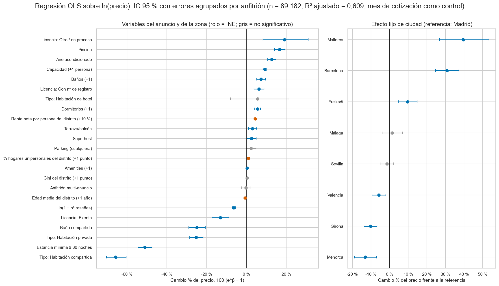

Asociaciones principales (IC 95 % con errores agrupados por anfitrión):

- Cada persona más de capacidad: <!--f:estadistica.ols.coef_accommodates.pct:signo_pct-->+9,1 %<!--/f--> (<!--f:estadistica.ols.coef_accommodates.ic_inf_pct:signo_pct-->+8,3 %<!--/f--> a <!--f:estadistica.ols.coef_accommodates.ic_sup_pct:signo_pct-->+10,0 %<!--/f-->).
- Habitación privada frente a alojamiento entero: <!--f:estadistica.ols.coef_privada.pct:signo_pct-->-25,2 %<!--/f-->. Baño compartido: <!--f:estadistica.ols.coef_por_termino.bano_compartido.pct:signo_pct-->-24,9 %<!--/f-->.
- Estancia mínima larga: <!--f:estadistica.ols.coef_larga_estancia.pct:signo_pct-->-51,1 %<!--/f--> por noche, coherente con tarifas mensuales repartidas entre las noches.
- Piscina <!--f:estadistica.ols.coef_por_termino.tiene_piscina.pct:signo_pct-->+16,6 %<!--/f--> y aire acondicionado <!--f:estadistica.ols.coef_por_termino.tiene_aire_acondicionado.pct:signo_pct-->+12,7 %<!--/f-->.
- Superhost: <!--f:estadistica.ols.coef_superhost.pct:signo_pct-->+2,6 %<!--/f--> (IC <!--f:estadistica.ols.coef_superhost.ic_inf_pct:signo_pct-->+0,3 %<!--/f--> a <!--f:estadistica.ols.coef_superhost.ic_sup_pct:signo_pct-->+4,9 %<!--/f-->), pequeño y no significativo tras Holm. Anfitrión multi-anuncio: <!--f:estadistica.ols.coef_multianuncio.pct:signo_pct-->-0,3 %<!--/f--> (<!--f:estadistica.ols.coef_multianuncio.p_cluster:p-->p = 0,780<!--/f-->).
- **Renta de la zona.** Con todo lo anterior constante, una renta del distrito un 10 % mayor se asocia con un precio <!--f:estadistica.ols.coef_renta.pct_por_10pct_renta:signo_pct-->+4,3 %<!--/f--> mayor (IC agrupando por anfitrión <!--f:estadistica.ols.coef_renta.ic_inf_10pct:signo_pct-->+3,8 %<!--/f--> a <!--f:estadistica.ols.coef_renta.ic_sup_10pct:signo_pct-->+4,8 %<!--/f-->; agrupando por distrito <!--f:estadistica.ols.coef_renta.ic_inf_10pct_distrito:signo_pct-->+3,4 %<!--/f--> a <!--f:estadistica.ols.coef_renta.ic_sup_10pct_distrito:signo_pct-->+5,2 %<!--/f-->, p <!--f:estadistica.ols.coef_renta.p_cluster_distrito:pvalor-->< 0,001<!--/f-->). Gini: <!--f:estadistica.ols.coef_por_termino.ine_dis_gini.pct:signo_pct-->+0,3 %<!--/f--> por punto (agrupando por distrito, <!--f:estadistica.ols.coef_por_termino.ine_dis_gini.p_cluster_distrito:p-->p = 0,407<!--/f-->); edad media: <!--f:estadistica.ols.coef_por_termino.ine_dis_edad_media.pct:signo_pct-->-0,7 %<!--/f--> por año (<!--f:estadistica.ols.coef_por_termino.ine_dis_edad_media.p_cluster_distrito:p-->p = 0,206<!--/f-->); hogares unipersonales: <!--f:estadistica.ols.coef_por_termino.ine_dis_pct_hogares_unipersonales.pct:signo_pct-->+0,9 %<!--/f--> por punto (<!--f:estadistica.ols.coef_por_termino.ine_dis_pct_hogares_unipersonales.p_cluster_distrito:p-->p < 0,001<!--/f-->). Agrupando por distrito son significativas <!--f:estadistica.ols.n_ine_significativos_distrito:n0-->2<!--/f--> de las cuatro variables del INE.

**¿Cuánto aporta la renta?** Con las mismas filas, el modelo sin las variables del INE tiene un R² ajustado de <!--f:estadistica.ols.sin_ine.r2_ajustado:n3-->0,588<!--/f--> frente a <!--f:estadistica.ols.r2_ajustado:n3-->0,609<!--/f--> con ellas: <!--f:estadistica.ols.delta_r2_ajustado_ine_pp:n1-->2,1<!--/f--> puntos. La asociación condicional es clara y estable, pero explica poca varianza adicional: el precio depende sobre todo del alojamiento y de la ciudad. La renta del distrito también puede estar recogiendo otras cosas de la zona que no se miden (centralidad, atractivo turístico, calidad de la vivienda): en las ciudades urbanas, al añadir la distancia al centro, la asociación baja a <!--f:estadistica.ols.sensibilidades.solo_urbanas_con_distancia.renta.pct_por_10pct_renta:signo_pct-->+3,2 %<!--/f--> por cada 10 % de renta, y cada km de distancia se asocia con un precio <!--f:estadistica.ols.sensibilidades.solo_urbanas_con_distancia.distancia.pct:signo_pct-->-3,2 %<!--/f-->.

**Diagnóstico.** Breusch-Pagan detecta heterocedasticidad (p <!--f:estadistica.ols.diagnostico.breusch_pagan_p:pvalor-->< 0,001<!--/f-->), por eso los errores son robustos y agrupados. Jarque-Bera rechaza la normalidad de los residuos (asimetría <!--f:estadistica.ols.diagnostico.asimetria_residuos:n2-->1,33<!--/f-->, curtosis <!--f:estadistica.ols.diagnostico.curtosis_residuos:n1-->10,7<!--/f-->); con este tamaño muestral la inferencia sobre los coeficientes sigue siendo aproximadamente válida. El VIF máximo de las variables (sin las dummies de ciudad y mes) es <!--f:estadistica.ols.vif_max.vif:n2-->3,83<!--/f--> (Capacidad (+1 persona)); con la matriz completa, el de la renta es <!--f:estadistica.ols.vif_completo_renta:n2-->3,35<!--/f--> y el GVIF ajustado máximo <!--f:estadistica.ols.gvif_max.gvif_ajustado:n2-->2,03<!--/f--> (Gini del distrito (+1 punto)). El <!--f:estadistica.ols.diagnostico.pct_cook_mayor_4_n:pct1-->5,2 %<!--/f--> de las observaciones tiene una distancia de Cook alta; sin ellas se conservan los signos de los coeficientes significativos (R² ajustado <!--f:estadistica.ols.sensibilidad_sin_influyentes.r2_ajustado:n3-->0,702<!--/f-->).

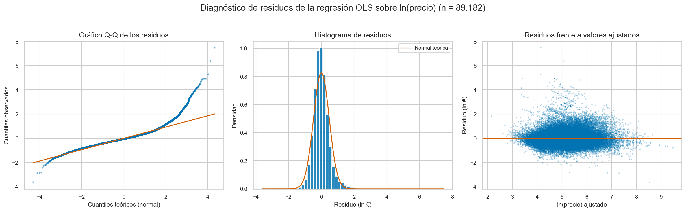

**Sensibilidades del modelo** (coeficiente de la renta por cada 10 % más):

| Variante | n | R² ajustado | Renta (+10 %) | IC 95 % |
|---|---:|---:|---:|---|
| Modelo principal | <!--f:estadistica.ols.n_efectivo:n0-->89.182<!--/f--> | <!--f:estadistica.ols.r2_ajustado:n3-->0,609<!--/f--> | <!--f:estadistica.ols.coef_renta.pct_por_10pct_renta:signo_pct-->+4,3 %<!--/f--> | <!--f:estadistica.ols.coef_renta.ic_inf_10pct:signo_pct-->+3,8 %<!--/f--> a <!--f:estadistica.ols.coef_renta.ic_sup_10pct:signo_pct-->+4,8 %<!--/f--> |
| Sin atípicos | <!--f:estadistica.ols.sensibilidades.sin_outliers.n_efectivo:n0-->85.427<!--/f--> | <!--f:estadistica.ols.sensibilidades.sin_outliers.r2_ajustado:n3-->0,593<!--/f--> | <!--f:estadistica.ols.sensibilidades.sin_outliers.renta.pct_por_10pct_renta:signo_pct-->+4,3 %<!--/f--> | <!--f:estadistica.ols.sensibilidades.sin_outliers.renta.ic_inf_10pct:signo_pct-->+3,9 %<!--/f--> a <!--f:estadistica.ols.sensibilidades.sin_outliers.renta.ic_sup_10pct:signo_pct-->+4,7 %<!--/f--> |
| Sin estancias mínimas largas ni tarifas mensuales | <!--f:estadistica.ols.sensibilidades.sin_estancias_30.n_efectivo:n0-->80.173<!--/f--> | <!--f:estadistica.ols.sensibilidades.sin_estancias_30.r2_ajustado:n3-->0,572<!--/f--> | <!--f:estadistica.ols.sensibilidades.sin_estancias_30.renta.pct_por_10pct_renta:signo_pct-->+4,5 %<!--/f--> | <!--f:estadistica.ols.sensibilidades.sin_estancias_30.renta.ic_inf_10pct:signo_pct-->+4,0 %<!--/f--> a <!--f:estadistica.ols.sensibilidades.sin_estancias_30.renta.ic_sup_10pct:signo_pct-->+5,0 %<!--/f--> |
| Un anuncio por anfitrión | <!--f:estadistica.ols.sensibilidades.un_anuncio_por_anfitrion.n_efectivo:n0-->32.484<!--/f--> | <!--f:estadistica.ols.sensibilidades.un_anuncio_por_anfitrion.r2_ajustado:n3-->0,611<!--/f--> | <!--f:estadistica.ols.sensibilidades.un_anuncio_por_anfitrion.renta.pct_por_10pct_renta:signo_pct-->+4,5 %<!--/f--> | <!--f:estadistica.ols.sensibilidades.un_anuncio_por_anfitrion.renta.ic_inf_10pct:signo_pct-->+4,1 %<!--/f--> a <!--f:estadistica.ols.sensibilidades.un_anuncio_por_anfitrion.renta.ic_sup_10pct:signo_pct-->+4,9 %<!--/f--> |
| Solo ciudades urbanas, con distancia al centro | <!--f:estadistica.ols.sensibilidades.solo_urbanas_con_distancia.n_efectivo:n0-->54.798<!--/f--> | <!--f:estadistica.ols.sensibilidades.solo_urbanas_con_distancia.r2_ajustado:n3-->0,605<!--/f--> | <!--f:estadistica.ols.sensibilidades.solo_urbanas_con_distancia.renta.pct_por_10pct_renta:signo_pct-->+3,2 %<!--/f--> | <!--f:estadistica.ols.sensibilidades.solo_urbanas_con_distancia.renta.ic_inf_10pct:signo_pct-->+2,6 %<!--/f--> a <!--f:estadistica.ols.sensibilidades.solo_urbanas_con_distancia.renta.ic_sup_10pct:signo_pct-->+3,7 %<!--/f--> |
| Sin control del mes de cotización | <!--f:estadistica.ols.sensibilidades.sin_mes.n_efectivo:n0-->89.182<!--/f--> | <!--f:estadistica.ols.sensibilidades.sin_mes.r2_ajustado:n3-->0,590<!--/f--> | <!--f:estadistica.ols.sensibilidades.sin_mes.renta.pct_por_10pct_renta:signo_pct-->+4,1 %<!--/f--> | <!--f:estadistica.ols.sensibilidades.sin_mes.renta.ic_inf_10pct:signo_pct-->+3,6 %<!--/f--> a <!--f:estadistica.ols.sensibilidades.sin_mes.renta.ic_sup_10pct:signo_pct-->+4,6 %<!--/f--> |

El coeficiente de la renta conserva el signo y un orden de magnitud parecido en todas las variantes.

### 5.5 Modelo de machine learning complementario

Un HistGradientBoosting sobre ln(precio) con <!--f:estadistica.ml.n_features:n0-->37<!--/f--> variables (incluidas la ciudad y 6 del INE) se valida con <!--f:estadistica.ml.n_folds:n0-->5<!--/f--> particiones **agrupadas por anfitrión** (`GroupKFold`): ningún anfitrión está a la vez en entrenamiento y en prueba. La imputación y la agrupación de categorías raras se aprenden dentro del pipeline, solo con los datos de entrenamiento de cada partición.

- R² = <!--f:estadistica.ml.cv.r2_media:n3-->0,713<!--/f--> ± <!--f:estadistica.ml.cv.r2_std:n3-->0,014<!--/f-->; mediana del error absoluto ≈ <!--f:estadistica.ml.cv.medae_eur_media:eur0-->35 €<!--/f--> por noche (línea base que predice la mediana: R² = <!--f:estadistica.ml.cv_base.r2_media:n3-->-0,008<!--/f-->).
- Con una partición aleatoria por anuncio el R² sería <!--f:estadistica.ml.aleatorio.r2:n3-->0,769<!--/f-->: más alto porque el <!--f:estadistica.ml.aleatorio.pct_test_con_anfitrion_en_train:pct1-->72,8 %<!--/f--> de los anuncios de prueba tiene a su anfitrión en el entrenamiento.
- **Comparación homogénea con el lineal** (mismas filas que el OLS, mismas particiones y mismas variables): regresión lineal R² = <!--f:estadistica.ml.comparacion_misma_muestra.lineal_vars_ols.r2_media:n3-->0,602<!--/f-->, HistGradientBoosting R² = <!--f:estadistica.ml.comparacion_misma_muestra.hgb_vars_ols.r2_media:n3-->0,661<!--/f-->; con todas sus variables, <!--f:estadistica.ml.comparacion_misma_muestra.hgb_todas.r2_media:n3-->0,713<!--/f-->.
- **Aporte del INE.** Sin las variables del INE y con las mismas particiones, R² = <!--f:estadistica.ml.cv_sin_ine.r2_media:n3-->0,698<!--/f-->: la zona añade <!--f:estadistica.ml.aporte_r2_ine:n3-->0,016<!--/f--> de R². La primera variable del INE aparece en el puesto <!--f:estadistica.ml.rango_ine_en_importancia:n0-->9<!--/f--> de importancia.

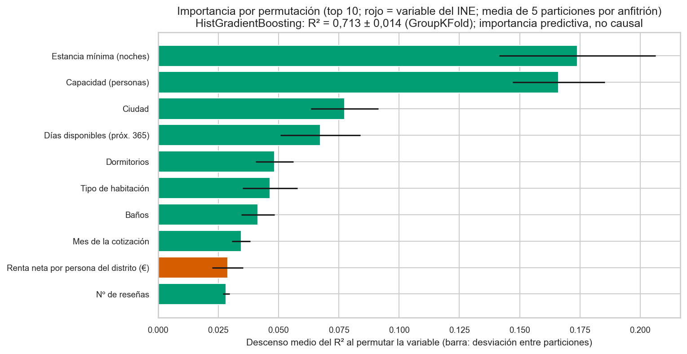

La importancia por permutación es predictiva, no causal: mide cuánto empeora la predicción al desordenar una variable, no qué pasaría si se cambiara.

### 5.6 Multiplicidad

Se han hecho <!--f:estadistica.multiplicidad.n_contrastes_principales:n0-->6<!--/f--> contrastes principales, <!--f:estadistica.multiplicidad.n_pares_posthoc:n0-->42<!--/f--> comparaciones post-hoc (corregidas por Bonferroni), <!--f:estadistica.multiplicidad.n_coeficientes_ols:n0-->43<!--/f--> coeficientes del OLS (con Holm) y <!--f:estadistica.multiplicidad.n_rho_ciudad:n0-->9<!--/f--> correlaciones por ciudad (con Holm): <!--f:estadistica.multiplicidad.n_hipotesis_total:n0-->100<!--/f--> hipótesis en total. Las conclusiones se apoyan en los resultados que sobreviven a la corrección y en los tamaños de efecto.

## 6. Conclusiones

1. El precio de un alojamiento de Airbnb en España se asocia sobre todo con **qué se alquila** (tipo, capacidad, baños, piscina, aire acondicionado), **cómo** (estancia mínima larga, mes de la cotización) y **en qué ciudad o región**.
2. La **renta de la zona** tiene una asociación positiva con el precio **dentro de cada ciudad**, que se mantiene en la regresión y en todas las sensibilidades, pero **explica poco**: <!--f:estadistica.ols.delta_r2_ajustado_ine_pp:n1-->2,1<!--/f--> puntos de R² ajustado en el OLS y <!--f:estadistica.ml.aporte_r2_ine:n3-->0,016<!--/f--> de R² en el modelo predictivo. Mezclando ciudades la relación casi desaparece, porque la zona más cara (Mallorca) no es la de mayor renta.
3. Ser superhost o tener varios anuncios apenas se asocia con el precio una vez se controla el resto.

## 7. Recomendaciones (hipótesis a validar)

Son hipótesis que se desprenden de asociaciones observadas, no efectos demostrados:

- Para **fijar un precio de referencia**, comparar con anuncios del mismo tipo, capacidad y ciudad pesa más que la renta del barrio.
- Para **estudios de mercado o de vivienda**, conviene analizar cada ciudad por separado: los agregados nacionales mezclan mercados distintos.
- Para **reguladores**, el alto porcentaje de anuncios sin licencia visible en algunas ciudades merece cruzarse con los registros oficiales, que no se han usado aquí.
- Validar estas hipótesis exigiría datos de reservas reales, precios pagados y varios momentos del año.

## 8. Limitaciones

- **Datos scrapeados** de la web pública de Airbnb por Inside Airbnb: pueden tener errores y campos vacíos (<!--f:calidad.n_columnas_100_nulas:n0-->13<!--/f--> columnas vienen vacías).
- **Snapshots distintos y únicos:** del <!--f:meta.snapshot_min:fecha-->2026-09-17<!--/f--> al <!--f:meta.snapshot_max:fecha-->2026-09-28<!--/f-->, uno por ciudad. No hay evolución temporal ni estacionalidad completa.
- **Precio de anuncio ≠ precio pagado:** es una cotización fechada, con descuentos aplicados y sin tasas, no lo que pagó un huésped.
- **Sesgo de selección:** el <!--f:limpieza.precio.pct_nulo:pct1-->18,1 %<!--/f--> de los anuncios no tiene precio y el análisis de precio solo describe los que sí.
- **Desfase temporal entre fuentes:** la renta es de <!--f:meta.anio_ine:texto-->2024<!--/f--> (INE) y los anuncios, de snapshots tomados entre el <!--f:meta.snapshot_min:fecha-->2026-09-17<!--/f--> y el <!--f:meta.snapshot_max:fecha-->2026-09-28<!--/f-->. La renta se usa como contexto socioeconómico de la zona, no como dato simultáneo.
- **Málaga:** sus distritos censales del INE no coinciden con sus distritos municipales; el dato por distrito censal se asigna por geometría, pero no se puede contrastar por nombre.
- **Coordenadas anonimizadas** por Airbnb (desplazamientos de hasta unos cientos de metros): algún anuncio puede caer en un distrito vecino.
- **Ocupación:** el proxy mezcla reservas y bloqueos y mira al futuro; no es ocupación observada.
- **Licencias:** se clasifican por el texto que muestra el anuncio, sin verificar en registros oficiales.
- **Observacional:** correlación no implica causalidad; anuncios de un mismo anfitrión o de un mismo distrito no son independientes (se tiene en cuenta con errores agrupados y bootstrap por clusters).

## 9. Reproducibilidad

```bash
python run_pipeline.py --sin-descarga
```

Regenera el conjunto final, las figuras, `reports/findings.json`, este informe, el README, el diccionario y los notebooks, y ejecuta `scripts/verificar_consistencia.py`. Semilla: <!--f:meta.semilla:n0-->42<!--/f-->; remuestreos bootstrap: <!--f:meta.n_boot:n0-->2.000<!--/f-->.

Fuentes: Inside Airbnb (Creative Commons Attribution 4.0 International (CC BY 4.0)) e INE. Elaboración propia con datos extraídos del sitio web del INE: www.ine.es. Última actualización del ADRH: <!--f:dataset.fuente_ine.actualizacion.fecha:fecha-->2026-10-19<!--/f-->.
