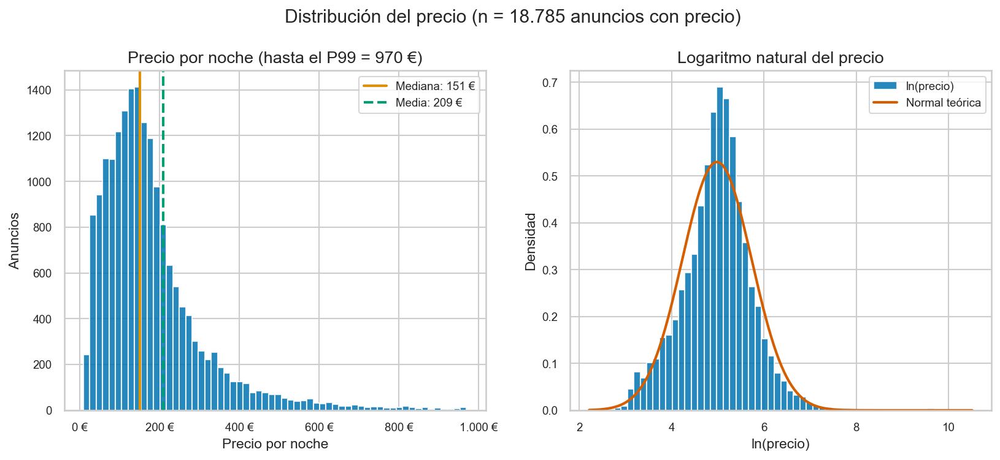
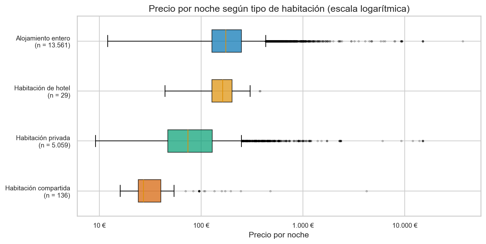
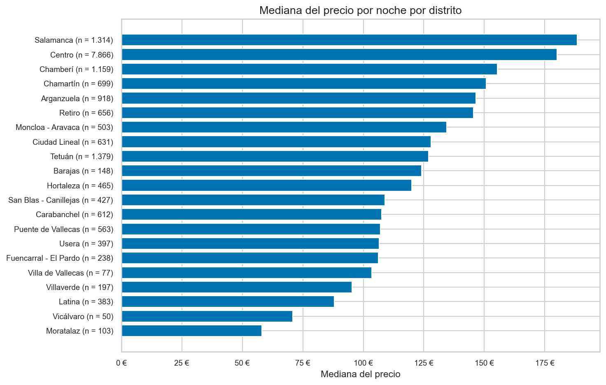
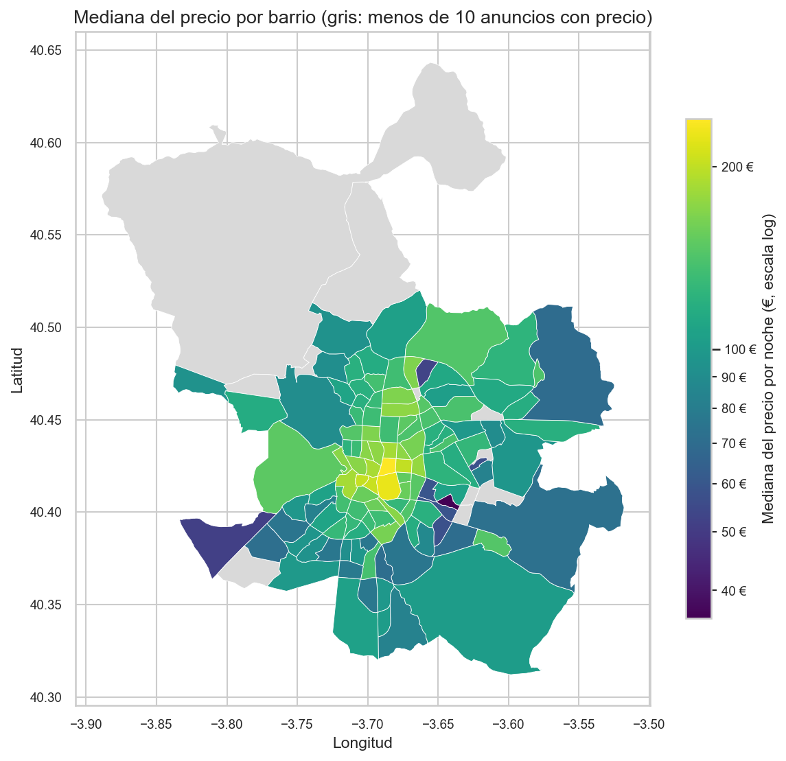
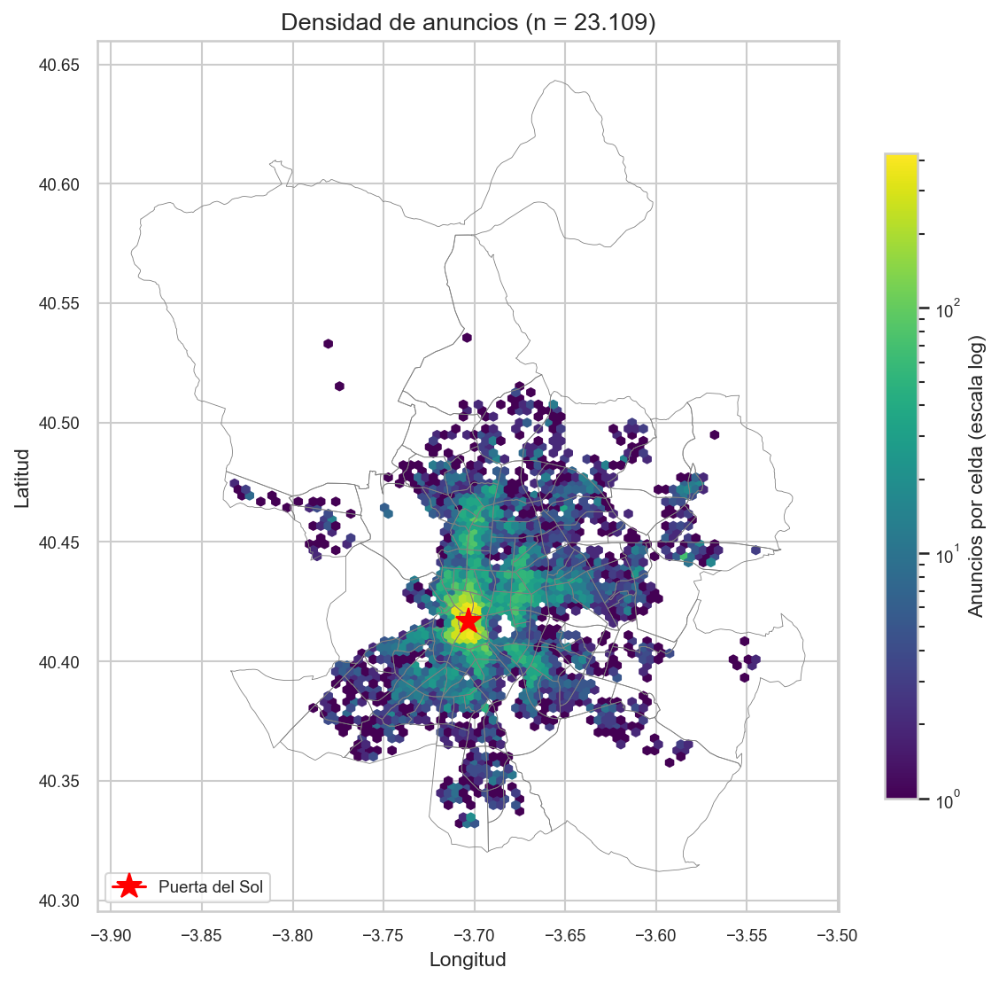
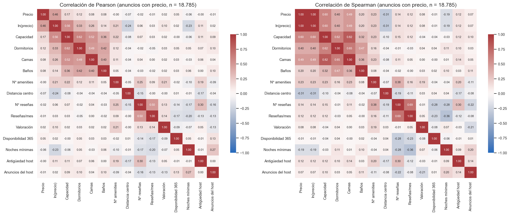
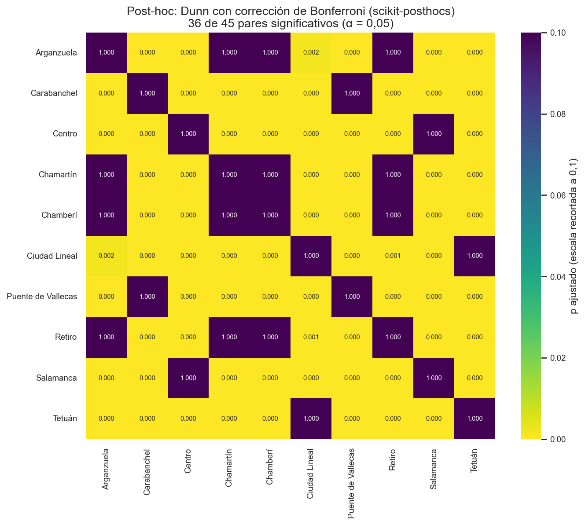
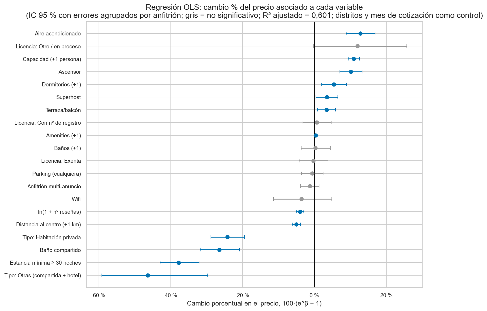
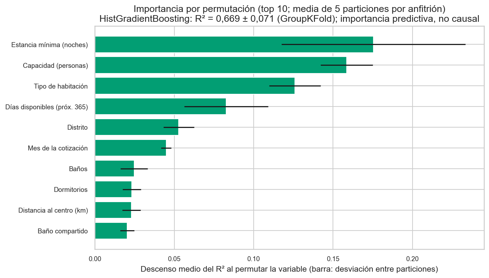

# Informe: mercado de alquiler turístico de Airbnb en Madrid

**Autor:** Diego Hernández Pellegrini (GitHub [diegopellegrini1](https://github.com/diegopellegrini1)) · **Datos:** Inside Airbnb, snapshot <!--f:meta.fecha_snapshot_url:fecha-->2026-09-17<!--/f--> · **Documento generado** desde `reports/findings.json` por `run_pipeline.py`.

> **Cómo se generan y qué se verifica.** Todas las cifras de este informe se insertan automáticamente desde [findings.json](findings.json). `scripts/verificar_consistencia.py` comprueba que el documento **reproduce** findings.json (cada cifra marcada coincide con su valor, el texto se vuelve a generar idéntico, no hay enlaces rotos ni números escritos a mano en la plantilla). Es una comprobación de **transcripción**: no demuestra que las interpretaciones sean ciertas. Si se ejecuta el pipeline con otro snapshot, las cifras se recalculan y las frases que dependen del sentido de un resultado se evalúan por código: si falla una invariante estructural (por ejemplo, que la moneda sea EUR) el pipeline se detiene; si deja de cumplirse una afirmación interpretativa, el texto usa una redacción alternativa o muestra un aviso visible junto a la frase.

## 1. Introducción y objetivo

El objetivo es describir **con qué se asocia el precio por noche** de los anuncios de Airbnb en Madrid y **cómo está estructurada la oferta** (tipos de alojamiento, zonas, anfitriones con uno o con muchos anuncios), y convertirlo en una herramienta operativa: un dashboard con filtros y un comparador de anuncios similares.

Preguntas de trabajo:

- ¿Cómo se distribuye el precio y qué tan asimétrico es?
- ¿Cuánto cambia el precio según el tipo de habitación, el distrito y la capacidad?
- ¿Tienen precios más altos los superhosts? ¿Se mantiene la diferencia al controlar por otras variables?
- ¿Qué peso tienen los anfitriones con muchos anuncios?
- ¿Qué variables se asocian con el precio en un modelo multivariante, y cuánto se puede predecir para anfitriones no vistos?

El análisis es **observacional**: describe asociaciones, no efectos causales.

## 2. Datos y fuente

- **Fuente:** [Inside Airbnb](https://insideairbnb.com/get-the-data/), ficheros `listings.csv.gz`, `neighbourhoods.csv` y `neighbourhoods.geojson` de Madrid.
- **Fecha:** el snapshot publicado lleva la fecha <!--f:meta.fecha_snapshot_url:fecha-->2026-09-17<!--/f--> (es la fecha de la URL); los anuncios se scrapearon entre el <!--f:meta.last_scraped_min:fecha-->2026-09-19<!--/f--> y el <!--f:meta.last_scraped_max:fecha-->2026-09-22<!--/f--> (`last_scraped`). La fecha de referencia para calcular antigüedades es <!--f:meta.fecha_referencia:fecha-->2026-09-22<!--/f-->.
- **Licencia:** Creative Commons Attribution 4.0 International (CC BY 4.0), verificada en la página de descargas el <!--f:dataset.licencia.fecha_verificacion:fecha-->2026-10-25<!--/f-->. Los datos se han transformado (limpieza y variables derivadas).
- **Volumen:** <!--f:dataset.filas_raw:n0-->23.109<!--/f--> anuncios × <!--f:dataset.columnas_raw:n0-->90<!--/f--> columnas, <!--f:dataset.n_distritos:n0-->21<!--/f--> distritos, <!--f:dataset.n_barrios:n0-->128<!--/f--> barrios y <!--f:dataset.n_hosts:n0-->8.704<!--/f--> anfitriones.
- **Tipos de variable** (clasificación por código del fichero original): <!--f:dataset.tipos_raw.numerico:n0-->54<!--/f--> numéricas, <!--f:dataset.tipos_raw.categorico:n0-->4<!--/f--> categóricas, <!--f:dataset.tipos_raw.booleano:n0-->4<!--/f--> booleanas, <!--f:dataset.tipos_raw.fecha:n0-->6<!--/f--> de fecha, <!--f:dataset.tipos_raw.texto:n0-->10<!--/f--> de texto libre, <!--f:dataset.tipos_raw.geoespacial:n0-->2<!--/f--> geoespaciales y <!--f:dataset.tipos_raw.identificador:n0-->10<!--/f--> identificadores. Cumple los umbrales propios del proyecto (al menos <!--f:meta.parametros.umbral_filas:n0-->1.000<!--/f--> filas, <!--f:meta.parametros.umbral_columnas:n0-->20<!--/f--> columnas y los cinco tipos de variable).
- **Moneda.** `price` viene como texto con símbolo `$`, pero el <!--f:moneda.pct_moneda:pct1-->100,0 %<!--/f--> de las <!--f:moneda.n_cotizaciones_con_moneda:n0-->18.539<!--/f--> cotizaciones con moneda indica EUR, así que el símbolo es un artefacto y se trabaja en euros.
- **Qué es exactamente el precio.** `price` coincide con el precio por noche de la cotización (`price_quote_price_per_night`) en el <!--f:precio_naturaleza.pct_precio_igual_cotizacion:pct1-->100,0 %<!--/f--> de los casos comparables, con fechas de entrada entre el <!--f:precio_naturaleza.checkin_min:fecha-->2026-09-19<!--/f--> y el <!--f:precio_naturaleza.checkin_max:fecha-->2027-09-18<!--/f-->. **Es el precio por noche de una cotización concreta, ya con los descuentos aplicables (semanal, mensual, de última hora…) y sin tasas de limpieza ni de servicio**: el subtotal de las noches tras descuentos dividido entre las noches cotizadas. Calculado por código desde `price_quote_raw`, el <!--f:precio_naturaleza.pct_con_descuento:pct1-->20,3 %<!--/f--> de las <!--f:precio_naturaleza.n_cotizaciones_con_precio:n0-->18.785<!--/f--> cotizaciones con precio incluye algún descuento (mediana del descuento: <!--f:precio_naturaleza.mediana_pct_descuento:pct1-->9,9 %<!--/f--> del subtotal). Las partidas de descuento más frecuentes son `Last-minute discount` (<!--f:precio_naturaleza.partidas_descuento.Last-minute discount:n0-->1.202<!--/f-->), `Monthly stay discount` (<!--f:precio_naturaleza.partidas_descuento.Monthly stay discount:n0-->1.119<!--/f-->), `Special offer` (<!--f:precio_naturaleza.partidas_descuento.Special offer:n0-->551<!--/f-->), `Weekly stay discount` (<!--f:precio_naturaleza.partidas_descuento.Weekly stay discount:n0-->501<!--/f-->), `Long stay discount` (<!--f:precio_naturaleza.partidas_descuento.Long stay discount:n0-->325<!--/f-->), `Early booking discount` (<!--f:precio_naturaleza.partidas_descuento.Early booking discount:n0-->127<!--/f-->). La estancia cotizada coincide con la estancia mínima del anuncio en el <!--f:precio_naturaleza.pct_noches_igual_minimo:pct1-->75,0 %<!--/f--> de los <!--f:precio_naturaleza.n_noches_comparables:n0-->17.284<!--/f--> casos comparables, y el <!--f:precio_naturaleza.pct_tarifa_mensual:pct1-->14,1 %<!--/f--> de las cotizaciones usa tarifa mensual (el <!--f:precio_naturaleza.pct_mensual_entre_min30:pct1-->88,9 %<!--/f--> de los <!--f:precio_naturaleza.n_min30:n0-->2.325<!--/f--> anuncios con estancia mínima de al menos <!--f:meta.parametros.min_nights_larga_estancia:n0-->30<!--/f--> noches): en esos casos el precio por noche es una tarifa mensual repartida entre las noches. Por eso el análisis incluye una **sensibilidad sin estancias mínimas de <!--f:meta.parametros.min_nights_larga_estancia:n0-->30<!--/f--> noches o más ni tarifas mensuales**.

## 3. Metodología

### Limpieza y transformación

El orden es: perfilar → convertir tipos → derivar → eliminar columnas → reglas de calidad. El detalle completo está en [calidad_datos.json](calidad_datos.json) y el diccionario de columnas en [diccionario_datos.md](diccionario_datos.md).

- **Conversiones:** precio de texto a número con validación del formato completo (signo conservado; lo que no encaja, como una coma decimal o texto, se marca como no convertible y se cuenta), booleanos `t/f` a `bool`, fechas ISO a `datetime64`, porcentajes de texto a número (las tasas de respuesta vienen vacías en este snapshot), `bathrooms_text` a número de baños más un indicador de baño compartido, y `amenities` a número de amenities y <!--f:features.n_flags_amenities:n0-->13<!--/f--> indicadores. Los indicadores se calculan **elemento a elemento sobre la lista JSON** (no sobre el texto crudo), con patrones que resuelven los casos ambiguos vistos en el snapshot: «HDTV» cuenta como televisión, «Dishwasher» no cuenta como lavadora y «Pool table» no cuenta como piscina; cada patrón tiene un rango de prevalencia plausible y el pipeline se detiene si sale de él. <!--f:limpieza.amenities_malformadas:n0-->0<!--/f--> listas tenían JSON malformado (el parser tiene plan B por expresión regular).
- **Columnas eliminadas:** <!--f:limpieza.n_columnas_eliminadas:n0-->27<!--/f-->, cada una con su motivo: <!--f:calidad.n_columnas_100_nulas:n0-->13<!--/f--> venían completamente vacías en este snapshot (entre ellas `host_since`, `host_response_rate` e `instant_bookable`), además de URLs, identificadores técnicos, datos personales innecesarios (nombre y ubicación declarada del anfitrión) y textos largos sustituidos por métricas de longitud. Se conserva `host_id` porque es imprescindible para agrupar los anuncios de un mismo anfitrión. Se crearon <!--f:limpieza.n_columnas_derivadas:n0-->49<!--/f--> columnas nuevas. El resultado tiene <!--f:dataset.filas_procesadas:n0-->23.109<!--/f--> filas × <!--f:dataset.columnas_procesadas:n0-->112<!--/f--> columnas y se guarda en Parquet.
- **Duplicados:** <!--f:limpieza.duplicados.por_id:n0-->0<!--/f--> por `id` y <!--f:limpieza.duplicados.filas_completas:n0-->0<!--/f--> filas completas repetidas; no se eliminó ninguna fila sin contabilizarla.
- **Nulos:** cada columna con nulos tiene una regla documentada (política declarativa en `src/limpieza.py`). Las puntuaciones de reseñas se dejan vacías (no tener reseñas no es puntuar cero). Para los descriptivos y el OLS se imputan `bedrooms` (<!--f:limpieza.imputados.bedrooms:n0-->12<!--/f--> filas) y `beds` (<!--f:limpieza.imputados.beds:n0-->574<!--/f--> filas) con la mediana por tipo de habitación y capacidad, con indicador de imputación; en el modelo predictivo esa imputación se vuelve a aprender dentro del Pipeline solo con los datos de entrenamiento.
- **Precio:** <!--f:limpieza.precio.nulo:n0-->4.324<!--/f--> anuncios (<!--f:limpieza.precio.pct_nulo:pct1-->18,7 %<!--/f-->) no tienen precio, <!--f:limpieza.precio.cero:n0-->0<!--/f--> tienen precio cero y <!--f:limpieza.precio.negativo:n0-->0<!--/f--> negativo. No se imputa el precio porque es la variable objetivo. El <!--f:limpieza.precio.pct_nulos_sin_disponibilidad:pct1-->75,6 %<!--/f--> de los precios nulos corresponde a anuncios sin ningún día disponible en el año, así que los nulos no son aleatorios.
- **Outliers:** vallas de Tukey (k = <!--f:limpieza.outliers.k:n1-->1,5<!--/f-->) sobre el logaritmo del precio, porque la escala original es muy asimétrica. Valla inferior <!--f:limpieza.outliers.valla_inf:eur2-->26,46 €<!--/f--> y superior <!--f:limpieza.outliers.valla_sup:eur2-->809,80 €<!--/f-->: <!--f:limpieza.outliers.n_bajo:n0-->320<!--/f--> anuncios por debajo y <!--f:limpieza.outliers.n_alto:n0-->289<!--/f--> por encima, <!--f:limpieza.outliers.n_total:n0-->609<!--/f--> en total (<!--f:limpieza.outliers.pct_total:pct1-->3,2 %<!--/f--> de los anuncios con precio). **No se borran:** se marcan con `es_outlier_precio`. Los contrastes no paramétricos, el bootstrap y el modelo predictivo usan todos los precios; la regresión los excluye y repite el ajuste con ellos como análisis de sensibilidad.
- **Estancias mínimas:** <!--f:limpieza.minimum_nights.extremo_mayor_365:n0-->8<!--/f--> anuncios exigen más de <!--f:meta.parametros.min_nights_extremo:n0-->365<!--/f--> noches (máximo <!--f:limpieza.minimum_nights.max:n0-->1.125<!--/f-->) y <!--f:limpieza.minimum_nights.larga_estancia_30_o_mas:n0-->3.151<!--/f--> exigen al menos <!--f:meta.parametros.min_nights_larga_estancia:n0-->30<!--/f-->; se marcan, no se modifican.
- **Coordenadas:** <!--f:limpieza.coordenadas.fuera_bbox_o_nulas:n0-->0<!--/f--> anuncios quedan fuera del rectángulo de validación de Madrid.

### Variables derivadas

Precio por persona, logaritmo del precio, antigüedad del anfitrión (fuente: hosts_time_as_host_years + hosts_time_as_host_months / 12 (host_since 100 % nulo)), **porcentaje de días no disponibles en el próximo año** `(365 − availability_365) / 365` (no es ocupación: mezcla reservas y bloqueos del anfitrión), indicador de anuncio activo probable (descarta los que no tienen disponibilidad ni reseñas en el último año), **ingreso anual hipotético** `price × (365 − availability_365)` (un proxy, no un ingreso observado), **mes de la cotización** (mes de la fecha de entrada; los meses con menos de <!--f:meta.parametros.min_n_categoria_rara:n0-->200<!--/f--> anuncios con precio se agrupan en «Otros meses»), indicador de tarifa mensual, distancia haversine a la Puerta del Sol, categoría de precio por cuartiles (cortes en <!--f:features.cortes_categoria_precio.1:eur2-->95,45 €<!--/f-->, <!--f:features.cortes_categoria_precio.2:eur2-->151,00 €<!--/f--> y <!--f:features.cortes_categoria_precio.3:eur2-->224,50 €<!--/f-->), tramos de capacidad, segmento del anfitrión según su número de anuncios, tipo de licencia, indicadores de amenities y tipo de habitación agrupado: las categorías con menos de <!--f:meta.parametros.min_n_categoria_rara:n0-->200<!--/f--> anuncios con precio (habitación compartida y de hotel) se agrupan en «Otras (compartida + hotel)» para los contrastes, el bootstrap y la regresión.

### Análisis estadístico

Nivel de significación α = <!--f:meta.alfa:n2-->0,05<!--/f--> en todos los contrastes. Para cada uno se declaran H0 y H1 antes de ejecutarlo, se comprueban los supuestos y se informa el tamaño del efecto, porque con miles de observaciones casi cualquier diferencia es «significativa». Los grupos con menos de <!--f:meta.parametros.min_n_grupo:n0-->30<!--/f--> anuncios con precio se excluyen de la inferencia y de los rankings. Semilla fija <!--f:meta.semilla:n0-->42<!--/f--> para muestreos, bootstrap y modelo.

- **Dependencia entre anuncios del mismo anfitrión.** Un anfitrión puede tener cientos de anuncios casi iguales, así que las observaciones no son independientes. Se trata de tres formas: errores agrupados por anfitrión en la regresión; intervalos bootstrap que remuestrean **anfitriones** (no anuncios); y una sensibilidad con **un anuncio por anfitrión** para todos los contrastes (Mann-Whitney, los dos Kruskal-Wallis, el post-hoc de distritos y los tres chi-cuadrado). Los p-valores de los contrastes no paramétricos y de chi-cuadrado son **inferencia a nivel anuncio y pueden ser anticonservadores**; por eso se leen junto a esa sensibilidad.
- **Multiplicidad.** Se evalúan unas <!--f:estadistica.multiplicidad.n_hipotesis_total:n0-->100<!--/f--> hipótesis: <!--f:estadistica.multiplicidad.n_contrastes_principales:n0-->6<!--/f--> contrastes principales, <!--f:estadistica.multiplicidad.n_pares_posthoc:n0-->48<!--/f--> comparaciones por pares (corregidas con Bonferroni) y <!--f:estadistica.multiplicidad.n_coeficientes_ols:n0-->46<!--/f--> coeficientes del OLS. <!--f:estadistica.multiplicidad.n_principales_p_menor_0001:n0-->6<!--/f--> de los <!--f:estadistica.multiplicidad.n_contrastes_principales:n0-->6<!--/f--> contrastes principales tienen un p-valor inferior a una milésima, así que ninguna corrección cambiaría su decisión. En el OLS, <!--f:estadistica.multiplicidad.n_significativos_ols:n0-->27<!--/f--> de los <!--f:estadistica.multiplicidad.n_coeficientes_ols:n0-->46<!--/f--> coeficientes son significativos con α y <!--f:estadistica.multiplicidad.n_significativos_ols_holm:n0-->24<!--/f--> lo siguen siendo tras la corrección de Holm (columna «p Holm» de la tabla).

## 4. Hallazgos descriptivos

**Precio.** Sobre <!--f:descriptivo.precio.n:n0-->18.785<!--/f--> anuncios con precio, la mediana es <!--f:descriptivo.precio.mediana:eur2-->151,00 €<!--/f--> y la media <!--f:descriptivo.precio.media:eur2-->208,63 €<!--/f--> (desviación típica <!--f:descriptivo.precio.std:eur2-->543,63 €<!--/f-->). El rango intercuartílico va de <!--f:descriptivo.precio.q1:eur2-->95,45 €<!--/f--> a <!--f:descriptivo.precio.q3:eur2-->224,50 €<!--/f--> (IQR = <!--f:descriptivo.precio.iqr:eur2-->129,05 €<!--/f-->). La distribución es muy asimétrica a la derecha (asimetría <!--f:descriptivo.precio.asimetria:n2-->31,54<!--/f-->, curtosis de exceso <!--f:descriptivo.precio.curtosis_exceso:n1-->1.469,9<!--/f-->), con un máximo de <!--f:descriptivo.precio.max:eur0-->36.883 €<!--/f-->. Sin outliers, la media baja a <!--f:descriptivo.precio_sin_outliers.media:eur2-->178,61 €<!--/f--> y la mediana queda en <!--f:descriptivo.precio_sin_outliers.mediana:eur2-->151,00 €<!--/f-->. En escala logarítmica la asimetría es <!--f:descriptivo.log_precio.asimetria:n2-->0,21<!--/f-->, por eso la regresión modela `ln(precio)`. **Sin estancias mínimas de <!--f:meta.parametros.min_nights_larga_estancia:n0-->30<!--/f--> noches o más ni tarifas mensuales** (se excluyen <!--f:descriptivo.sin_mensuales.n_excluidos:n0-->2.905<!--/f--> anuncios, el <!--f:descriptivo.sin_mensuales.pct_excluidos:pct1-->15,5 %<!--/f-->), la mediana pasa a <!--f:descriptivo.sin_mensuales.precio.mediana:eur2-->161,78 €<!--/f--> y la media a <!--f:descriptivo.sin_mensuales.precio.media:eur2-->225,21 €<!--/f-->.

**Tipo de habitación.**

| Tipo | Anuncios con precio | Mediana | Media | Q1 | Q3 |
|---|---|---|---|---|---|
| Alojamiento entero | <!--f:descriptivo.por_tipo.0.n:n0-->13.561<!--/f--> | <!--f:descriptivo.por_tipo.0.mediana:eur2-->173,63 €<!--/f--> | <!--f:descriptivo.por_tipo.0.media:eur2-->234,55 €<!--/f--> | <!--f:descriptivo.por_tipo.0.q1:eur2-->127,50 €<!--/f--> | <!--f:descriptivo.por_tipo.0.q3:eur2-->247,95 €<!--/f--> |
| Habitación de hotel | <!--f:descriptivo.por_tipo.1.n:n0-->29<!--/f--> | <!--f:descriptivo.por_tipo.1.mediana:eur2-->162,00 €<!--/f--> | <!--f:descriptivo.por_tipo.1.media:eur2-->174,34 €<!--/f--> | <!--f:descriptivo.por_tipo.1.q1:eur2-->127,00 €<!--/f--> | <!--f:descriptivo.por_tipo.1.q3:eur2-->201,00 €<!--/f--> |
| Habitación privada | <!--f:descriptivo.por_tipo.2.n:n0-->5.059<!--/f--> | <!--f:descriptivo.por_tipo.2.mediana:eur2-->74,00 €<!--/f--> | <!--f:descriptivo.por_tipo.2.media:eur2-->142,95 €<!--/f--> | <!--f:descriptivo.por_tipo.2.q1:eur2-->47,00 €<!--/f--> | <!--f:descriptivo.por_tipo.2.q3:eur2-->128,00 €<!--/f--> |
| Habitación compartida | <!--f:descriptivo.por_tipo.3.n:n0-->136<!--/f--> | <!--f:descriptivo.por_tipo.3.mediana:eur2-->27,00 €<!--/f--> | <!--f:descriptivo.por_tipo.3.media:eur2-->74,81 €<!--/f--> | <!--f:descriptivo.por_tipo.3.q1:eur2-->24,00 €<!--/f--> | <!--f:descriptivo.por_tipo.3.q3:eur2-->40,00 €<!--/f--> |

**Distritos y barrios.** Entre los distritos con al menos <!--f:descriptivo.distritos_n_min:n0-->30<!--/f--> anuncios con precio (en este snapshot lo cumplen todos), el de mediana más alta es Salamanca (<!--f:descriptivo.por_distrito.0.mediana:eur2-->188,34 €<!--/f-->, n = <!--f:descriptivo.por_distrito.0.n:n0-->1.314<!--/f-->), seguido de Centro (<!--f:descriptivo.por_distrito.1.mediana:eur2-->180,00 €<!--/f-->, n = <!--f:descriptivo.por_distrito.1.n:n0-->7.866<!--/f-->); el de mediana más baja es Moratalaz (<!--f:descriptivo.distrito_mas_barato.mediana:eur2-->58,00 €<!--/f-->, n = <!--f:descriptivo.distrito_mas_barato.n:n0-->103<!--/f-->). Los dos primeros están **empatados estadísticamente**: en el post-hoc de Dunn con Bonferroni su p ajustado es <!--f:estadistica.top_distritos_empate.p_ajustado:n3-->1,000<!--/f--> y sus intervalos bootstrap por anfitrión se solapan, así que el orden entre ellos no es distinguible. Entre los <!--f:descriptivo.n_barrios_con_n_min:n0-->96<!--/f--> barrios con al menos <!--f:descriptivo.barrios_n_min:n0-->30<!--/f--> anuncios con precio, el de mediana más alta es Recoletos (<!--f:estadistica.bootstrap.barrios_extremos.0.mediana:eur2-->240,00 €<!--/f-->, n = <!--f:estadistica.bootstrap.barrios_extremos.0.n:n0-->263<!--/f-->; IC 95 % por anfitrión <!--f:estadistica.bootstrap.barrios_extremos.0.ic_inf_cluster:eur2-->204,00 €<!--/f--> – <!--f:estadistica.bootstrap.barrios_extremos.0.ic_sup_cluster:eur2-->287,41 €<!--/f-->) y el de mediana más baja Portazgo (<!--f:estadistica.bootstrap.barrios_extremos.2.mediana:eur2-->57,71 €<!--/f-->, n = <!--f:estadistica.bootstrap.barrios_extremos.2.n:n0-->33<!--/f-->; IC <!--f:estadistica.bootstrap.barrios_extremos.2.ic_inf_cluster:eur2-->44,00 €<!--/f--> – <!--f:estadistica.bootstrap.barrios_extremos.2.ic_sup_cluster:eur2-->80,90 €<!--/f-->). Con muestras tan pequeñas, el orden frente al segundo barrio (Jerónimos y Fontarrón, respectivamente) **no es estadísticamente distinguible**: sus intervalos se solapan. El mapa muestra que los precios más altos se concentran en los barrios centrales; en la regresión, el precio se asocia negativamente con la distancia al centro.

**Capacidad.** La mediana crece con la capacidad: 1-2 personas, <!--f:descriptivo.por_capacidad.0.mediana:eur2-->101,20 €<!--/f--> (n = <!--f:descriptivo.por_capacidad.0.n:n0-->8.524<!--/f-->); 3-4 personas, <!--f:descriptivo.por_capacidad.1.mediana:eur2-->168,21 €<!--/f--> (n = <!--f:descriptivo.por_capacidad.1.n:n0-->6.854<!--/f-->); 5-6 personas, <!--f:descriptivo.por_capacidad.2.mediana:eur2-->225,50 €<!--/f--> (n = <!--f:descriptivo.por_capacidad.2.n:n0-->2.490<!--/f-->); 7 o más, <!--f:descriptivo.por_capacidad.3.mediana:eur2-->368,85 €<!--/f--> (n = <!--f:descriptivo.por_capacidad.3.n:n0-->917<!--/f-->).

**Fecha de la cotización (temporada).** Cada anuncio se cotiza para su primera ventana de fechas reservable, así que el precio mezcla temporadas. El <!--f:descriptivo.mes_cotizacion.pct_primeros_dos_meses:pct1-->76,8 %<!--/f--> de las cotizaciones entra en los dos primeros meses, y la mediana mensual va de <!--f:descriptivo.mes_cotizacion.mes_mediana_min.mediana:eur2-->74,50 €<!--/f--> (2027-08, n = <!--f:descriptivo.mes_cotizacion.mes_mediana_min.n:n0-->87<!--/f-->) a <!--f:descriptivo.mes_cotizacion.mes_mediana_max.mediana:eur2-->174,00 €<!--/f--> (2026-10, n = <!--f:descriptivo.mes_cotizacion.mes_mediana_max.n:n0-->4.800<!--/f-->) entre los meses con al menos <!--f:meta.parametros.min_n_grupo:n0-->30<!--/f--> anuncios. Los meses lejanos tienen pocos anuncios y muchos son de estancia larga, por lo que su mediana mezcla temporada y tipo de estancia. Por eso la regresión y el modelo predictivo incluyen el mes de la cotización como control.

| Mes de entrada | Anuncios con precio | Mediana |
|---|---|---|
| 2026-09 | <!--f:descriptivo.mes_cotizacion.meses.0.n:n0-->9.623<!--/f--> | <!--f:descriptivo.mes_cotizacion.meses.0.mediana:eur2-->159,00 €<!--/f--> |
| 2026-10 | <!--f:descriptivo.mes_cotizacion.meses.1.n:n0-->4.800<!--/f--> | <!--f:descriptivo.mes_cotizacion.meses.1.mediana:eur2-->174,00 €<!--/f--> |
| 2026-11 | <!--f:descriptivo.mes_cotizacion.meses.2.n:n0-->1.813<!--/f--> | <!--f:descriptivo.mes_cotizacion.meses.2.mediana:eur2-->128,50 €<!--/f--> |
| 2026-12 | <!--f:descriptivo.mes_cotizacion.meses.3.n:n0-->972<!--/f--> | <!--f:descriptivo.mes_cotizacion.meses.3.mediana:eur2-->87,53 €<!--/f--> |
| 2027-01 | <!--f:descriptivo.mes_cotizacion.meses.4.n:n0-->588<!--/f--> | <!--f:descriptivo.mes_cotizacion.meses.4.mediana:eur2-->94,01 €<!--/f--> |
| 2027-02 | <!--f:descriptivo.mes_cotizacion.meses.5.n:n0-->208<!--/f--> | <!--f:descriptivo.mes_cotizacion.meses.5.mediana:eur2-->94,89 €<!--/f--> |
| 2027-03 | <!--f:descriptivo.mes_cotizacion.meses.6.n:n0-->103<!--/f--> | <!--f:descriptivo.mes_cotizacion.meses.6.mediana:eur2-->103,30 €<!--/f--> |
| 2027-04 | <!--f:descriptivo.mes_cotizacion.meses.7.n:n0-->83<!--/f--> | <!--f:descriptivo.mes_cotizacion.meses.7.mediana:eur2-->108,27 €<!--/f--> |
| 2027-05 | <!--f:descriptivo.mes_cotizacion.meses.8.n:n0-->180<!--/f--> | <!--f:descriptivo.mes_cotizacion.meses.8.mediana:eur2-->98,91 €<!--/f--> |
| 2027-06 | <!--f:descriptivo.mes_cotizacion.meses.9.n:n0-->165<!--/f--> | <!--f:descriptivo.mes_cotizacion.meses.9.mediana:eur2-->140,50 €<!--/f--> |
| 2027-07 | <!--f:descriptivo.mes_cotizacion.meses.10.n:n0-->139<!--/f--> | <!--f:descriptivo.mes_cotizacion.meses.10.mediana:eur2-->133,84 €<!--/f--> |
| 2027-08 | <!--f:descriptivo.mes_cotizacion.meses.11.n:n0-->87<!--/f--> | <!--f:descriptivo.mes_cotizacion.meses.11.mediana:eur2-->74,50 €<!--/f--> |
| 2027-09 | <!--f:descriptivo.mes_cotizacion.meses.12.n:n0-->24<!--/f--> | <!--f:descriptivo.mes_cotizacion.meses.12.mediana:eur2-->168,00 €<!--/f--> |

**Anfitriones.** Hay <!--f:descriptivo.hosts.n_hosts:n0-->8.704<!--/f--> anfitriones. El <!--f:descriptivo.hosts.pct_hosts_un_anuncio:pct1-->70,3 %<!--/f--> de ellos tiene un solo anuncio, pero el <!--f:descriptivo.hosts.pct_anuncios_multianuncio:pct1-->73,5 %<!--/f--> de los anuncios pertenece a anfitriones con varios. El <!--f:descriptivo.hosts.pct_anuncios_hosts_6_o_mas:pct1-->50,0 %<!--/f--> de los anuncios está en manos de anfitriones con seis o más, y los diez mayores concentran el <!--f:descriptivo.hosts.pct_anuncios_top10_hosts:pct1-->11,1 %<!--/f--> (el mayor tiene <!--f:descriptivo.hosts.anuncios_por_host_max:n0-->469<!--/f-->). Son superhosts el <!--f:descriptivo.hosts.pct_hosts_superhost:pct1-->27,1 %<!--/f--> de los anfitriones y el <!--f:descriptivo.hosts.pct_anuncios_superhost:pct1-->23,8 %<!--/f--> de los anuncios. La oferta está **concentrada** en cuentas con varios anuncios. Tener varios anuncios **no equivale** a gestión profesional: una cuenta con dos pisos puede ser un particular, y el fichero no dice quién es una gestora. Las cuentas con muchos anuncios sí sugieren gestión comercial, pero el dato solo mide concentración.

**Días no disponibles e ingreso hipotético (no son ocupación ni ingresos reales).** Entre los <!--f:descriptivo.ocupacion_ingresos.n_comparacion_ocupacion:n0-->18.757<!--/f--> anuncios activos con precio, el **porcentaje de días no disponibles en el próximo año** tiene una media del <!--f:descriptivo.ocupacion_ingresos.no_disponible_media:pct1-->48,6 %<!--/f-->, frente a una ocupación media del <!--f:descriptivo.ocupacion_ingresos.ocupacion_inside_airbnb_media:pct1-->31,6 %<!--/f--> que estima Inside Airbnb para los **últimos doce meses** a partir de reseñas (ρ de Spearman entre ambas = <!--f:descriptivo.ocupacion_ingresos.spearman_ocupacion:n2-->0,32<!--/f-->). Las dos medidas **no cubren el mismo periodo** (una mira al futuro y otra al pasado) y la propia cuenta como «no disponibles» también los días bloqueados por el anfitrión, así que la diferencia mezcla ventana temporal y bloqueos. El ingreso hipotético propio multiplica el precio de **una sola cotización** por esos días: no es un ingreso observado ni una cota en ninguna dirección (los bloqueos lo inflan, pero el precio cobrado en otras fechas puede ser mayor o menor). Sobre los mismos <!--f:descriptivo.ocupacion_ingresos.n_comparacion_ingresos:n0-->18.757<!--/f--> anuncios, su mediana es <!--f:descriptivo.ocupacion_ingresos.ingreso_hipotetico_mediana:eur0-->19.503 €<!--/f-->, <!--f:descriptivo.ocupacion_ingresos.cociente_medianas:n2-->1,57<!--/f--> veces la mediana de Inside Airbnb (<!--f:descriptivo.ocupacion_ingresos.ingresos_inside_airbnb_mediana:eur0-->12.432 €<!--/f-->), con una correlación de Spearman de <!--f:descriptivo.ocupacion_ingresos.spearman_propio_vs_inside:n2-->0,47<!--/f-->.

**Amenities.** Las más frecuentes son wifi (<!--f:descriptivo.amenities.0.prevalencia_pct:pct1-->96,8 %<!--/f-->), cocina (<!--f:descriptivo.amenities.1.prevalencia_pct:pct1-->88,7 %<!--/f-->), tv (<!--f:descriptivo.amenities.2.prevalencia_pct:pct1-->86,7 %<!--/f-->). Las diferencias de mediana entre anuncios con y sin cada amenity son asociaciones brutas y pueden reflejar diferencias de tipo de alojamiento o de zona.

**Correlaciones.** La variable más correlacionada con el precio es `accommodates` (ρ de Spearman = <!--f:descriptivo.correlaciones.con_precio.0.spearman:n2-->0,60<!--/f-->; Pearson con `ln(precio)` = <!--f:descriptivo.correlaciones.con_precio.0.pearson_log:n2-->0,56<!--/f-->), seguida de `beds` (<!--f:descriptivo.correlaciones.con_precio.1.spearman:n2-->0,49<!--/f-->) y `bedrooms` (<!--f:descriptivo.correlaciones.con_precio.2.spearman:n2-->0,40<!--/f-->). La distancia al centro tiene ρ = <!--f:descriptivo.correlaciones.con_precio_por_variable.distancia_centro_km.spearman:n2-->-0,31<!--/f-->. Pearson sobre el precio en escala original es mucho menor que Spearman porque los valores extremos dominan la covarianza: un motivo más para usar rangos o logaritmos.

## 5. Hallazgos estadísticos

### Normalidad del precio

- **H0:** La variable procede de una distribución normal.
- **H1:** La variable no procede de una distribución normal.
- **Resultado:** estadístico = <!--f:estadistica.normalidad_precio.estadistico:n2-->49.774,06<!--/f-->, <!--f:estadistica.normalidad_precio.p_valor:p-->p < 0,001<!--/f-->; asimetría y curtosis = <!--f:estadistica.normalidad_precio.tamano_efecto.valor:n3-->31,540<!--/f--> (efecto grande).
- **Conclusión:** Se rechaza H0 (p < α) con un efecto grande. El precio no es normal (asimetría 31,54, curtosis de exceso 1.469,92). Con n tan grande el test rechaza incluso desviaciones leves; la decisión de usar contrastes no paramétricos se apoya también en la asimetría y en los gráficos Q-Q.
- **Supuestos y detalle:** Shapiro-Wilk sobre una muestra aleatoria de <!--f:estadistica.normalidad_precio.supuestos.n_muestra_shapiro:n0-->5.000<!--/f--> precios (W = <!--f:estadistica.normalidad_precio.extra.shapiro_w:n3-->0,100<!--/f-->, <!--f:estadistica.normalidad_precio.extra.shapiro_p:p-->p < 0,001<!--/f-->) y D'Agostino-K² sobre todos. Para `ln(precio)` también se rechaza (K² = <!--f:estadistica.normalidad_log_precio.estadistico:n1-->1.014,4<!--/f-->, <!--f:estadistica.normalidad_log_precio.p_valor:p-->p < 0,001<!--/f-->), aunque su asimetría es solo <!--f:estadistica.normalidad_log_precio.tamano_efecto.valor:n2-->0,21<!--/f-->. **Decisión:** contrastes no paramétricos (Mann-Whitney, Kruskal-Wallis) para comparar grupos, y regresión sobre `ln(precio)` con errores robustos.

### Superhosts frente a no superhosts (Mann-Whitney U)

- **H0:** El precio de los anuncios de superhosts y de no superhosts tiene la misma distribución (P(X_superhost > X_no) = 0,5).
- **H1:** Las distribuciones difieren (contraste bilateral).
- **Resultado:** estadístico = <!--f:estadistica.mann_whitney_superhost.estadistico:n2-->38.271.719,00<!--/f-->, <!--f:estadistica.mann_whitney_superhost.p_valor:p-->p < 0,001<!--/f-->; correlación rank-biserial = <!--f:estadistica.mann_whitney_superhost.tamano_efecto.valor:n4-->0,0997<!--/f--> (efecto despreciable).
- **Conclusión:** Se rechaza H0 (p < α): resultado estadísticamente significativo pero con efecto despreciable, sin relevancia práctica. Los anuncios de superhosts tienden a tener precios más altos (mediana de superhosts: 163,50 €; de no superhosts: 147,00 €). Es una asociación bruta, sin controlar por ubicación ni tipo.
- **Detalle:** n = <!--f:estadistica.mann_whitney_superhost.n.superhosts:n0-->5.078<!--/f--> y <!--f:estadistica.mann_whitney_superhost.n.no superhosts:n0-->13.707<!--/f-->; probabilidad de superioridad (CLES) = <!--f:estadistica.mann_whitney_superhost.tamano_efecto.cles:n3-->0,550<!--/f-->. La correlación rank-biserial (<!--f:estadistica.mann_whitney_superhost.tamano_efecto.valor:n4-->0,0997<!--/f-->) queda justo por debajo del umbral convencional de <!--f:estadistica.umbrales_efecto.rank_biserial.0:n1-->0,1<!--/f--> que separa un efecto despreciable de uno pequeño: es una diferencia en el límite de lo despreciable, no una ausencia de diferencia. Con **un anuncio por anfitrión** (n = <!--f:estadistica.sensibilidad_un_anuncio_por_host.n:n0-->6.546<!--/f-->) la correlación rank-biserial es <!--f:estadistica.sensibilidad_un_anuncio_por_host.mann_whitney_superhost.tamano_efecto.valor:n3-->0,080<!--/f--> (<!--f:estadistica.sensibilidad_un_anuncio_por_host.mann_whitney_superhost.p_valor:p-->p < 0,001<!--/f-->).
- **Al controlar en la regresión:** el coeficiente de superhost es <!--f:estadistica.ols.coef_superhost.pct:signo_pct-->+3,4 %<!--/f--> (IC 95 % con errores agrupados por anfitrión <!--f:estadistica.ols.coef_superhost.ic_inf_pct:signo_pct-->+0,5 %<!--/f--> a <!--f:estadistica.ols.coef_superhost.ic_sup_pct:signo_pct-->+6,5 %<!--/f-->, <!--f:estadistica.ols.coef_superhost.p_cluster:p-->p = 0,024<!--/f-->). Es significativo a nivel individual, pero **la evidencia es débil**: tras la corrección de Holm deja de serlo (p = <!--f:estadistica.ols.coef_superhost.p_holm:n3-->0,497<!--/f-->) y, sin el control de mes de cotización, el coeficiente es <!--f:estadistica.ols.sensibilidad_sin_mes.coeficientes.host_is_superhost.pct_alternativo:signo_pct-->+2,5 %<!--/f--> con un IC de <!--f:estadistica.ols.sensibilidad_sin_mes.coeficientes.host_is_superhost.ic_inf_alternativo:signo_pct-->-0,5 %<!--/f--> a <!--f:estadistica.ols.sensibilidad_sin_mes.coeficientes.host_is_superhost.ic_sup_alternativo:signo_pct-->+5,7 %<!--/f--> (<!--f:estadistica.ols.sensibilidad_sin_mes.coeficientes.host_is_superhost.p_alternativo:p-->p = 0,107<!--/f-->). Conclusión prudente: **no hay evidencia robusta de una prima por superhost al controlar; si existe, es pequeña** (del orden de unos pocos puntos porcentuales). Con errores HC3, que ignoran la dependencia entre anuncios del mismo anfitrión, el p-valor sería <!--f:estadistica.ols.coef_superhost.p_hc3:p-->p < 0,001<!--/f-->; como esa dependencia es real, se da por buena la versión agrupada. La diferencia bruta parece reflejar sobre todo qué tipo de alojamiento y en qué zonas anuncian los superhosts.

### Precio por tipo de habitación (Kruskal-Wallis)

- **H0:** La distribución del precio es la misma en todos los tipos de habitación.
- **H1:** Al menos un tipo de habitación tiene una distribución de precio distinta.
- **Resultado:** estadístico = <!--f:estadistica.kruskal_tipo.estadistico:n2-->4.403,95<!--/f-->, <!--f:estadistica.kruskal_tipo.p_valor:p-->p < 0,001<!--/f-->; épsilon cuadrado = <!--f:estadistica.kruskal_tipo.tamano_efecto.valor:n3-->0,234<!--/f--> (efecto grande).
- **Conclusión:** Se rechaza H0 (p < α) con un efecto grande. El precio difiere entre tipos de habitación: la mediana más alta es la de Alojamiento entero y la más baja la de Otras (compartida + hotel).
- **Detalle:** grupos: Alojamiento entero (n = <!--f:estadistica.kruskal_tipo.n.Alojamiento entero:n0-->13.561<!--/f-->), Habitación privada (n = <!--f:estadistica.kruskal_tipo.n.Habitación privada:n0-->5.059<!--/f-->), Otras (compartida + hotel) (n = <!--f:estadistica.kruskal_tipo.n.Otras (compartida + hotel):n0-->165<!--/f-->). Post-hoc (Dunn con corrección de Bonferroni (scikit-posthocs)): <!--f:estadistica.posthoc_tipo.n_pares_significativos:n0-->3<!--/f--> de <!--f:estadistica.posthoc_tipo.n_pares:n0-->3<!--/f--> pares significativos. Con un anuncio por anfitrión, ε² = <!--f:estadistica.sensibilidad_un_anuncio_por_host.kruskal_tipo.tamano_efecto.valor:n3-->0,277<!--/f--> (<!--f:estadistica.sensibilidad_un_anuncio_por_host.kruskal_tipo.p_valor:p-->p < 0,001<!--/f-->). La habitación compartida y la de hotel se describen aparte porque son pocas: Habitación de hotel con <!--f:estadistica.tipos_solo_descriptivos.0.n:n0-->29<!--/f--> anuncios con precio y mediana <!--f:estadistica.tipos_solo_descriptivos.0.mediana:eur2-->162,00 €<!--/f-->; Habitación compartida con <!--f:estadistica.tipos_solo_descriptivos.1.n:n0-->136<!--/f--> anuncios con precio y mediana <!--f:estadistica.tipos_solo_descriptivos.1.mediana:eur2-->27,00 €<!--/f-->. Agruparlas mezcla dos productos muy distintos, así que la categoría «Otras» solo se interpreta como control.

### Precio por distrito (Kruskal-Wallis)

- **H0:** La distribución del precio es la misma en todos los distritos (n ≥ 30).
- **H1:** Al menos un distrito tiene una distribución de precio distinta.
- **Resultado:** estadístico = <!--f:estadistica.kruskal_distrito.estadistico:n2-->2.296,34<!--/f-->, <!--f:estadistica.kruskal_distrito.p_valor:p-->p < 0,001<!--/f-->; épsilon cuadrado = <!--f:estadistica.kruskal_distrito.tamano_efecto.valor:n3-->0,122<!--/f--> (efecto mediano).
- **Conclusión:** Se rechaza H0 (p < α) con un efecto mediano. El precio difiere entre distritos: la mediana más alta es la de Salamanca y la más baja la de Moratalaz.
- **Detalle:** <!--f:estadistica.kruskal_distrito.supuestos.n_grupos:n0-->21<!--/f--> distritos con al menos <!--f:meta.parametros.min_n_grupo:n0-->30<!--/f--> anuncios con precio. Post-hoc sobre los <!--f:meta.parametros.top_n_distritos:n0-->10<!--/f--> distritos con más anuncios (Dunn con corrección de Bonferroni (scikit-posthocs)): <!--f:estadistica.posthoc_distrito.n_pares_significativos:n0-->36<!--/f--> de <!--f:estadistica.posthoc_distrito.n_pares:n0-->45<!--/f--> pares difieren. Con la misma medida (ε²) y la misma muestra, la diferencia entre tipos de habitación es mayor que la diferencia entre distritos.
- **Sensibilidad con un anuncio por anfitrión:** ε² = <!--f:estadistica.sensibilidad_un_anuncio_por_host.kruskal_distrito.tamano_efecto.valor:n3-->0,147<!--/f--> (<!--f:estadistica.sensibilidad_un_anuncio_por_host.kruskal_distrito.p_valor:p-->p < 0,001<!--/f-->), y el post-hoc mantiene <!--f:estadistica.sensibilidad_un_anuncio_por_host.posthoc_distrito.n_pares_significativos:n0-->27<!--/f--> de <!--f:estadistica.sensibilidad_un_anuncio_por_host.posthoc_distrito.n_pares:n0-->45<!--/f--> pares significativos. Las decisiones de los contrastes principales no cambian, aunque con menos datos hay menos pares de distritos distinguibles.

### Tipo de habitación × superhost (chi-cuadrado)

- **H0:** El tipo de habitación y ser superhost son independientes.
- **H1:** Existe asociación entre tipo de habitación y ser superhost.
- **Resultado:** estadístico = <!--f:estadistica.chi2_tipo_superhost.estadistico:n2-->181,14<!--/f-->, <!--f:estadistica.chi2_tipo_superhost.p_valor:p-->p < 0,001<!--/f-->; V de Cramér = <!--f:estadistica.chi2_tipo_superhost.tamano_efecto.valor:n3-->0,089<!--/f--> (efecto despreciable).
- **Conclusión:** Se rechaza H0 (p < α): resultado estadísticamente significativo pero con efecto despreciable, sin relevancia práctica. Hay asociación entre tipo de habitación y ser superhost (V de Cramér = 0,089).
- **Supuestos:** frecuencia esperada mínima <!--f:estadistica.chi2_tipo_superhost.supuestos.min_esperada:n1-->45,7<!--/f-->; <!--f:estadistica.chi2_tipo_superhost.supuestos.pct_celdas_esperada_menor_5:pct1-->0,0 %<!--/f--> de celdas con esperada menor que cinco. Con un anuncio por anfitrión: V = <!--f:estadistica.sensibilidad_un_anuncio_por_host.chi2_tipo_superhost.tamano_efecto.valor:n3-->0,110<!--/f--> (<!--f:estadistica.sensibilidad_un_anuncio_por_host.chi2_tipo_superhost.p_valor:p-->p < 0,001<!--/f-->).

### Distrito × tipo de habitación (chi-cuadrado)

- **H0:** El distrito y el tipo de habitación son independientes.
- **H1:** Existe asociación entre distrito y tipo de habitación.
- **Resultado:** estadístico = <!--f:estadistica.chi2_distrito_tipo.estadistico:n2-->1.320,26<!--/f-->, <!--f:estadistica.chi2_distrito_tipo.p_valor:p-->p < 0,001<!--/f-->; V de Cramér = <!--f:estadistica.chi2_distrito_tipo.tamano_efecto.valor:n3-->0,169<!--/f--> (efecto pequeño).
- **Conclusión:** Se rechaza H0 (p < α) con un efecto pequeño. Hay asociación entre distrito y tipo de habitación (V de Cramér = 0,169).
- **Supuestos:** con todos los distritos, demasiadas celdas tenían frecuencia esperada baja, así que se agruparon en «Otros distritos» los de menos de <!--f:meta.parametros.min_n_categoria_rara:n0-->200<!--/f--> anuncios (Barajas, Moratalaz, Vicálvaro, Villa de Vallecas); tras ello, <!--f:estadistica.chi2_distrito_tipo.supuestos.pct_celdas_esperada_menor_5:pct1-->13,0 %<!--/f--> de celdas con esperada menor que cinco. La mezcla de tipos de alojamiento cambia de un distrito a otro. Con un anuncio por anfitrión: V = <!--f:estadistica.sensibilidad_un_anuncio_por_host.chi2_distrito_tipo.tamano_efecto.valor:n3-->0,209<!--/f--> (<!--f:estadistica.sensibilidad_un_anuncio_por_host.chi2_distrito_tipo.p_valor:p-->p < 0,001<!--/f-->).

### Anfitrión multi-anuncio × tipo de habitación (chi-cuadrado)

- **H0:** Ser anfitrión multi-anuncio y el tipo de habitación son independientes.
- **H1:** Existe asociación entre ser multi-anuncio y el tipo de habitación.
- **Resultado:** estadístico = <!--f:estadistica.chi2_multi_tipo.estadistico:n2-->178,12<!--/f-->, <!--f:estadistica.chi2_multi_tipo.p_valor:p-->p < 0,001<!--/f-->; V de Cramér = <!--f:estadistica.chi2_multi_tipo.tamano_efecto.valor:n3-->0,088<!--/f--> (efecto despreciable).
- **Conclusión:** Se rechaza H0 (p < α): resultado estadísticamente significativo pero con efecto despreciable, sin relevancia práctica. Hay asociación entre ser multi-anuncio y tipo de habitación (V de Cramér = 0,088).
- **Supuestos:** <!--f:estadistica.chi2_multi_tipo.supuestos.pct_celdas_esperada_menor_5:pct1-->0,0 %<!--/f--> de celdas con esperada menor que cinco. Con un anuncio por anfitrión: V = <!--f:estadistica.sensibilidad_un_anuncio_por_host.chi2_multi_tipo.tamano_efecto.valor:n3-->0,060<!--/f--> (<!--f:estadistica.sensibilidad_un_anuncio_por_host.chi2_multi_tipo.p_valor:p-->p < 0,001<!--/f-->).

### Intervalos de confianza bootstrap de la mediana

<!--f:estadistica.bootstrap.n_boot:n0-->2.000<!--/f--> remuestreos con reemplazo por grupo, IC 95 % por percentiles, semilla fija, de dos formas: remuestreando **anuncios** (supone independencia) y remuestreando **anfitriones** con todos sus anuncios (bootstrap por cluster, respeta la dependencia y da intervalos más anchos). Incluso con el bootstrap por anfitrión, los intervalos de alojamiento entero y habitación privada no se solapan.

| Grupo | n | Anfitriones | Mediana | IC 95 % por anuncio | IC 95 % por anfitrión |
|---|---|---|---|---|---|
| Alojamiento entero | <!--f:estadistica.bootstrap.tipo.0.n:n0-->13.561<!--/f--> | <!--f:estadistica.bootstrap.tipo.0.n_anfitriones:n0-->4.561<!--/f--> | <!--f:estadistica.bootstrap.tipo.0.mediana:eur2-->173,63 €<!--/f--> | <!--f:estadistica.bootstrap.tipo.0.ic_inf:eur2-->172,00 €<!--/f--> – <!--f:estadistica.bootstrap.tipo.0.ic_sup:eur2-->175,36 €<!--/f--> | <!--f:estadistica.bootstrap.tipo.0.ic_inf_cluster:eur2-->167,00 €<!--/f--> – <!--f:estadistica.bootstrap.tipo.0.ic_sup_cluster:eur2-->180,00 €<!--/f--> |
| Habitación privada | <!--f:estadistica.bootstrap.tipo.1.n:n0-->5.059<!--/f--> | <!--f:estadistica.bootstrap.tipo.1.n_anfitriones:n0-->2.228<!--/f--> | <!--f:estadistica.bootstrap.tipo.1.mediana:eur2-->74,00 €<!--/f--> | <!--f:estadistica.bootstrap.tipo.1.ic_inf:eur2-->71,32 €<!--/f--> – <!--f:estadistica.bootstrap.tipo.1.ic_sup:eur2-->75,60 €<!--/f--> | <!--f:estadistica.bootstrap.tipo.1.ic_inf_cluster:eur2-->66,00 €<!--/f--> – <!--f:estadistica.bootstrap.tipo.1.ic_sup_cluster:eur2-->81,67 €<!--/f--> |
| Otras (compartida + hotel) | <!--f:estadistica.bootstrap.tipo.2.n:n0-->165<!--/f--> | <!--f:estadistica.bootstrap.tipo.2.n_anfitriones:n0-->46<!--/f--> | <!--f:estadistica.bootstrap.tipo.2.mediana:eur2-->29,00 €<!--/f--> | <!--f:estadistica.bootstrap.tipo.2.ic_inf:eur2-->27,00 €<!--/f--> – <!--f:estadistica.bootstrap.tipo.2.ic_sup:eur2-->35,00 €<!--/f--> | <!--f:estadistica.bootstrap.tipo.2.ic_inf_cluster:eur2-->24,00 €<!--/f--> – <!--f:estadistica.bootstrap.tipo.2.ic_sup_cluster:eur2-->64,00 €<!--/f--> |
| Distrito: Salamanca | <!--f:estadistica.bootstrap.distritos.0.n:n0-->1.314<!--/f--> | <!--f:estadistica.bootstrap.distritos.0.n_anfitriones:n0-->528<!--/f--> | <!--f:estadistica.bootstrap.distritos.0.mediana:eur2-->188,34 €<!--/f--> | <!--f:estadistica.bootstrap.distritos.0.ic_inf:eur2-->180,23 €<!--/f--> – <!--f:estadistica.bootstrap.distritos.0.ic_sup:eur2-->194,25 €<!--/f--> | <!--f:estadistica.bootstrap.distritos.0.ic_inf_cluster:eur2-->176,00 €<!--/f--> – <!--f:estadistica.bootstrap.distritos.0.ic_sup_cluster:eur2-->202,00 €<!--/f--> |
| Distrito: Centro | <!--f:estadistica.bootstrap.distritos.1.n:n0-->7.866<!--/f--> | <!--f:estadistica.bootstrap.distritos.1.n_anfitriones:n0-->2.760<!--/f--> | <!--f:estadistica.bootstrap.distritos.1.mediana:eur2-->180,00 €<!--/f--> | <!--f:estadistica.bootstrap.distritos.1.ic_inf:eur2-->177,50 €<!--/f--> – <!--f:estadistica.bootstrap.distritos.1.ic_sup:eur2-->182,20 €<!--/f--> | <!--f:estadistica.bootstrap.distritos.1.ic_inf_cluster:eur2-->173,00 €<!--/f--> – <!--f:estadistica.bootstrap.distritos.1.ic_sup_cluster:eur2-->187,70 €<!--/f--> |
| Distrito: Chamberí | <!--f:estadistica.bootstrap.distritos.2.n:n0-->1.159<!--/f--> | <!--f:estadistica.bootstrap.distritos.2.n_anfitriones:n0-->441<!--/f--> | <!--f:estadistica.bootstrap.distritos.2.mediana:eur2-->155,40 €<!--/f--> | <!--f:estadistica.bootstrap.distritos.2.ic_inf:eur2-->149,23 €<!--/f--> – <!--f:estadistica.bootstrap.distritos.2.ic_sup:eur2-->162,00 €<!--/f--> | <!--f:estadistica.bootstrap.distritos.2.ic_inf_cluster:eur2-->136,50 €<!--/f--> – <!--f:estadistica.bootstrap.distritos.2.ic_sup_cluster:eur2-->170,20 €<!--/f--> |
| Distrito: Chamartín | <!--f:estadistica.bootstrap.distritos.3.n:n0-->699<!--/f--> | <!--f:estadistica.bootstrap.distritos.3.n_anfitriones:n0-->266<!--/f--> | <!--f:estadistica.bootstrap.distritos.3.mediana:eur2-->150,70 €<!--/f--> | <!--f:estadistica.bootstrap.distritos.3.ic_inf:eur2-->144,76 €<!--/f--> – <!--f:estadistica.bootstrap.distritos.3.ic_sup:eur2-->157,50 €<!--/f--> | <!--f:estadistica.bootstrap.distritos.3.ic_inf_cluster:eur2-->139,00 €<!--/f--> – <!--f:estadistica.bootstrap.distritos.3.ic_sup_cluster:eur2-->164,80 €<!--/f--> |
| Distrito: Arganzuela | <!--f:estadistica.bootstrap.distritos.4.n:n0-->918<!--/f--> | <!--f:estadistica.bootstrap.distritos.4.n_anfitriones:n0-->480<!--/f--> | <!--f:estadistica.bootstrap.distritos.4.mediana:eur2-->146,57 €<!--/f--> | <!--f:estadistica.bootstrap.distritos.4.ic_inf:eur2-->138,62 €<!--/f--> – <!--f:estadistica.bootstrap.distritos.4.ic_sup:eur2-->151,25 €<!--/f--> | <!--f:estadistica.bootstrap.distritos.4.ic_inf_cluster:eur2-->132,80 €<!--/f--> – <!--f:estadistica.bootstrap.distritos.4.ic_sup_cluster:eur2-->155,45 €<!--/f--> |
| Distrito: Retiro | <!--f:estadistica.bootstrap.distritos.5.n:n0-->656<!--/f--> | <!--f:estadistica.bootstrap.distritos.5.n_anfitriones:n0-->294<!--/f--> | <!--f:estadistica.bootstrap.distritos.5.mediana:eur2-->145,47 €<!--/f--> | <!--f:estadistica.bootstrap.distritos.5.ic_inf:eur2-->137,76 €<!--/f--> – <!--f:estadistica.bootstrap.distritos.5.ic_sup:eur2-->156,01 €<!--/f--> | <!--f:estadistica.bootstrap.distritos.5.ic_inf_cluster:eur2-->126,00 €<!--/f--> – <!--f:estadistica.bootstrap.distritos.5.ic_sup_cluster:eur2-->163,39 €<!--/f--> |
| Distrito: Ciudad Lineal | <!--f:estadistica.bootstrap.distritos.6.n:n0-->631<!--/f--> | <!--f:estadistica.bootstrap.distritos.6.n_anfitriones:n0-->349<!--/f--> | <!--f:estadistica.bootstrap.distritos.6.mediana:eur2-->128,00 €<!--/f--> | <!--f:estadistica.bootstrap.distritos.6.ic_inf:eur2-->120,50 €<!--/f--> – <!--f:estadistica.bootstrap.distritos.6.ic_sup:eur2-->133,50 €<!--/f--> | <!--f:estadistica.bootstrap.distritos.6.ic_inf_cluster:eur2-->114,98 €<!--/f--> – <!--f:estadistica.bootstrap.distritos.6.ic_sup_cluster:eur2-->137,33 €<!--/f--> |
| Distrito: Tetuán | <!--f:estadistica.bootstrap.distritos.7.n:n0-->1.379<!--/f--> | <!--f:estadistica.bootstrap.distritos.7.n_anfitriones:n0-->483<!--/f--> | <!--f:estadistica.bootstrap.distritos.7.mediana:eur2-->127,00 €<!--/f--> | <!--f:estadistica.bootstrap.distritos.7.ic_inf:eur2-->121,42 €<!--/f--> – <!--f:estadistica.bootstrap.distritos.7.ic_sup:eur2-->131,33 €<!--/f--> | <!--f:estadistica.bootstrap.distritos.7.ic_inf_cluster:eur2-->113,97 €<!--/f--> – <!--f:estadistica.bootstrap.distritos.7.ic_sup_cluster:eur2-->137,39 €<!--/f--> |
| Distrito: Carabanchel | <!--f:estadistica.bootstrap.distritos.8.n:n0-->612<!--/f--> | <!--f:estadistica.bootstrap.distritos.8.n_anfitriones:n0-->330<!--/f--> | <!--f:estadistica.bootstrap.distritos.8.mediana:eur2-->107,50 €<!--/f--> | <!--f:estadistica.bootstrap.distritos.8.ic_inf:eur2-->101,64 €<!--/f--> – <!--f:estadistica.bootstrap.distritos.8.ic_sup:eur2-->116,15 €<!--/f--> | <!--f:estadistica.bootstrap.distritos.8.ic_inf_cluster:eur2-->96,35 €<!--/f--> – <!--f:estadistica.bootstrap.distritos.8.ic_sup_cluster:eur2-->122,62 €<!--/f--> |
| Distrito: Puente de Vallecas | <!--f:estadistica.bootstrap.distritos.9.n:n0-->563<!--/f--> | <!--f:estadistica.bootstrap.distritos.9.n_anfitriones:n0-->276<!--/f--> | <!--f:estadistica.bootstrap.distritos.9.mediana:eur2-->107,00 €<!--/f--> | <!--f:estadistica.bootstrap.distritos.9.ic_inf:eur2-->101,50 €<!--/f--> – <!--f:estadistica.bootstrap.distritos.9.ic_sup:eur2-->114,15 €<!--/f--> | <!--f:estadistica.bootstrap.distritos.9.ic_inf_cluster:eur2-->91,16 €<!--/f--> – <!--f:estadistica.bootstrap.distritos.9.ic_sup_cluster:eur2-->120,00 €<!--/f--> |
| Barrio: Recoletos | <!--f:estadistica.bootstrap.barrios_extremos.0.n:n0-->263<!--/f--> | <!--f:estadistica.bootstrap.barrios_extremos.0.n_anfitriones:n0-->108<!--/f--> | <!--f:estadistica.bootstrap.barrios_extremos.0.mediana:eur2-->240,00 €<!--/f--> | <!--f:estadistica.bootstrap.barrios_extremos.0.ic_inf:eur2-->219,60 €<!--/f--> – <!--f:estadistica.bootstrap.barrios_extremos.0.ic_sup:eur2-->266,86 €<!--/f--> | <!--f:estadistica.bootstrap.barrios_extremos.0.ic_inf_cluster:eur2-->204,00 €<!--/f--> – <!--f:estadistica.bootstrap.barrios_extremos.0.ic_sup_cluster:eur2-->287,41 €<!--/f--> |
| Barrio: Jerónimos | <!--f:estadistica.bootstrap.barrios_extremos.1.n:n0-->68<!--/f--> | <!--f:estadistica.bootstrap.barrios_extremos.1.n_anfitriones:n0-->48<!--/f--> | <!--f:estadistica.bootstrap.barrios_extremos.1.mediana:eur2-->224,97 €<!--/f--> | <!--f:estadistica.bootstrap.barrios_extremos.1.ic_inf:eur2-->173,74 €<!--/f--> – <!--f:estadistica.bootstrap.barrios_extremos.1.ic_sup:eur2-->262,95 €<!--/f--> | <!--f:estadistica.bootstrap.barrios_extremos.1.ic_inf_cluster:eur2-->167,64 €<!--/f--> – <!--f:estadistica.bootstrap.barrios_extremos.1.ic_sup_cluster:eur2-->272,67 €<!--/f--> |
| Barrio: Portazgo | <!--f:estadistica.bootstrap.barrios_extremos.2.n:n0-->33<!--/f--> | <!--f:estadistica.bootstrap.barrios_extremos.2.n_anfitriones:n0-->25<!--/f--> | <!--f:estadistica.bootstrap.barrios_extremos.2.mediana:eur2-->57,71 €<!--/f--> | <!--f:estadistica.bootstrap.barrios_extremos.2.ic_inf:eur2-->47,00 €<!--/f--> – <!--f:estadistica.bootstrap.barrios_extremos.2.ic_sup:eur2-->80,00 €<!--/f--> | <!--f:estadistica.bootstrap.barrios_extremos.2.ic_inf_cluster:eur2-->44,00 €<!--/f--> – <!--f:estadistica.bootstrap.barrios_extremos.2.ic_sup_cluster:eur2-->80,90 €<!--/f--> |
| Barrio: Fontarrón | <!--f:estadistica.bootstrap.barrios_extremos.3.n:n0-->35<!--/f--> | <!--f:estadistica.bootstrap.barrios_extremos.3.n_anfitriones:n0-->17<!--/f--> | <!--f:estadistica.bootstrap.barrios_extremos.3.mediana:eur2-->59,00 €<!--/f--> | <!--f:estadistica.bootstrap.barrios_extremos.3.ic_inf:eur2-->33,00 €<!--/f--> – <!--f:estadistica.bootstrap.barrios_extremos.3.ic_sup:eur2-->119,00 €<!--/f--> | <!--f:estadistica.bootstrap.barrios_extremos.3.ic_inf_cluster:eur2-->26,00 €<!--/f--> – <!--f:estadistica.bootstrap.barrios_extremos.3.ic_sup_cluster:eur2-->139,59 €<!--/f--> |

### Regresión OLS sobre ln(precio)

- **H0 por coeficiente:** Cada coeficiente β es 0 (la variable no se asocia con ln(precio) controlando por el resto). **H1:** β ≠ 0.
- **Muestra:** anuncios con precio, sin outliers y con coordenadas válidas; n efectivo = <!--f:estadistica.ols.n_efectivo:n0-->18.159<!--/f--> (<!--f:estadistica.ols.perdidas_por_nulos:n0-->17<!--/f--> perdidos por nulos en covariables). Controles: distritos como efectos fijos (referencia: Centro) y **mes de la cotización** (referencia: 2026-09, el mes con más anuncios); tipo de referencia: Alojamiento entero.
- **Ajuste:** R² = <!--f:estadistica.ols.r2:n3-->0,602<!--/f-->, R² ajustado = <!--f:estadistica.ols.r2_ajustado:n3-->0,601<!--/f-->. Contraste global de Wald con la **covarianza agrupada por anfitrión** (coherente con la inferencia de los coeficientes): F = <!--f:estadistica.ols.f_cluster:n1-->189,1<!--/f--> (<!--f:estadistica.ols.f_cluster_p:p-->p < 0,001<!--/f-->). El F convencional (<!--f:estadistica.ols.f_no_robusto:n1-->595,4<!--/f-->) supone errores independientes y homocedásticos, así que solo se da como referencia **no robusta**.
- **Control de mes:** sin él, el R² ajustado es <!--f:estadistica.ols.sensibilidad_sin_mes.r2_ajustado:n3-->0,571<!--/f--> y los coeficientes clave cambian así: capacidad (+1 persona) <!--f:estadistica.ols.sensibilidad_sin_mes.coeficientes.accommodates.pct_alternativo:signo_pct-->+12,0 %<!--/f--> sin control frente a <!--f:estadistica.ols.sensibilidad_sin_mes.coeficientes.accommodates.pct_principal:signo_pct-->+11,0 %<!--/f--> con él; baño compartido <!--f:estadistica.ols.sensibilidad_sin_mes.coeficientes.bano_compartido.pct_alternativo:signo_pct-->-26,4 %<!--/f--> sin control frente a <!--f:estadistica.ols.sensibilidad_sin_mes.coeficientes.bano_compartido.pct_principal:signo_pct-->-26,4 %<!--/f--> con él; distancia al centro (+1 km) <!--f:estadistica.ols.sensibilidad_sin_mes.coeficientes.distancia_centro_km.pct_alternativo:signo_pct-->-4,7 %<!--/f--> sin control frente a <!--f:estadistica.ols.sensibilidad_sin_mes.coeficientes.distancia_centro_km.pct_principal:signo_pct-->-5,0 %<!--/f--> con él; superhost <!--f:estadistica.ols.sensibilidad_sin_mes.coeficientes.host_is_superhost.pct_alternativo:signo_pct-->+2,5 %<!--/f--> sin control frente a <!--f:estadistica.ols.sensibilidad_sin_mes.coeficientes.host_is_superhost.pct_principal:signo_pct-->+3,4 %<!--/f--> con él; estancia mínima ≥ 30 noches <!--f:estadistica.ols.sensibilidad_sin_mes.coeficientes.alquiler_larga_estancia.pct_alternativo:signo_pct-->-45,0 %<!--/f--> sin control frente a <!--f:estadistica.ols.sensibilidad_sin_mes.coeficientes.alquiler_larga_estancia.pct_principal:signo_pct-->-37,7 %<!--/f--> con él; aire acondicionado <!--f:estadistica.ols.sensibilidad_sin_mes.coeficientes.tiene_aire_acondicionado.pct_alternativo:signo_pct-->+15,0 %<!--/f--> sin control frente a <!--f:estadistica.ols.sensibilidad_sin_mes.coeficientes.tiene_aire_acondicionado.pct_principal:signo_pct-->+12,8 %<!--/f--> con él. El coeficiente de estancia mínima larga es el que más cambia, porque las cotizaciones lejanas en el tiempo son sobre todo de estancias mensuales.
- **Supuestos:** Breusch-Pagan detecta heterocedasticidad (LM = <!--f:estadistica.ols.diagnostico.breusch_pagan_lm:n1-->1.707,6<!--/f-->, <!--f:estadistica.ols.diagnostico.breusch_pagan_p:p-->p < 0,001<!--/f-->), por lo que los errores estándar se calculan **agrupados por anfitrión** (también robustos a heterocedasticidad), con HC3 como comparación. Jarque-Bera rechaza la normalidad de los residuos (asimetría <!--f:estadistica.ols.diagnostico.asimetria_residuos:n2-->0,56<!--/f-->, curtosis <!--f:estadistica.ols.diagnostico.curtosis_residuos:n2-->4,82<!--/f-->); con este tamaño muestral la inferencia sobre coeficientes es robusta a ello.
- **Multicolinealidad:** sin las dummies de distrito ni de mes, el VIF máximo es <!--f:estadistica.ols.vif_max.vif:n2-->2,20<!--/f--> (Capacidad (+1 persona)). Con la matriz **completa** (con dummies), el VIF de la distancia al centro sube a <!--f:estadistica.ols.vif_completo_distancia:n2-->8,98<!--/f--> (GVIF ajustado máximo: <!--f:estadistica.ols.gvif_max.gvif_ajustado:n2-->3,00<!--/f-->, Distancia al centro (+1 km)): distancia y distrito están muy relacionados. Por eso **el coeficiente de distancia es un efecto dentro de cada distrito** (cuánto cambia el precio al alejarse del centro sin cambiar de distrito). Sin las dummies de distrito, el coeficiente de distancia es <!--f:estadistica.ols.sin_distritos.coef_distancia.pct:signo_pct-->-4,9 %<!--/f--> por km (R² ajustado <!--f:estadistica.ols.sin_distritos.r2_ajustado:n3-->0,573<!--/f-->).
- **Observaciones influyentes:** <!--f:estadistica.ols.diagnostico.n_cook_mayor_4_n:n0-->999<!--/f--> observaciones (<!--f:estadistica.ols.diagnostico.pct_cook_mayor_4_n:pct1-->5,5 %<!--/f-->) tienen distancia de Cook mayor que `4/n`. Sin ellas (n = <!--f:estadistica.ols.sensibilidad_sin_influyentes.n_efectivo:n0-->17.160<!--/f-->), el R² ajustado es <!--f:estadistica.ols.sensibilidad_sin_influyentes.r2_ajustado:n3-->0,690<!--/f--> y los <!--f:estadistica.ols.sensibilidad_sin_influyentes.n_significativos:n0-->27<!--/f--> coeficientes significativos conservan el signo; por ejemplo, capacidad (+1 persona) <!--f:estadistica.ols.sensibilidad_sin_influyentes.coeficientes.accommodates.pct:signo_pct-->+9,5 %<!--/f--> (frente a <!--f:estadistica.ols.sensibilidad_sin_influyentes.coeficientes.accommodates.pct_principal:signo_pct-->+11,0 %<!--/f-->), distancia al centro (+1 km) <!--f:estadistica.ols.sensibilidad_sin_influyentes.coeficientes.distancia_centro_km.pct:signo_pct-->-5,6 %<!--/f--> (frente a <!--f:estadistica.ols.sensibilidad_sin_influyentes.coeficientes.distancia_centro_km.pct_principal:signo_pct-->-5,0 %<!--/f-->), superhost <!--f:estadistica.ols.sensibilidad_sin_influyentes.coeficientes.host_is_superhost.pct:signo_pct-->+3,5 %<!--/f--> (frente a <!--f:estadistica.ols.sensibilidad_sin_influyentes.coeficientes.host_is_superhost.pct_principal:signo_pct-->+3,4 %<!--/f-->), aire acondicionado <!--f:estadistica.ols.sensibilidad_sin_influyentes.coeficientes.tiene_aire_acondicionado.pct:signo_pct-->+13,4 %<!--/f--> (frente a <!--f:estadistica.ols.sensibilidad_sin_influyentes.coeficientes.tiene_aire_acondicionado.pct_principal:signo_pct-->+12,8 %<!--/f-->), baño compartido <!--f:estadistica.ols.sensibilidad_sin_influyentes.coeficientes.bano_compartido.pct:signo_pct-->-32,0 %<!--/f--> (frente a <!--f:estadistica.ols.sensibilidad_sin_influyentes.coeficientes.bano_compartido.pct_principal:signo_pct-->-26,4 %<!--/f-->), estancia mínima ≥ 30 noches <!--f:estadistica.ols.sensibilidad_sin_influyentes.coeficientes.alquiler_larga_estancia.pct:signo_pct-->-37,2 %<!--/f--> (frente a <!--f:estadistica.ols.sensibilidad_sin_influyentes.coeficientes.alquiler_larga_estancia.pct_principal:signo_pct-->-37,7 %<!--/f-->).
- **Outliers:** incluyendo los outliers de precio, R² ajustado = <!--f:estadistica.ols.sensibilidad_con_outliers.r2_ajustado:n3-->0,563<!--/f--> y los <!--f:estadistica.ols.sensibilidad_con_outliers.n_significativos:n0-->27<!--/f--> coeficientes significativos de <!--f:estadistica.ols.n_coeficientes:n0-->46<!--/f--> (incluidas las <!--f:estadistica.ols.n_coef_distrito:n0-->20<!--/f--> dummies de distrito y las <!--f:estadistica.ols.n_coef_mes:n0-->6<!--/f--> de mes) conservan su signo. Excluir outliers **de la variable dependiente** trunca su distribución (se ve como un borde diagonal en el gráfico de residuos frente a ajustados) y puede sesgar levemente los coeficientes hacia cero; la sensibilidad con outliers acota ese riesgo.
- **Sin estancias mensuales:** excluyendo estancias mínimas de <!--f:meta.parametros.min_nights_larga_estancia:n0-->30<!--/f--> noches o más y tarifas mensuales (n = <!--f:estadistica.ols.sensibilidad_sin_mensuales.n_efectivo:n0-->15.438<!--/f-->; R² ajustado <!--f:estadistica.ols.sensibilidad_sin_mensuales.r2_ajustado:n3-->0,580<!--/f-->), capacidad (+1 persona) <!--f:estadistica.ols.sensibilidad_sin_mensuales.coeficientes.accommodates.pct_alternativo:signo_pct-->+10,1 %<!--/f--> (frente a <!--f:estadistica.ols.sensibilidad_sin_mensuales.coeficientes.accommodates.pct_principal:signo_pct-->+11,0 %<!--/f-->), baño compartido <!--f:estadistica.ols.sensibilidad_sin_mensuales.coeficientes.bano_compartido.pct_alternativo:signo_pct-->-29,1 %<!--/f--> (frente a <!--f:estadistica.ols.sensibilidad_sin_mensuales.coeficientes.bano_compartido.pct_principal:signo_pct-->-26,4 %<!--/f-->), distancia al centro (+1 km) <!--f:estadistica.ols.sensibilidad_sin_mensuales.coeficientes.distancia_centro_km.pct_alternativo:signo_pct-->-5,2 %<!--/f--> (frente a <!--f:estadistica.ols.sensibilidad_sin_mensuales.coeficientes.distancia_centro_km.pct_principal:signo_pct-->-5,0 %<!--/f-->), superhost <!--f:estadistica.ols.sensibilidad_sin_mensuales.coeficientes.host_is_superhost.pct_alternativo:signo_pct-->+3,5 %<!--/f--> (frente a <!--f:estadistica.ols.sensibilidad_sin_mensuales.coeficientes.host_is_superhost.pct_principal:signo_pct-->+3,4 %<!--/f-->), aire acondicionado <!--f:estadistica.ols.sensibilidad_sin_mensuales.coeficientes.tiene_aire_acondicionado.pct_alternativo:signo_pct-->+10,5 %<!--/f--> (frente a <!--f:estadistica.ols.sensibilidad_sin_mensuales.coeficientes.tiene_aire_acondicionado.pct_principal:signo_pct-->+12,8 %<!--/f-->). Los dos distritos de mayor mediana siguen siendo Salamanca (<!--f:descriptivo.sin_mensuales.top_distritos.0.mediana:eur2-->203,67 €<!--/f-->) y Centro (<!--f:descriptivo.sin_mensuales.top_distritos.1.mediana:eur2-->190,95 €<!--/f-->).

Coeficientes (cambio porcentual del precio asociado a cada variable, manteniendo constantes las demás; IC 95 % con errores agrupados por anfitrión). La tabla muestra los <!--f:estadistica.ols.n_coef_variables:n0-->20<!--/f--> coeficientes que no son de distrito ni de mes; de ellos, <!--f:estadistica.ols.n_coef_significativos:n0-->13<!--/f--> son significativos con α. El modelo tiene <!--f:estadistica.ols.n_coeficientes:n0-->46<!--/f--> coeficientes en total (<!--f:estadistica.ols.n_significativos:n0-->27<!--/f--> significativos y <!--f:estadistica.ols.n_significativos_holm:n0-->24<!--/f--> tras Holm).

| Variable | Cambio % | IC 95 % | p (cluster) | p (HC3) | p Holm |
|---|---|---|---|---|---|
| Tipo: Habitación privada | <!--f:estadistica.ols.coeficientes.0.pct:signo_pct-->-24,2 %<!--/f--> | <!--f:estadistica.ols.coeficientes.0.ic_inf_pct:signo_pct-->-28,7 %<!--/f--> a <!--f:estadistica.ols.coeficientes.0.ic_sup_pct:signo_pct-->-19,3 %<!--/f--> | <!--f:estadistica.ols.coeficientes.0.p_cluster:pvalor-->< 0,001<!--/f--> | <!--f:estadistica.ols.coeficientes.0.p_hc3:pvalor-->< 0,001<!--/f--> | <!--f:estadistica.ols.coeficientes.0.p_holm:pvalor-->< 0,001<!--/f--> |
| Tipo: Otras (compartida + hotel) | <!--f:estadistica.ols.coeficientes.1.pct:signo_pct-->-46,2 %<!--/f--> | <!--f:estadistica.ols.coeficientes.1.ic_inf_pct:signo_pct-->-59,0 %<!--/f--> a <!--f:estadistica.ols.coeficientes.1.ic_sup_pct:signo_pct-->-29,6 %<!--/f--> | <!--f:estadistica.ols.coeficientes.1.p_cluster:pvalor-->< 0,001<!--/f--> | <!--f:estadistica.ols.coeficientes.1.p_hc3:pvalor-->< 0,001<!--/f--> | <!--f:estadistica.ols.coeficientes.1.p_holm:pvalor-->< 0,001<!--/f--> |
| Licencia: Con nº de registro | <!--f:estadistica.ols.coeficientes.2.pct:signo_pct-->+0,7 %<!--/f--> | <!--f:estadistica.ols.coeficientes.2.ic_inf_pct:signo_pct-->-3,2 %<!--/f--> a <!--f:estadistica.ols.coeficientes.2.ic_sup_pct:signo_pct-->+4,7 %<!--/f--> | <!--f:estadistica.ols.coeficientes.2.p_cluster:pvalor-->0,731<!--/f--> | <!--f:estadistica.ols.coeficientes.2.p_hc3:pvalor-->0,435<!--/f--> | <!--f:estadistica.ols.coeficientes.2.p_holm:pvalor-->1,000<!--/f--> |
| Licencia: Exenta | <!--f:estadistica.ols.coeficientes.3.pct:signo_pct-->-0,3 %<!--/f--> | <!--f:estadistica.ols.coeficientes.3.ic_inf_pct:signo_pct-->-4,2 %<!--/f--> a <!--f:estadistica.ols.coeficientes.3.ic_sup_pct:signo_pct-->+3,8 %<!--/f--> | <!--f:estadistica.ols.coeficientes.3.p_cluster:pvalor-->0,883<!--/f--> | <!--f:estadistica.ols.coeficientes.3.p_hc3:pvalor-->0,682<!--/f--> | <!--f:estadistica.ols.coeficientes.3.p_holm:pvalor-->1,000<!--/f--> |
| Licencia: Otro / en proceso | <!--f:estadistica.ols.coeficientes.4.pct:signo_pct-->+11,9 %<!--/f--> | <!--f:estadistica.ols.coeficientes.4.ic_inf_pct:signo_pct-->-0,3 %<!--/f--> a <!--f:estadistica.ols.coeficientes.4.ic_sup_pct:signo_pct-->+25,6 %<!--/f--> | <!--f:estadistica.ols.coeficientes.4.p_cluster:pvalor-->0,056<!--/f--> | <!--f:estadistica.ols.coeficientes.4.p_hc3:pvalor-->0,002<!--/f--> | <!--f:estadistica.ols.coeficientes.4.p_holm:pvalor-->1,000<!--/f--> |
| Capacidad (+1 persona) | <!--f:estadistica.ols.coeficientes.31.pct:signo_pct-->+11,0 %<!--/f--> | <!--f:estadistica.ols.coeficientes.31.ic_inf_pct:signo_pct-->+9,4 %<!--/f--> a <!--f:estadistica.ols.coeficientes.31.ic_sup_pct:signo_pct-->+12,5 %<!--/f--> | <!--f:estadistica.ols.coeficientes.31.p_cluster:pvalor-->< 0,001<!--/f--> | <!--f:estadistica.ols.coeficientes.31.p_hc3:pvalor-->< 0,001<!--/f--> | <!--f:estadistica.ols.coeficientes.31.p_holm:pvalor-->< 0,001<!--/f--> |
| Dormitorios (+1) | <!--f:estadistica.ols.coeficientes.32.pct:signo_pct-->+5,4 %<!--/f--> | <!--f:estadistica.ols.coeficientes.32.ic_inf_pct:signo_pct-->+2,1 %<!--/f--> a <!--f:estadistica.ols.coeficientes.32.ic_sup_pct:signo_pct-->+8,9 %<!--/f--> | <!--f:estadistica.ols.coeficientes.32.p_cluster:pvalor-->0,001<!--/f--> | <!--f:estadistica.ols.coeficientes.32.p_hc3:pvalor-->0,006<!--/f--> | <!--f:estadistica.ols.coeficientes.32.p_holm:pvalor-->0,032<!--/f--> |
| Baños (+1) | <!--f:estadistica.ols.coeficientes.33.pct:signo_pct-->+0,3 %<!--/f--> | <!--f:estadistica.ols.coeficientes.33.ic_inf_pct:signo_pct-->-3,6 %<!--/f--> a <!--f:estadistica.ols.coeficientes.33.ic_sup_pct:signo_pct-->+4,4 %<!--/f--> | <!--f:estadistica.ols.coeficientes.33.p_cluster:pvalor-->0,881<!--/f--> | <!--f:estadistica.ols.coeficientes.33.p_hc3:pvalor-->0,709<!--/f--> | <!--f:estadistica.ols.coeficientes.33.p_holm:pvalor-->1,000<!--/f--> |
| Baño compartido | <!--f:estadistica.ols.coeficientes.34.pct:signo_pct-->-26,4 %<!--/f--> | <!--f:estadistica.ols.coeficientes.34.ic_inf_pct:signo_pct-->-31,7 %<!--/f--> a <!--f:estadistica.ols.coeficientes.34.ic_sup_pct:signo_pct-->-20,8 %<!--/f--> | <!--f:estadistica.ols.coeficientes.34.p_cluster:pvalor-->< 0,001<!--/f--> | <!--f:estadistica.ols.coeficientes.34.p_hc3:pvalor-->< 0,001<!--/f--> | <!--f:estadistica.ols.coeficientes.34.p_holm:pvalor-->< 0,001<!--/f--> |
| Amenities (+1) | <!--f:estadistica.ols.coeficientes.35.pct:signo_pct-->+0,3 %<!--/f--> | <!--f:estadistica.ols.coeficientes.35.ic_inf_pct:signo_pct-->+0,2 %<!--/f--> a <!--f:estadistica.ols.coeficientes.35.ic_sup_pct:signo_pct-->+0,5 %<!--/f--> | <!--f:estadistica.ols.coeficientes.35.p_cluster:pvalor-->< 0,001<!--/f--> | <!--f:estadistica.ols.coeficientes.35.p_hc3:pvalor-->< 0,001<!--/f--> | <!--f:estadistica.ols.coeficientes.35.p_holm:pvalor-->< 0,001<!--/f--> |
| Distancia al centro (+1 km) | <!--f:estadistica.ols.coeficientes.36.pct:signo_pct-->-5,0 %<!--/f--> | <!--f:estadistica.ols.coeficientes.36.ic_inf_pct:signo_pct-->-6,1 %<!--/f--> a <!--f:estadistica.ols.coeficientes.36.ic_sup_pct:signo_pct-->-3,8 %<!--/f--> | <!--f:estadistica.ols.coeficientes.36.p_cluster:pvalor-->< 0,001<!--/f--> | <!--f:estadistica.ols.coeficientes.36.p_hc3:pvalor-->< 0,001<!--/f--> | <!--f:estadistica.ols.coeficientes.36.p_holm:pvalor-->< 0,001<!--/f--> |
| Superhost | <!--f:estadistica.ols.coeficientes.37.pct:signo_pct-->+3,4 %<!--/f--> | <!--f:estadistica.ols.coeficientes.37.ic_inf_pct:signo_pct-->+0,5 %<!--/f--> a <!--f:estadistica.ols.coeficientes.37.ic_sup_pct:signo_pct-->+6,5 %<!--/f--> | <!--f:estadistica.ols.coeficientes.37.p_cluster:pvalor-->0,024<!--/f--> | <!--f:estadistica.ols.coeficientes.37.p_hc3:pvalor-->< 0,001<!--/f--> | <!--f:estadistica.ols.coeficientes.37.p_holm:pvalor-->0,497<!--/f--> |
| Anfitrión multi-anuncio | <!--f:estadistica.ols.coeficientes.38.pct:signo_pct-->-1,3 %<!--/f--> | <!--f:estadistica.ols.coeficientes.38.ic_inf_pct:signo_pct-->-3,8 %<!--/f--> a <!--f:estadistica.ols.coeficientes.38.ic_sup_pct:signo_pct-->+1,3 %<!--/f--> | <!--f:estadistica.ols.coeficientes.38.p_cluster:pvalor-->0,323<!--/f--> | <!--f:estadistica.ols.coeficientes.38.p_hc3:pvalor-->0,118<!--/f--> | <!--f:estadistica.ols.coeficientes.38.p_holm:pvalor-->1,000<!--/f--> |
| Estancia mínima ≥ 30 noches | <!--f:estadistica.ols.coeficientes.39.pct:signo_pct-->-37,7 %<!--/f--> | <!--f:estadistica.ols.coeficientes.39.ic_inf_pct:signo_pct-->-42,8 %<!--/f--> a <!--f:estadistica.ols.coeficientes.39.ic_sup_pct:signo_pct-->-32,0 %<!--/f--> | <!--f:estadistica.ols.coeficientes.39.p_cluster:pvalor-->< 0,001<!--/f--> | <!--f:estadistica.ols.coeficientes.39.p_hc3:pvalor-->< 0,001<!--/f--> | <!--f:estadistica.ols.coeficientes.39.p_holm:pvalor-->< 0,001<!--/f--> |
| Aire acondicionado | <!--f:estadistica.ols.coeficientes.40.pct:signo_pct-->+12,8 %<!--/f--> | <!--f:estadistica.ols.coeficientes.40.ic_inf_pct:signo_pct-->+8,9 %<!--/f--> a <!--f:estadistica.ols.coeficientes.40.ic_sup_pct:signo_pct-->+16,8 %<!--/f--> | <!--f:estadistica.ols.coeficientes.40.p_cluster:pvalor-->< 0,001<!--/f--> | <!--f:estadistica.ols.coeficientes.40.p_hc3:pvalor-->< 0,001<!--/f--> | <!--f:estadistica.ols.coeficientes.40.p_holm:pvalor-->< 0,001<!--/f--> |
| Ascensor | <!--f:estadistica.ols.coeficientes.41.pct:signo_pct-->+10,1 %<!--/f--> | <!--f:estadistica.ols.coeficientes.41.ic_inf_pct:signo_pct-->+7,1 %<!--/f--> a <!--f:estadistica.ols.coeficientes.41.ic_sup_pct:signo_pct-->+13,2 %<!--/f--> | <!--f:estadistica.ols.coeficientes.41.p_cluster:pvalor-->< 0,001<!--/f--> | <!--f:estadistica.ols.coeficientes.41.p_hc3:pvalor-->< 0,001<!--/f--> | <!--f:estadistica.ols.coeficientes.41.p_holm:pvalor-->< 0,001<!--/f--> |
| Terraza/balcón | <!--f:estadistica.ols.coeficientes.42.pct:signo_pct-->+3,4 %<!--/f--> | <!--f:estadistica.ols.coeficientes.42.ic_inf_pct:signo_pct-->+0,9 %<!--/f--> a <!--f:estadistica.ols.coeficientes.42.ic_sup_pct:signo_pct-->+5,9 %<!--/f--> | <!--f:estadistica.ols.coeficientes.42.p_cluster:pvalor-->0,007<!--/f--> | <!--f:estadistica.ols.coeficientes.42.p_hc3:pvalor-->< 0,001<!--/f--> | <!--f:estadistica.ols.coeficientes.42.p_holm:pvalor-->0,154<!--/f--> |
| Parking (cualquiera) | <!--f:estadistica.ols.coeficientes.43.pct:signo_pct-->-0,6 %<!--/f--> | <!--f:estadistica.ols.coeficientes.43.ic_inf_pct:signo_pct-->-3,6 %<!--/f--> a <!--f:estadistica.ols.coeficientes.43.ic_sup_pct:signo_pct-->+2,4 %<!--/f--> | <!--f:estadistica.ols.coeficientes.43.p_cluster:pvalor-->0,683<!--/f--> | <!--f:estadistica.ols.coeficientes.43.p_hc3:pvalor-->0,403<!--/f--> | <!--f:estadistica.ols.coeficientes.43.p_holm:pvalor-->1,000<!--/f--> |
| Wifi | <!--f:estadistica.ols.coeficientes.44.pct:signo_pct-->-3,6 %<!--/f--> | <!--f:estadistica.ols.coeficientes.44.ic_inf_pct:signo_pct-->-11,3 %<!--/f--> a <!--f:estadistica.ols.coeficientes.44.ic_sup_pct:signo_pct-->+4,8 %<!--/f--> | <!--f:estadistica.ols.coeficientes.44.p_cluster:pvalor-->0,392<!--/f--> | <!--f:estadistica.ols.coeficientes.44.p_hc3:pvalor-->0,120<!--/f--> | <!--f:estadistica.ols.coeficientes.44.p_holm:pvalor-->1,000<!--/f--> |
| ln(1 + nº reseñas) | <!--f:estadistica.ols.coeficientes.45.pct:signo_pct-->-4,0 %<!--/f--> | <!--f:estadistica.ols.coeficientes.45.ic_inf_pct:signo_pct-->-5,0 %<!--/f--> a <!--f:estadistica.ols.coeficientes.45.ic_sup_pct:signo_pct-->-3,0 %<!--/f--> | <!--f:estadistica.ols.coeficientes.45.p_cluster:pvalor-->< 0,001<!--/f--> | <!--f:estadistica.ols.coeficientes.45.p_hc3:pvalor-->< 0,001<!--/f--> | <!--f:estadistica.ols.coeficientes.45.p_holm:pvalor-->< 0,001<!--/f--> |

Lectura: cada persona más de capacidad se asocia con un precio <!--f:estadistica.ols.coef_accommodates.pct:signo_pct-->+11,0 %<!--/f-->; cada kilómetro más lejos de la Puerta del Sol dentro del mismo distrito, <!--f:estadistica.ols.coef_distancia.pct:signo_pct-->-5,0 %<!--/f-->; una habitación privada frente a un alojamiento entero comparable, <!--f:estadistica.ols.coef_privada.pct:signo_pct-->-24,2 %<!--/f-->; exigir una estancia mínima de al menos <!--f:meta.parametros.min_nights_larga_estancia:n0-->30<!--/f--> noches, <!--f:estadistica.ols.coef_por_termino.alquiler_larga_estancia.pct:signo_pct-->-37,7 %<!--/f--> (precio por noche de tarifas mensuales); el baño compartido, <!--f:estadistica.ols.coef_por_termino.bano_compartido.pct:signo_pct-->-26,4 %<!--/f-->; y el aire acondicionado, <!--f:estadistica.ols.coef_por_termino.tiene_aire_acondicionado.pct:signo_pct-->+12,8 %<!--/f-->.

**Cómo leer los coeficientes de distrito.** Son **condicionales a la distancia**: comparan anuncios de dos distritos a la misma distancia del centro, algo que en la realidad casi no ocurre. El coeficiente de distrito más alto es el de Barajas (<!--f:estadistica.ols.top_distritos.0.pct:signo_pct-->+48,6 %<!--/f--> frente a Centro), y **no significa que sea más caro**: su mediana bruta en la muestra del modelo es <!--f:estadistica.ols.top_distritos.0.mediana_bruta:eur2-->122,00 €<!--/f--> frente a <!--f:estadistica.ols.referencia_distrito.mediana_bruta:eur2-->178,34 €<!--/f--> en Centro. Sus anuncios están de media a <!--f:estadistica.ols.top_distritos.0.distancia_media_km:n1-->11,6<!--/f--> km de la Puerta del Sol, y a esa distancia el término lineal de distancia ya implica un cambio de <!--f:estadistica.ols.top_distritos.0.efecto_distancia_pct:signo_pct-->-44,8 %<!--/f-->; la dummy de distrito compensa en parte esa penalización (la relación con la distancia no es lineal). Los demás distritos con coeficientes significativos más grandes son Usera (<!--f:estadistica.ols.top_distritos.1.pct:signo_pct-->-29,6 %<!--/f-->; mediana bruta <!--f:estadistica.ols.top_distritos.1.mediana_bruta:eur2-->107,28 €<!--/f-->), Moratalaz (<!--f:estadistica.ols.top_distritos.2.pct:signo_pct-->-29,2 %<!--/f-->; mediana bruta <!--f:estadistica.ols.top_distritos.2.mediana_bruta:eur2-->66,25 €<!--/f-->), Latina (<!--f:estadistica.ols.top_distritos.3.pct:signo_pct-->-23,7 %<!--/f-->; mediana bruta <!--f:estadistica.ols.top_distritos.3.mediana_bruta:eur2-->90,00 €<!--/f-->). Son **asociaciones, no efectos causales**.

### Modelo predictivo (complementario)

Modelo HistGradientBoostingRegressor (max_iter=300, early_stopping) sobre `ln(precio)` con <!--f:estadistica.ml.n_features:n0-->33<!--/f--> variables de una lista blanca (ninguna derivada del precio), sobre los <!--f:estadistica.ml.n:n0-->18.785<!--/f--> anuncios con precio (outliers incluidos) de <!--f:estadistica.ml.n_anfitriones:n0-->6.546<!--/f--> anfitriones.

- **Validación agrupada por anfitrión.** Se usan <!--f:estadistica.ml.n_folds:n0-->5<!--/f--> particiones `GroupKFold` por `host_id`: ningún anfitrión aparece a la vez en entrenamiento y prueba, así que se mide cómo predice el modelo para **anfitriones no vistos**. La imputación de dormitorios y camas y la agrupación de categorías raras se aprenden **dentro del Pipeline**, solo con el entrenamiento de cada partición. Resultado (media ± desviación típica entre particiones): R² = <!--f:estadistica.ml.cv.r2_media:n3-->0,669<!--/f--> ± <!--f:estadistica.ml.cv.r2_std:n3-->0,071<!--/f-->, MAE en logaritmo = <!--f:estadistica.ml.cv.mae_log_media:n3-->0,300<!--/f--> ± <!--f:estadistica.ml.cv.mae_log_std:n3-->0,016<!--/f-->, **mediana del error absoluto ≈ <!--f:estadistica.ml.cv.medae_eur_media:eur0-->30 €<!--/f-->** por noche (± <!--f:estadistica.ml.cv.medae_eur_std:eur0-->2 €<!--/f-->) y MAE ≈ <!--f:estadistica.ml.cv.mae_eur_media:eur0-->78 €<!--/f--> (± <!--f:estadistica.ml.cv.mae_eur_std:eur0-->19 €<!--/f-->). El MAE en euros varía mucho entre particiones porque lo dominan unos pocos anuncios extremos; la mediana del error y el MAE en logaritmo son las métricas robustas. Línea base (mediana del entrenamiento): R² = <!--f:estadistica.ml.cv_base.r2_media:n3-->-0,007<!--/f-->, mediana del error ≈ <!--f:estadistica.ml.cv_base.medae_eur_media:eur0-->62 €<!--/f-->.
- **Contraste optimista (partición aleatoria).** Con una partición aleatoria por fila (<!--f:estadistica.ml.aleatorio.n_train:n0-->15.028<!--/f--> / <!--f:estadistica.ml.aleatorio.n_test:n0-->3.757<!--/f-->), el R² sube a <!--f:estadistica.ml.aleatorio.r2:n3-->0,755<!--/f-->, pero el <!--f:estadistica.ml.aleatorio.pct_test_con_anfitrion_en_train:pct1-->74,5 %<!--/f--> de los anuncios de prueba tiene a su anfitrión también en entrenamiento: esa cifra mide interpolación dentro de carteras ya vistas y es **optimista**. No se usa como resultado.
- **Comparación homogénea con el modelo lineal.** Sobre las mismas <!--f:estadistica.ml.comparacion_misma_muestra.n:n0-->18.159<!--/f--> filas que el OLS, las mismas particiones por anfitrión y las mismas variables del OLS: regresión lineal R² = <!--f:estadistica.ml.comparacion_misma_muestra.lineal_vars_ols.r2_media:n3-->0,581<!--/f--> ± <!--f:estadistica.ml.comparacion_misma_muestra.lineal_vars_ols.r2_std:n3-->0,049<!--/f--> y HistGradientBoosting R² = <!--f:estadistica.ml.comparacion_misma_muestra.hgb_vars_ols.r2_media:n3-->0,637<!--/f--> ± <!--f:estadistica.ml.comparacion_misma_muestra.hgb_vars_ols.r2_std:n3-->0,045<!--/f-->; con todas sus variables, el HistGradientBoosting llega a <!--f:estadistica.ml.comparacion_misma_muestra.hgb_todas.r2_media:n3-->0,697<!--/f--> ± <!--f:estadistica.ml.comparacion_misma_muestra.hgb_todas.r2_std:n3-->0,044<!--/f-->. Con las mismas variables, el modelo no lineal predice algo mejor que el lineal fuera de muestra, lo que es compatible con no linealidades e interacciones que el OLS no recoge; parte de la ventaja adicional viene de variables que el OLS no usa. El R² ajustado del OLS (<!--f:estadistica.ols.r2_ajustado:n3-->0,601<!--/f-->) es **dentro de muestra** y no se compara directamente con estas cifras.
- **Importancia por permutación** (media de las particiones): las variables con más peso predictivo son estancia mínima (noches), capacidad (personas), tipo de habitación, días disponibles (próx. 365). Es importancia **predictiva**, no causal, y no mide «lo que más pesa» en el precio: la estancia mínima codifica en buena parte si la cotización es una tarifa mensual, y la disponibilidad recoge si el anuncio está activo.

## 6. Limitaciones

- **Datos scrapeados:** Inside Airbnb recoge la información pública de los anuncios; puede haber errores de captura y campos vacíos en algunos snapshots (en este, <!--f:calidad.n_columnas_100_nulas:n0-->13<!--/f--> columnas vienen completamente vacías, entre ellas la fecha de alta y las tasas de respuesta del anfitrión).
- **Precio de anuncio ≠ precio pagado:** es el precio por noche de una cotización concreta, **ya con los descuentos aplicables** (el <!--f:precio_naturaleza.pct_con_descuento:pct1-->20,3 %<!--/f--> de las cotizaciones con precio tiene alguno) y **sin tasas** de limpieza ni de servicio; no recoge negociaciones ni el precio final pagado.
- **La duración cotizada importa:** la estancia cotizada suele ser la estancia mínima del anuncio (<!--f:precio_naturaleza.pct_noches_igual_minimo:pct1-->75,0 %<!--/f--> de los casos), y en estancias de <!--f:meta.parametros.min_nights_larga_estancia:n0-->30<!--/f--> noches o más el precio por noche suele ser una tarifa mensual repartida. Mezclar ambos mercados baja los precios por noche; se mitiga con el indicador de estancia larga en el OLS y con la sensibilidad sin tarifas mensuales.
- **El precio es una cotización fechada:** cada anuncio se cotiza para una ventana distinta entre el <!--f:precio_naturaleza.checkin_min:fecha-->2026-09-19<!--/f--> y el <!--f:precio_naturaleza.checkin_max:fecha-->2027-09-18<!--/f-->. La mediana mensual va de <!--f:descriptivo.mes_cotizacion.mes_mediana_min.mediana:eur2-->74,50 €<!--/f--> a <!--f:descriptivo.mes_cotizacion.mes_mediana_max.mediana:eur2-->174,00 €<!--/f-->; el mes entra como control en los modelos, pero no separa temporada de tipo de estancia.
- **Días no disponibles ≠ ocupación:** `365 − availability_365` mezcla reservas y bloqueos y mira al próximo año; la ocupación de Inside Airbnb mira a los últimos doce meses y también es un modelo. No son comparables directamente.
- **Ingreso hipotético:** es un proxy (una cotización × días no disponibles), no un ingreso observado ni una cota.
- **Sesgo de selección:** el <!--f:limpieza.precio.pct_nulo:pct1-->18,7 %<!--/f--> de los anuncios no tiene precio y esos nulos se concentran en anuncios sin disponibilidad. Los análisis de precio describen a los anuncios con fechas reservables, no a toda la oferta.
- **Snapshot único:** una foto de <!--f:meta.fecha_snapshot_url:fecha-->2026-09-17<!--/f-->; no permite estudiar tendencias.
- **Correlación ≠ causalidad:** ni la regresión ni el modelo predictivo identifican efectos causales; hay variables omitidas (calidad de las fotos, reformas, vistas…).
- **Truncamiento en la regresión:** el OLS excluye outliers de la variable dependiente, lo que puede sesgar los coeficientes hacia cero (acotado con la sensibilidad con outliers).
- **Dependencia y multiplicidad:** los anuncios de un mismo anfitrión no son independientes; se mitiga con errores agrupados, bootstrap por anfitrión y un anuncio por anfitrión, pero los p-valores de los contrastes por anuncio pueden ser anticonservadores. Hay muchas hipótesis; los coeficientes con p cercano a α (columna «p Holm») deben leerse con cautela.
- **Anuncios inactivos o duplicados:** <!--f:descriptivo.n_no_activos:n0-->2.469<!--/f--> anuncios no tienen disponibilidad ni reseñas en el último año; se excluyen de la comparación de días no disponibles e ingresos. Un mismo inmueble podría aparecer con varios anuncios y no hay forma fiable de detectarlo.
- **Coordenadas anonimizadas:** Airbnb desplaza la ubicación hasta unos cientos de metros, lo que añade ruido a la distancia al centro y a los mapas.

## 7. Recomendaciones e hipótesis de trabajo

Son recomendaciones de **uso de los datos** y **hipótesis** a validar, no prescripciones: el análisis es observacional.

1. **Para quien fija precios, comparar con el segmento correcto.** Entre los dos contrastes de Kruskal-Wallis, la diferencia entre tipos de habitación (ε² = <!--f:estadistica.kruskal_tipo.tamano_efecto.valor:n3-->0,234<!--/f-->) es mayor que entre distritos (ε² = <!--f:estadistica.kruskal_distrito.tamano_efecto.valor:n3-->0,122<!--/f-->), y la capacidad es la variable más correlacionada con el precio (ρ = <!--f:descriptivo.correlaciones.con_precio.0.spearman:n2-->0,60<!--/f-->). Las comparaciones de precio deberían hacerse dentro del mismo tipo, capacidad, zona y tipo de estancia (corta o mensual); la pestaña «Comparador» del dashboard hace exactamente eso.
2. **No dar por hecha una prima por la etiqueta de superhost.** La diferencia bruta es despreciable (r = <!--f:estadistica.mann_whitney_superhost.tamano_efecto.valor:n4-->0,0997<!--/f-->) y, al controlar, la evidencia de una prima es débil o nula (coeficiente <!--f:estadistica.ols.coef_superhost.pct:signo_pct-->+3,4 %<!--/f-->, IC <!--f:estadistica.ols.coef_superhost.ic_inf_pct:signo_pct-->+0,5 %<!--/f--> a <!--f:estadistica.ols.coef_superhost.ic_sup_pct:signo_pct-->+6,5 %<!--/f-->). **Hipótesis a validar** con datos longitudinales o experimentales: que características como el aire acondicionado (<!--f:estadistica.ols.coef_por_termino.tiene_aire_acondicionado.pct:signo_pct-->+12,8 %<!--/f-->) o el baño privado (el compartido se asocia con <!--f:estadistica.ols.coef_por_termino.bano_compartido.pct:signo_pct-->-26,4 %<!--/f-->) permitan cobrar más; aquí solo se observa que los anuncios que las tienen cotizan más caro a igualdad de las demás variables.
3. **Para un analista de vivienda, medir la concentración con más datos.** El <!--f:descriptivo.hosts.pct_anuncios_hosts_6_o_mas:pct1-->50,0 %<!--/f--> de los anuncios pertenece a cuentas con seis o más anuncios y el <!--f:descriptivo.pct_sin_licencia:pct1-->47,2 %<!--/f--> no informa licencia en el anuncio (lo que no prueba que no la tenga). Son indicadores descriptivos para formular hipótesis sobre gestión comercial o cumplimiento normativo; contrastarlas exigiría cruzar con registros oficiales, algo fuera del alcance de este proyecto.
4. **Separar el mercado de media estancia.** Los anuncios con estancia mínima de al menos <!--f:meta.parametros.min_nights_larga_estancia:n0-->30<!--/f--> noches (<!--f:limpieza.minimum_nights.larga_estancia_30_o_mas:n0-->3.151<!--/f-->) se asocian con un precio por noche <!--f:estadistica.ols.coef_por_termino.alquiler_larga_estancia.pct:signo_pct-->-37,7 %<!--/f--> a igualdad de características, y sus cotizaciones son casi siempre tarifas mensuales: son otro producto y conviene analizarlos aparte (el dashboard los excluye por defecto).
5. **No usar `365 − availability_365` como ocupación real.** Da una media del <!--f:descriptivo.ocupacion_ingresos.no_disponible_media:pct1-->48,6 %<!--/f--> de días no disponibles frente a una ocupación del <!--f:descriptivo.ocupacion_ingresos.ocupacion_inside_airbnb_media:pct1-->31,6 %<!--/f--> estimada por Inside Airbnb para otra ventana temporal. Para estimar rentabilidad hace falta el calendario o las reseñas (el pipeline puede descargarlos con `--incluir-calendar` y `--incluir-reviews`).

## 8. Conclusiones

El precio de Airbnb en Madrid es muy asimétrico (mediana <!--f:descriptivo.precio.mediana:eur2-->151,00 €<!--/f-->, media <!--f:descriptivo.precio.media:eur2-->208,63 €<!--/f-->) y es el precio por noche de una cotización ya con descuentos, muy dependiente de la duración y la fecha cotizadas. Se asocia sobre todo con **qué se alquila** (alojamiento entero frente a habitación, capacidad, baño privado) y **dónde** (Salamanca y Centro tienen las medianas más altas, sin diferencia estadística entre ellos; dentro de un mismo distrito, cada kilómetro desde el centro se asocia con <!--f:estadistica.ols.coef_distancia.pct:signo_pct-->-5,0 %<!--/f-->). Un modelo lineal con controles de distrito y de mes explica el <!--f:estadistica.ols.r2_ajustado_pct:pct1-->60,1 %<!--/f--> de la varianza de `ln(precio)` dentro de muestra; para anfitriones no vistos, un modelo no lineal alcanza un R² de <!--f:estadistica.ml.cv.r2_media:n3-->0,669<!--/f--> ± <!--f:estadistica.ml.cv.r2_std:n3-->0,071<!--/f--> (validación agrupada), con una mediana del error de unos <!--f:estadistica.ml.cv.medae_eur_media:eur0-->30 €<!--/f--> por noche. No hay evidencia robusta de una prima por ser superhost una vez controladas esas variables; si existe, es pequeña. La oferta está concentrada: la mayoría de anuncios pertenece a cuentas con varios anuncios, lo que no implica por sí solo gestión profesional. Los días no disponibles y el ingreso hipotético son proxies, no ocupación ni ingresos reales.
